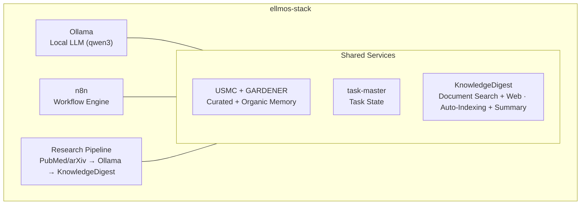
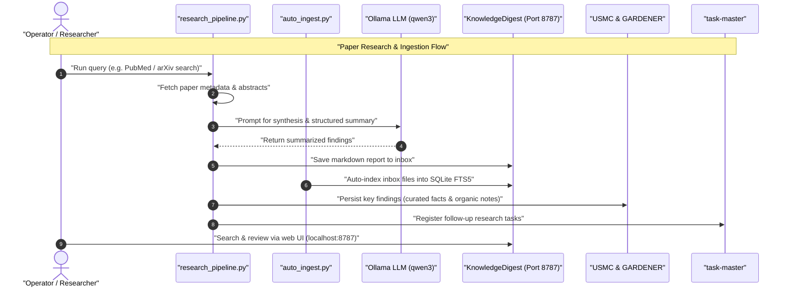

# ellmos-stack


**[English](README.md) · [Deutsch](README_de.md) · [Español](README_es.md) · [Français](README_fr.md) · [日本語](README_ja.md) · [Русский](README_ru.md) · [简体中文](README_zh.md) · [हिन्दी](README_hi.md) · [العربية](README_ar.md) · [বাংলা](README_bn.md) · [Português](README_pt.md)**

[](https://github.com/ellmos-ai/ellmos-stack/actions/workflows/tests.yml)
[](tests)
[](https://github.com/ellmos-ai/ellmos-stack/releases)
[](https://github.com/ellmos-ai)
[](https://github.com/open-bricks)
[](#architecture)
[](#security-notes)
[](THIRD_PARTY_LICENSES.md#non-elevation-invariant-runasinvoker)
[](THIRD_PARTY_LICENSES.md)
[](llms.txt)
[](https://www.python.org/)
[](LICENSE)

[البدء السريع](#quickstart) • [البنية](#architecture) • [سير العمل والتسلسل](#workflows--sequence) • [عائلة المكدسات](#stack-family) • [الأمان](#security-notes) • [llms.txt](llms.txt)

مكدس مستضاف ذاتيًا للبحث بالذكاء الاصطناعي وإدارة المعرفة. يجمع نموذجًا لغويًا كبيرًا محليًا، وأتمتة سير العمل، وذاكرة دائمة، وقاعدة معرفية ضمن إعداد واحد قابل للنشر.

> [!NOTE]
> **سياق قابل للقراءة آليًا لوكلاء الذكاء الاصطناعي:**
> للاطلاع على نظرة عامة مفهرسة للحدود المعمارية والواجهات الأساسية وسياسات السلامة وقواعد الاستدلال المحلي أولًا، راجع [`llms.txt`](llms.txt) أو [`STACK-MAP.md`](STACK-MAP.md).

**لا يعتمد افتراضيًا على نموذج مستضاف.** يبقى الاستدلال وحالة سير العمل والذاكرة والمستندات على خادمك. ويتطلب البحث عن الأوراق العلمية (PubMed/arXiv) وTelegram وتنزيل الحزم والصور، وكذلك خدمة التلخيص الاختيارية من Anthropic، اتصالًا بالشبكة.

السياق القابل للقراءة آليًا لنماذج LLM وأدوات البرمجة الوكيلة: [`llms.txt`](llms.txt).

## ابدأ من هنا

| إذا كنت تحتاج إلى... | ابدأ بـ | السبب |
|----------------------|---------|-------|
| خادم بحث محلي بالذكاء الاصطناعي | [`install.sh`](install.sh) | يثبّت Ollama وn8n وUSMC وGARDENER وtask-master وKnowledgeDigest ضمن `/opt/ellmos-stack`. |
| أتمتة سير العمل باستخدام نموذج محلي | [`docker-compose.yml`](docker-compose.yml) | يشغّل n8n وOllama مع وحدات تخزين دائمة. |
| صندوق وارد للمستندات قابل للبحث | [`services/auto_ingest.py`](services/auto_ingest.py) | ينقل المستندات الجديدة إلى فهرسة KnowledgeDigest. |
| مسارات البحث عن الأوراق وتلخيصها | [`services/research_pipeline.py`](services/research_pipeline.py) | يبحث عن الأوراق ويلخصها، ويمكنه حفظ النتائج في قاعدة المعرفة. |
| ذاكرة الوكلاء وحالة المهام | [`stack.v2.json`](stack.v2.json) | يفصل الذاكرة المنتقاة والذاكرة العضوية والمهام في وحدات متخصصة. |

أفضل طريقة لفهم ellmos-stack هي اعتباره **مكدس ذكاء اصطناعي محليًا أولًا لأتمتة البحث والعمل المعرفي الخاص**. فهو ليس منتج SaaS مستضافًا، ولا بوابة سحابية لنماذج LLM، ولا منصة Kubernetes.

مراسي شائعة للاكتشاف: `ellmos-stack` و`self-hosted AI research stack` و`Ollama n8n KnowledgeDigest` و`private local RAG server` و`Docker Compose AI knowledge base`.

## ما الذي يتضمنه




| المكوّن | الدور | المصدر |
|---------|-------|--------|
| **[Ollama](https://ollama.com)** | استدلال محلي لنموذج LLM (qwen3:4b افتراضيًا) | Docker |
| **[n8n](https://n8n.io)** | أتمتة سير العمل وخطافات الويب والجدولة | Docker |
| **[USMC](https://github.com/ellmos-ai/usmc)** | حقائق منتقاة وذاكرة عمل ودروس (`memory.curated`) | التزام Git مثبت |
| **[GARDENER](https://github.com/ellmos-ai/gardener)** | ذاكرة عضوية محلية وركيزة معرفية (`memory.organic`) | التزام Git مثبت |
| **[task-master](https://github.com/ellmos-ai/task-master)** | حالة مخصصة للمهام (`tasks.default`) | التزام Git مثبت |
| **[KnowledgeDigest](https://github.com/file-bricks/knowledgedigest)** | إدخال المستندات وتقسيمها إلى مقاطع والبحث وواجهة الويب | التزام Git مثبت |
| **مسار البحث** | البحث عبر واجهات PubMed/arXiv البرمجية ← التحليل ← التخزين | مضمن |
| **بوابة Telegram** *(اختيارية)* | روبوت Telegram يجيب باستخدام نموذج LLM المحلي، مع تصفية المالك | مضمنة |

## لمحة سريعة عن التكوين

```
ellmos-stack (Docker Compose)
├── Inference       Ollama            local LLM (qwen3:4b)
├── Automation      n8n               workflows, webhooks, scheduling
├── Knowledge/RAG   KnowledgeDigest   ingest → chunk → FTS5 → summarize
├── Curated Memory  USMC              facts, working memory, lessons (pinned-git)
├── Organic Memory  GARDENER          local memory/knowledge substrate (pinned-git)
├── Tasks           task-master       dedicated task state (pinned-git)
├── services/       research_pipeline, auto_ingest, process_summaries,
│                   telegram_gateway, env_config
└── External APIs   PubMed · arXiv    paper search (https)
```


مخطط التكوين الكامل — المكوّنات والأدوار والمصادر والسياسات: **[STACK-MAP.md](STACK-MAP.md)**.

## المتطلبات

- **الخادم:** Linux (Ubuntu 22.04+ أو Debian 12+)، 2+ من أنوية CPU، و8+ GB من ذاكرة RAM
- **البرمجيات:** Docker وDocker Compose v2 وPython 3.10+
- **القرص:** نحو 5 GB للإعداد الأساسي (النموذج والحاويات)

## التحقق

يتضمن المستودع اختبارات دخان تعمل دون Docker أو Ollama أو n8n أو Telegram أو خدمات شبكة مباشرة:

```bash
PYTHONIOENCODING=utf-8 python -m unittest discover -s tests -v
PYTHONIOENCODING=utf-8 python -m compileall -q services tests tools
PYTHONIOENCODING=utf-8 python tools/check_release_gate.py
```


يشغّل سير عمل GitHub Actions القياسي التجميع ومجموعة اختبارات الوحدات كاملةً على Python 3.10 و3.11 و3.12. كما يشغّل سير عمل الإصدار اليدوي مدقق الإصدار الثابت واختبارات Compose على Linux.

هذه الفحوصات تمهيد أولي دون اتصال، وليست ادعاءً بنشر على Linux. تستخدم الإصدارات العامة بوابة الإصدار المنفصلة للمكدس [stack release gate](RELEASE_GATE.md): وسوم حاويات محددة بدقة، وتشغيلًا واختبارًا فعليين لـ Docker Compose على Linux، وفحوصات الارتباط بـ localhost، ومراجعة لحساب المالك وTLS وجدار الحماية. تفشل هذه البوابة عند استخدام وسوم `latest` المتحركة.

<a id="quickstart"></a>
## البدء السريع

```bash
# Clone
git clone https://github.com/ellmos-ai/ellmos-stack.git
cd ellmos-stack

# Install (as root)
sudo ./install.sh

# That's it. Services are running:
#   n8n:              http://127.0.0.1:5678 (localhost only -- see below)
#   KnowledgeDigest:  http://127.0.0.1:8787 (localhost only -- see below)
#   Ollama:           localhost:11434 (internal)
```


يقوم المثبّت بما يلي:
1. يثبّت تبعيات النظام (Python وGit وcurl)
2. يهيّئ خدمات Docker (Ollama وn8n)
3. يسحب نموذج LLM المحدد في الإعداد
4. يثبّت إصدارات الالتزامات المثبتة من USMC وGARDENER وtask-master وKnowledgeDigest داخل بيئة venv
5. ينشئ مستخدم نظام مقيّدًا باسم `ellmos-stack` وخدمة systemd لـ KnowledgeDigest
6. يهيّئ مهام cron لغير المستخدم الجذر للفهرسة التلقائية والتلخيص في الخلفية

**أول تشغيل لـ n8n — أنشئ حساب المالك:** لا يتضمن n8n 1.0+ مصادقة Basic Auth. تتم المصادقة عبر حساب المالك الذي تنشئه في واجهة الويب عند التشغيل الأول. ولأن المنفذ مرتبط بـ localhost، افتحه عبر نفق SSH وأكمل الإعداد قبل إتاحة أي خدمة للاتصال الخارجي:

```bash
ssh -L 5678:127.0.0.1:5678 -L 8787:127.0.0.1:8787 root@your-server
# then open http://localhost:5678 for n8n and http://localhost:8787 for KnowledgeDigest
```


## التكوين

انسخ ملف `.env` وعدّله:

```bash
cp .env.example .env
nano .env
```


الإعدادات الأساسية:

| المتغير | القيمة الافتراضية | الوصف |
|---------|------------------|-------|
| `OLLAMA_MODEL` | `qwen3:4b` | نموذج LLM المطلوب استخدامه |
| `OLLAMA_MEMORY_LIMIT` | `6G` | الحد الأقصى لذاكرة RAM المخصصة لـ Ollama |
| `OLLAMA_BASE_URL` | `http://localhost:11434` | نقطة نهاية Ollama التي تستخدمها البرامج النصية للخدمات |
| `OLLAMA_IMAGE_TAG` | `latest` | وسم صورة Ollama في Docker — ثبّت الإصدار قبل الاستخدام الإنتاجي |
| `N8N_IMAGE_TAG` | `latest` | وسم صورة n8n في Docker — ثبّت الإصدار قبل الاستخدام الإنتاجي |
| `KD_PORT` | `8787` | منفذ واجهة KnowledgeDigest على الويب |
| `KD_SUMMARY_PROVIDER` | `ollama` | خدمة التلخيص: `ollama` أو `anthropic` |
| `ELLMOS_TELEGRAM_TOKEN` | فارغ | رمز بوت Telegram المفضّل؛ أما `RINNSAL_TELEGRAM_TOKEN` القديم فهو احتياطي للترحيل فقط |

**ثبّت إصدارات الصور للاستخدام الإنتاجي:** يحدد ملف compose كلا صورتي Docker افتراضيًا على `latest`، وهو خيار ملائم للتقييم لكنه لا يضمن قابلية إعادة الإنتاج وقد يجلب تغييرات كاسرة غير مختبرة (يصدر n8n إصدارات رئيسية بانتظام). قبل الاستخدام الإنتاجي، اضبط `OLLAMA_IMAGE_TAG` و`N8N_IMAGE_TAG` في `.env` على الإصدارات المحددة التي اختبرتها.

## حالات الاستخدام

### 1. قاعدة المعرفة

ضع المستندات (PDF وTXT وMD وDOCX) في مجلد صندوق الوارد:

```bash
cp paper.pdf /opt/ellmos-stack/data/knowledgedigest/inbox/
# Auto-indexed within 5 minutes, summaries generated within 15 minutes
```


تصفّح المحتوى وابحث فيه عبر `http://localhost:8787` من خلال نفق SSH الموضح في قسم البدء السريع. أبقِ الخدمة مرتبطة بـ localhost ما لم تكن قد أعددت وكيلًا عكسيًا خاضعًا للمراجعة، مع TLS والمصادقة، وقاعدة في جدار الحماية.

### 2. أتمتة البحث العلمي

ابحث عن أوراق أكاديمية، وحللها بنموذج LLM المحلي، ثم خزّن النتائج:

```bash
cd /opt/ellmos-stack
venv/bin/python services/research_pipeline.py \
    "dark matter detection methods" \
    --papers 10 --summarize --save
```


يستخدم عميل البحث المضمّن، الذي لا يحتاج إلى تبعيات إضافية، واجهات [NCBI E-utilities للبحث في PubMed](https://www.ncbi.nlm.nih.gov/home/develop/api/) و[واجهة arXiv البرمجية](https://info.arxiv.org/help/api/index.html). اختر مصدرًا واحدًا باستخدام `--source pubmed` أو `--source arxiv`؛ ويتطلب البحث عن الأوراق اتصالًا صادرًا بالشبكة.

### 3. ذاكرة الذكاء الاصطناعي والمهام

تستخدم الذاكرة المنتقاة وحالة المهام قواعد بيانات مختلفة عمدًا. وتستخدم الذاكرة العضوية لدى GARDENER مجلدها الخاص `/opt/ellmos-stack/data/gardener/`.

```python
from pathlib import Path

from gardener import Gardener
from usmc import api as memory
from taskplan import api as tasks

memory_db = "/opt/ellmos-stack/data/usmc/usmc_memory.db"
task_db = "/opt/ellmos-stack/data/task-master/taskplan.db"
memory.init(db_path=memory_db, agent_id="ellmos-stack")
memory.remember("server_setup", "completed", category="project")

tasks.init(db_path=task_db, agent_id="ellmos-stack")
tasks.add("Review research results", priority="high")

organic = Gardener(
    home=Path("/opt/ellmos-stack/data/gardener/home"),
    data_dir=Path("/opt/ellmos-stack/data/gardener"),
)
organic.put("research-note", content="Review the new evidence", type="memory")
```


### 4. أتمتة سير العمل (n8n)

أنشئ مسارات عمل آلية باستخدام n8n على `http://localhost:5678` (عبر نفق SSH، كما هو موضح في قسم البدء السريع):

- **بحث مجدول:** Cron ← مسار البحث ← ملخص عبر البريد الإلكتروني
- **معالجة المستندات:** Webhook ← تنزيل ← صندوق وارد KnowledgeDigest
- **المراقبة:** فحوصات السلامة ← تنبيهات

### 5. الوصول المباشر إلى نموذج LLM

استعلم عن Ollama مباشرةً من أي خدمة:

```bash
curl http://localhost:11434/api/generate \
    -d '{"model":"qwen3:4b","prompt":"Explain quantum entanglement briefly"}'
```


### 6. تحليل المستندات على سطح المكتب (NoteSpaceLLM)

استخدم [NoteSpaceLLM](https://github.com/file-bricks/NoteSpaceLLM) عميلًا لسطح المكتب لتحليل المستندات تفاعليًا، بالاستفادة من مثيل Ollama في المكدس:

1. ثبّت NoteSpaceLLM على جهازك المحلي
2. أعد وكيل مصادقة لـ Ollama (راجع [إتاحة Ollama](#exposing-ollama-for-remote-access) أدناه)
3. في NoteSpaceLLM: Menu > LLM > Settings > أدخل عنوان URL للخادم ومفتاح API

يوفر NoteSpaceLLM تحليل المستندات بالسحب والإفلات، ومحادثة قائمة على RAG، وتصدير تقارير بصيغ متعددة — وتُعالَج جميعها بواسطة نموذج LLM في المكدس.

### 7. بوابة Telegram (اختيارية)

يعمل `services/telegram_gateway.py` كبوت Telegram يقتصر على المالك: لا يُسمح بالتواصل معه إلا لمعرّف محادثة المالك المُعد. ويجيب عن الرسائل الواردة نموذج LLM المحلي في المكدس، مع إمكانية إضافة سياق USMC؛ أما `/tasks` فيقرأ قاعدة بيانات task-master المنفصلة. لا يتضمن هذا الموصل مسارًا لإعادة التوجيه إلى BACH، ويستخدم مكتبة Python القياسية فقط.

الإعداد:

```bash
# 1. Get a bot token from @BotFather and your chat ID from @userinfobot,
#    then set ELLMOS_TELEGRAM_TOKEN and TELEGRAM_OWNER_CHAT_ID in .env

# 2. Test the connection
/opt/ellmos-stack/venv/bin/python /opt/ellmos-stack/services/telegram_gateway.py --test

# 3. Install as systemd service (unit file is included)
cp /opt/ellmos-stack/config/telegram-gateway.service /etc/systemd/system/
systemctl daemon-reload
systemctl enable --now telegram-gateway
```


<a id="architecture"></a>
## البنية

يستخدم المكدس **Docker** لتشغيل Ollama وn8n (خدمتان حالتيّتان مع وحدات تخزين)، ويثبّت USMC وGARDENER وtask-master وKnowledgeDigest من التزامات Git مثبتة داخل بيئة venv. وتبقى حالة التشغيل لكل منها في مسارات بيانات منفصلة. تعمل KnowledgeDigest ومعالجة cron في الخلفية تحت حساب المستخدم المقيّد `ellmos-stack`.

```
Port 5678  ──→ n8n (Docker, localhost only -- SSH tunnel or reverse proxy)
Port 8787  ──→ KnowledgeDigest Web Viewer (systemd, localhost only)
Port 11434 ──→ Ollama (Docker, localhost only)
Port 443   ──→ TLS Ollama reverse proxy (optional, for remote clients)

Cron:
  */5  min ──→ auto_ingest.py (index new documents)
  */15 min ──→ process_summaries.py (LLM summarization)
```


تُخزّن البيانات في `/opt/ellmos-stack/data/` (قواعد بيانات SQLite وملفات المستندات).

<a id="workflows--sequence"></a>
## سير العمل والتسلسل

يوضح مخطط التسلسل أدناه كيفية تنسيق الاستعلامات الآلية عن الأوراق العلمية، وإدخال المستندات، والتلخيص بواسطة نموذج LLM المحلي، وتحديثات الذاكرة عبر المكدس:




## التخصيص

### نموذج LLM مختلف

```bash
# Edit .env
OLLAMA_MODEL=mistral:7b

# Pull the new model
docker exec ollama ollama pull mistral:7b

# For NoteSpaceLLM RAG embeddings, also pull an embedding model:
docker exec ollama ollama pull nomic-embed-text

# Restart summary processing (uses OLLAMA_MODEL from .env)
```


### نموذج LLM سحابي للتلخيص

```bash
# In .env
KD_SUMMARY_PROVIDER=anthropic
ANTHROPIC_API_KEY=sk-ant-...
```


### مطالبة نظام مخصصة

عدّل `config/system_prompt.txt` لضبط شخصية نموذج LLM ولغته وسلوكه.

<a id="exposing-ollama-for-remote-access"></a>
## إتاحة Ollama للوصول عن بُعد

يستمع Ollama افتراضيًا إلى localhost فقط. وللعملاء البعيدين، أبقِ هذا الارتباط كما هو واستخدم وكيلًا عكسيًا مع TLS ورمز bearer. احصل أولًا على شهادة للنطاق `ollama.example.com`؛ ولا ترسل الرمز مطلقًا عبر HTTP غير مشفّر.

```bash
# Install Nginx
apt install nginx

# Create proxy config
cat > /etc/nginx/sites-available/ollama-proxy << 'EOF'
server {
    listen 443 ssl;
    server_name ollama.example.com;

    ssl_certificate /etc/letsencrypt/live/ollama.example.com/fullchain.pem;
    ssl_certificate_key /etc/letsencrypt/live/ollama.example.com/privkey.pem;

    location / {
        if ($http_authorization != "Bearer YOUR_SECRET_API_KEY") {
            return 401 "Unauthorized";
        }
        proxy_pass http://127.0.0.1:11434;
        proxy_set_header Host $host;
        proxy_read_timeout 300s;
        proxy_buffering off;
    }

}
EOF

# Enable and start
chmod 600 /etc/nginx/sites-available/ollama-proxy
ln -sf /etc/nginx/sites-available/ollama-proxy /etc/nginx/sites-enabled/
nginx -t
ufw allow 443/tcp
systemctl reload nginx
```


أنشئ مفتاحًا آمنًا: `python3 -c "import secrets; print(secrets.token_urlsafe(32))"`

ثم تتصل العملاء بـ `https://ollama.example.com` باستخدام الترويسة `Authorization: Bearer YOUR_SECRET_API_KEY`.

<a id="security-notes"></a>
## ملاحظات الأمان

- يرتبط n8n افتراضيًا بـ `127.0.0.1:5678` ولا يمكن الوصول إليه من الخارج. أزال n8n 1.0+ مصادقة Basic Auth؛ وتتم المصادقة عبر حساب مالك n8n، الذي يجب إنشاؤه في واجهة الويب عند التشغيل الأول (من خلال نفق SSH، كما هو موضح في قسم البدء السريع). **لا تتيح مثيل n8n للاتصال مطلقًا قبل إنشاء حساب المالك** — فأول زائر سيصبح المالك.
- للوصول عن بُعد إلى n8n، أبقِ الارتباط بـ localhost واستخدم وكيلًا عكسيًا خاضعًا للمراجعة مع TLS والمصادقة، أو نفق SSH، أو شبكة VPN خاصة. لا تكشف منفذ HTTP الخام 5678 على الإنترنت العام مطلقًا، حتى بعد إنشاء حساب المالك.
- يستمع Ollama إلى localhost فقط افتراضيًا (ولا يُتاح على الإنترنت).
- يستخدم وكيل Ollama الاختياري TLS مع مصادقة رمز bearer؛ ولا يكون رمز bearer آمنًا عبر HTTP غير المشفّر.
- توجد جميع بيانات الاعتماد في `.env` (ولا تُرفع إلى git مطلقًا)؛ ويقيّد المثبّت صلاحية هذا الملف للمالك (`0600`).
- يرتبط KnowledgeDigest بـ localhost افتراضيًا؛ ويتطلب الوصول الخارجي وكيلًا عكسيًا خاضعًا للمراجعة مع TLS والمصادقة، وقاعدة في جدار الحماية.
- ترفض بوابة Telegram التشغيل ما لم يُضبط كل من رمز البوت ومعرّف محادثة المالك.
- تُثبّت مدخلات المثبّت الخاصة بـ USMC وGARDENER وtask-master وKnowledgeDigest على التزامات محددة بدقة؛ أما الترقيات فتتطلب تغييرات صريحة في المصدر.
- راجع [`OPERATIONS.md`](OPERATIONS.md) وتدرّب على الاستعادة قبل أي ترقية أو إصدار.

## البحث وإزالة الالتباس

استخدم **ellmos-stack** عندما تقصد مكدس `ellmos-ai` المحلي المستضاف ذاتيًا للبحث بالذكاء الاصطناعي: Ollama للاستدلال، وn8n لأتمتة سير العمل، وذاكرة USMC/GARDENER المتخصصة، وحالة مهام task-master، والبحث في المستندات عبر KnowledgeDigest. ومن عبارات البحث المفيدة:

- `ellmos-stack self-hosted AI research stack`
- `ellmos stack Ollama n8n USMC GARDENER task-master KnowledgeDigest`
- `local-first AI knowledge stack Docker Compose`
- `self-hosted research automation Ollama n8n`
- `private local RAG server with Ollama and n8n`
- `Docker Compose AI knowledge base with document search`
- `self-hosted AI starter stack for research workflows`

لا يرتبط المشروع بـ Eclipse LMOS أو Llama Stack أو LLemonStack أو حزم n8n العامة للبدء بالذكاء الاصطناعي أو عمليات نشر Open WebUI فقط أو مكدسات LLMOps العامة أو منصات وكلاء الذكاء الاصطناعي المستضافة سحابيًا. استخدم المسار الأساسي للمستودع `ellmos-ai/ellmos-stack` عند إزالة الالتباس في نتائج البحث.

<a id="stack-family"></a>
## عائلة المكدسات

> **الفهرس المعتمد:** توجد القائمة الكاملة والمحدّثة لجميع مكدسات ellmos في
> **[ellmos-ai/stacks](https://github.com/ellmos-ai/stacks)** — مستودع نظرة عامة على المكدسات
> (الفهرس ومخطط البيان المشترك ووثائق «ما هو المكدس؟»). والجدول أدناه مقتطف للتيسير؛
> وعند الشك تكون الأولوية للفهرس.

ellmos-stack هو **مكدس البداية المتكامل** — التنفيذ المرجعي الذي يتضمن كل شيء. وتعتمد المكدسات الشقيقة على المبادئ المشتركة مع تركيز خاص بكل مجال:

| المكدس | التركيز | المكوّنات |
|--------|---------|-----------|
| **ellmos-stack** (هذا المستودع) | قاعدة معرفة وبحث متكاملة | Ollama + n8n + USMC + GARDENER + task-master + KnowledgeDigest + مسار البحث |
| [agent-ops-stack](https://github.com/ellmos-ai/agent-ops-stack) | عمليات متعددة الوكلاء (الأقفال والتذاكر وصورة القرار والذاكرة) | ticket-master + lock-master + build-your-users-mind + skills + controlcenter-mcp + homebase-mcp |
| ellmos-research-stack (مخطط له) | البحث الأكاديمي والأدبيات العلمية | + مسارات PubMed/arXiv وأدوات المراجع وشبكات الاستشهادات |
| ellmos-dev-stack (مخطط له) | تطوير البرمجيات وDevOps | + تحليل الشيفرة وتكامل CI/CD ومراقبة المستودعات |
| ellmos-media-stack (مخطط له) | إنشاء المحتوى والوسائط | + مسارات النسخ والتلخيص ومعالجة الوسائط |

كل مكدس مستودع مستقل ببيان وملف `install.sh` خاصين به. وتشترك المكدسات في مبدأ التكوين («التثبيت هو المخطط») لكنها تضيف أدوات ومسارات عمل خاصة بكل مجال.

## جزء من منظومة ellmos

| المكوّن | الوصف |
|---------|-------|
| [ellmos-ai/usmc](https://github.com/ellmos-ai/usmc) | ذاكرة منتقاة للوكلاء |
| [ellmos-ai/gardener](https://github.com/ellmos-ai/gardener) | ذاكرة عضوية محلية وركيزة معرفية |
| [ellmos-ai/task-master](https://github.com/ellmos-ai/task-master) | حالة مخصصة للمهام |
| [ellmos-ai/n8n-workflow-manager](https://github.com/ellmos-ai/n8n-workflow-manager) | يراجع مسارات العمل العاملة في n8n بهذا المكدس ويدير إصداراتها: عارض للرسم البياني وسجل للقرارات والتراجع عن التغييرات |
| [file-bricks/knowledgedigest](https://github.com/file-bricks/knowledgedigest) | قاعدة معرفة للمستندات مع واجهة ويب |
| [file-bricks/NoteSpaceLLM](https://github.com/file-bricks/NoteSpaceLLM) | تحليل المستندات على سطح المكتب ومحادثة RAG (يتصل بـ Ollama في المكدس) |
| [PubMed E-utilities](https://www.ncbi.nlm.nih.gov/home/develop/api/) و[واجهة arXiv البرمجية](https://info.arxiv.org/help/api/index.html) | بحث مباشر في بيانات وصفية للأوراق الأكاديمية، يستخدمه مسار البحث المضمّن |

## الترخيص

MIT

---

## المسؤولية

هذا المشروع **هبة مجانية مفتوحة المصدر** بالمعنى المقصود في المواد §§ 516 وما يليها من القانون المدني الألماني (BGB). وتقتصر مسؤولية المؤلف، وفقًا للمادة **§ 521 BGB**، على القصد والإهمال الجسيم. وتسري بالإضافة إلى ذلك استثناءات المسؤولية الواردة في GPL-3.0 / MIT / Apache-2.0، المواد §§ 15–16 (بحسب الترخيص المختار).

يكون الاستخدام على مسؤوليتك. لا يوجد تعهّد بالصيانة أو ضمان بالتوافر أو ضمان بالخلو من الأخطاء أو بالملاءمة لغرض معين.

هذا المشروع هبة مفتوحة المصدر غير مدفوعة. وتقتصر المسؤولية على القصد والإهمال الجسيم (§ 521 من القانون المدني الألماني). الاستخدام على مسؤوليتك. لا يوجد ضمان أو تعهّد بالصيانة أو افتراض للملاءمة لغرض معين.
