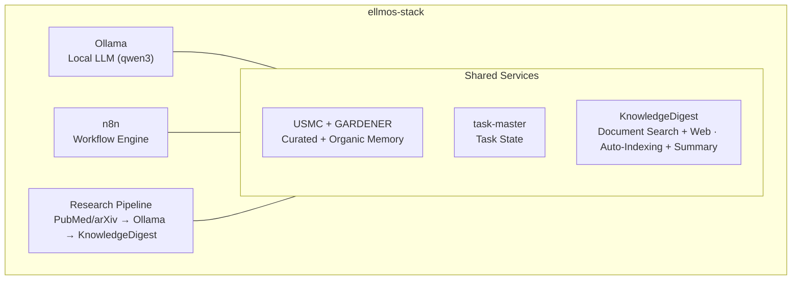
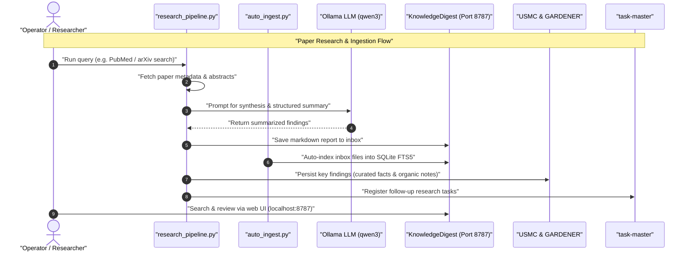

# ellmos-stack


**[English](README.md) · [Deutsch](README_de.md) · [Español](README_es.md) · [Français](README_fr.md) · [日本語](README_ja.md) · [Русский](README_ru.md) · [简体中文](README_zh.md) · [हिन्दी](README_hi.md) · [العربية](README_ar.md) · [বাংলা](README_bn.md) · [Português](README_pt.md)**

[](https://github.com/ellmos-ai/ellmos-stack/actions/workflows/tests.yml)
[](tests)
[](https://github.com/ellmos-ai/ellmos-stack/releases)
[](https://github.com/ellmos-ai)
[](https://github.com/open-bricks)
[](#architecture)
[](#security-notes)
[](THIRD_PARTY_LICENSES.md#non-elevation-invariant-runasinvoker)
[](THIRD_PARTY_LICENSES.md)
[](llms.txt)
[](https://www.python.org/)
[](LICENSE)

[দ্রুত শুরু](#quickstart) • [স্থাপত্য](#architecture) • [কর্মপ্রবাহ ও ক্রম](#workflows--sequence) • [স্ট্যাক পরিবার](#stack-family) • [নিরাপত্তা](#security-notes) • [llms.txt](llms.txt)

স্ব-হোস্ট করা AI গবেষণা ও জ্ঞান ব্যবস্থাপনার একটি স্ট্যাক। এটি স্থানীয় LLM, কর্মপ্রবাহ স্বয়ংক্রিয়করণ, স্থায়ী স্মৃতি এবং জ্ঞানভান্ডারকে এক স্থাপনযোগ্য সেটআপে একত্র করে।

> [!NOTE]
> **AI এজেন্টদের জন্য মেশিনে-পাঠযোগ্য প্রসঙ্গ:**
> স্থাপত্যের সীমানা, প্রধান ইন্টারফেস, নিরাপত্তানীতি এবং লোকাল-ফার্স্ট ইনফারেন্সের নিয়মের সূচিবদ্ধ সারসংক্ষেপের জন্য [`llms.txt`](llms.txt) অথবা [`STACK-MAP.md`](STACK-MAP.md) দেখুন।

**ডিফল্টভাবে হোস্টেড মডেলের ওপর নির্ভরতা নেই।** ইনফারেন্স, কর্মপ্রবাহের অবস্থা, স্মৃতি এবং নথি আপনার সার্ভারেই থাকে। গবেষণাপত্র অনুসন্ধান (PubMed/arXiv), Telegram, প্যাকেজ/ইমেজ ডাউনলোড এবং ঐচ্ছিক Anthropic সারাংশ ব্যাকএন্ডের জন্য বহির্গামী নেটওয়ার্ক সংযোগ প্রয়োজন।

LLM এবং এজেন্টভিত্তিক কোডিং টুলের জন্য মেশিনে-পাঠযোগ্য প্রসঙ্গ: [`llms.txt`](llms.txt)।

## শুরু করুন

| আপনার প্রয়োজন... | শুরু করুন | কেন |
|----------------|------------|-----|
| একটি স্থানীয় AI গবেষণা সার্ভার | [`install.sh`](install.sh) | `/opt/ellmos-stack`-এর অধীনে Ollama, n8n, USMC, GARDENER, task-master এবং KnowledgeDigest ইনস্টল করে। |
| স্থানীয় মডেলসহ কর্মপ্রবাহ স্বয়ংক্রিয়করণ | [`docker-compose.yml`](docker-compose.yml) | স্থায়ী ভলিউমসহ n8n ও Ollama চালায়। |
| অনুসন্ধানযোগ্য নথির ইনবক্স | [`services/auto_ingest.py`](services/auto_ingest.py) | নতুন নথিগুলো KnowledgeDigest-এ ইনডেক্স করার জন্য সরিয়ে দেয়। |
| গবেষণাপত্র অনুসন্ধান ও সারাংশের পাইপলাইন | [`services/research_pipeline.py`](services/research_pipeline.py) | গবেষণাপত্র খোঁজে, সারাংশ তৈরি করে এবং ফলাফল জ্ঞানভান্ডারে সংরক্ষণ করতে পারে। |
| এজেন্টের স্মৃতি ও কাজের অবস্থা | [`stack.v2.json`](stack.v2.json) | কিউরেটেড স্মৃতি, অর্গানিক স্মৃতি এবং কাজকে বিশেষায়িত মডিউলে আলাদা রাখে। |

ellmos-stack-কে গবেষণা স্বয়ংক্রিয়করণ ও ব্যক্তিগত জ্ঞানচর্চার জন্য একটি **লোকাল-ফার্স্ট AI স্ট্যাক** হিসেবে বিবেচনা করাই যথাযথ। এটি হোস্টেড SaaS পণ্য নয়, ক্লাউড LLM গেটওয়ে নয় এবং Kubernetes প্ল্যাটফর্মও নয়।

সাধারণ অনুসন্ধান-শব্দ: `ellmos-stack`, `self-hosted AI research stack`, `Ollama n8n KnowledgeDigest`, `private local RAG server`, এবং `Docker Compose AI knowledge base`।

## এর ভেতরে কী আছে



| উপাদান | ভূমিকা | উৎস |
|-----------|------|--------|
| **[Ollama](https://ollama.com)** | স্থানীয় LLM ইনফারেন্স (ডিফল্টে qwen3:4b) | Docker |
| **[n8n](https://n8n.io)** | কর্মপ্রবাহ স্বয়ংক্রিয়করণ, webhook এবং সময়সূচি | Docker |
| **[USMC](https://github.com/ellmos-ai/usmc)** | কিউরেটেড তথ্য, কার্যকরী স্মৃতি এবং শিক্ষা (`memory.curated`) | নির্দিষ্ট Git কমিটে পিন করা |
| **[GARDENER](https://github.com/ellmos-ai/gardener)** | অর্গানিক স্থানীয় স্মৃতি ও জ্ঞানের ভিত্তি (`memory.organic`) | নির্দিষ্ট Git কমিটে পিন করা |
| **[task-master](https://github.com/ellmos-ai/task-master)** | নিবেদিত কাজের অবস্থা (`tasks.default`) | নির্দিষ্ট Git কমিটে পিন করা |
| **[KnowledgeDigest](https://github.com/file-bricks/knowledgedigest)** | নথি গ্রহণ, খণ্ডীকরণ, অনুসন্ধান ও web UI | নির্দিষ্ট Git কমিটে পিন করা |
| গবেষণা পাইপলাইন | PubMed/arXiv API অনুসন্ধান → বিশ্লেষণ → সংরক্ষণ | অন্তর্ভুক্ত |
| Telegram Gateway *(ঐচ্ছিক)* | স্থানীয় LLM-এর মাধ্যমে উত্তর দেওয়া, মালিক-নির্দিষ্ট Telegram বট | অন্তর্ভুক্ত |

## সংমিশ্রণের সংক্ষিপ্ত চিত্র

```
ellmos-stack (Docker Compose)
├── Inference       Ollama            local LLM (qwen3:4b)
├── Automation      n8n               workflows, webhooks, scheduling
├── Knowledge/RAG   KnowledgeDigest   ingest → chunk → FTS5 → summarize
├── Curated Memory  USMC              facts, working memory, lessons (pinned-git)
├── Organic Memory  GARDENER          local memory/knowledge substrate (pinned-git)
├── Tasks           task-master       dedicated task state (pinned-git)
├── services/       research_pipeline, auto_ingest, process_summaries,
│                   telegram_gateway, env_config
└── External APIs   PubMed · arXiv    paper search (https)
```

সম্পূর্ণ সংমিশ্রণ নকশা—উপাদান, ভূমিকা, উৎস ও নীতি: **[STACK-MAP.md](STACK-MAP.md)**।

## প্রয়োজনীয়তা

- **সার্ভার:** Linux (Ubuntu 22.04+, Debian 12+), 2+ CPU কোর, 8+ GB RAM
- **সফটওয়্যার:** Docker, Docker Compose v2, Python 3.10+
- **ডিস্ক:** প্রাথমিক সেটআপে প্রায় 5 GB (মডেল + কনটেইনার)

## যাচাই

রিপোজিটরিতে এমন smoke test আছে যা Docker, Ollama, n8n, Telegram বা সচল নেটওয়ার্ক পরিষেবা ছাড়াই চলে:

```bash
PYTHONIOENCODING=utf-8 python -m unittest discover -s tests -v
PYTHONIOENCODING=utf-8 python -m compileall -q services tests tools
PYTHONIOENCODING=utf-8 python tools/check_release_gate.py
```

মানক GitHub Actions কর্মপ্রবাহ Python 3.10, 3.11 এবং 3.12-এ compilation ও সম্পূর্ণ unit test suite চালায়। ম্যানুয়াল release কর্মপ্রবাহ অতিরিক্তভাবে static release checker এবং Linux Compose probe চালায়।

এই যাচাইগুলো অফলাইন প্রাথমিক যাচাই; এগুলো Linux-এ স্থাপনের দাবি নয়। প্রকাশ্য release-এ পৃথক [stack release gate](RELEASE_GATE.md) প্রযোজ্য: কনটেইনারের সুনির্দিষ্ট tag, বাস্তব Linux Docker Compose startup/probe, localhost binding পরীক্ষা এবং owner account/TLS/firewall পর্যালোচনা। পরিবর্তনশীল `latest` tag এই release gate-এ ব্যর্থ হয়।

<a id="quickstart"></a>

## দ্রুত শুরু

```bash
# Clone
git clone https://github.com/ellmos-ai/ellmos-stack.git
cd ellmos-stack

# Install (as root)
sudo ./install.sh

# That's it. Services are running:
#   n8n:              http://127.0.0.1:5678 (localhost only -- see below)
#   KnowledgeDigest:  http://127.0.0.1:8787 (localhost only -- see below)
#   Ollama:           localhost:11434 (internal)
```

ইনস্টলারটি:
1. সিস্টেমের নির্ভরতা (Python, Git, curl) ইনস্টল করে
2. Docker পরিষেবা (Ollama + n8n) প্রস্তুত করে
3. নির্ধারিত LLM মডেল ডাউনলোড করে
4. নির্দিষ্ট USMC, GARDENER, task-master এবং KnowledgeDigest commit-গুলো Python venv-এ ইনস্টল করে
5. সীমিত অনুমতিসম্পন্ন `ellmos-stack` system user এবং KnowledgeDigest-এর systemd service তৈরি করে
6. স্বয়ংক্রিয় indexing এবং পটভূমিতে সারাংশ তৈরির জন্য root ছাড়া cron job তৈরি করে

**n8n প্রথমবার চালু করা—owner account তৈরি করুন:** n8n 1.0+ এ Basic Auth নেই। প্রথমবার চালুর পর ওয়েব UI-তে আপনি যে owner account তৈরি করবেন, সেটির মাধ্যমে authentication হয়। পোর্টটি localhost-এ সীমাবদ্ধ, তাই SSH tunnel দিয়ে খুলে কোনো কিছু উন্মুক্ত করার আগে সেটআপ সম্পন্ন করুন:

```bash
ssh -L 5678:127.0.0.1:5678 -L 8787:127.0.0.1:8787 root@your-server
# then open http://localhost:5678 for n8n and http://localhost:8787 for KnowledgeDigest
```

## কনফিগারেশন

`.env` কপি করে সম্পাদনা করুন:

```bash
cp .env.example .env
nano .env
```

গুরুত্বপূর্ণ সেটিংস:

| চলক | ডিফল্ট মান | বিবরণ |
|----------|---------|-------------|
| `OLLAMA_MODEL` | `qwen3:4b` | ব্যবহারের জন্য LLM মডেল |
| `OLLAMA_MEMORY_LIMIT` | `6G` | Ollama-এর সর্বোচ্চ RAM |
| `OLLAMA_BASE_URL` | `http://localhost:11434` | service script-গুলো যে Ollama endpoint ব্যবহার করে |
| `OLLAMA_IMAGE_TAG` | `latest` | Ollama Docker image tag—production-এ ব্যবহারের আগে নির্দিষ্ট সংস্করণ পিন করুন |
| `N8N_IMAGE_TAG` | `latest` | n8n Docker image tag—production-এ ব্যবহারের আগে নির্দিষ্ট সংস্করণ পিন করুন |
| `KD_PORT` | `8787` | KnowledgeDigest web UI-এর পোর্ট |
| `KD_SUMMARY_PROVIDER` | `ollama` | সারাংশের backend: `ollama`, `anthropic` |
| `ELLMOS_TELEGRAM_TOKEN` | খালি | পছন্দের Telegram bot token; পুরোনো `RINNSAL_TELEGRAM_TOKEN` শুধু migration-এর বিকল্প হিসেবে ব্যবহৃত হয় |

**Production-এ ব্যবহারের আগে image সংস্করণ পিন করুন:** compose file-এ Docker image দুটির ডিফল্ট `latest`; মূল্যায়নের জন্য এটি সুবিধাজনক হলেও পুনরুৎপাদনযোগ্য নয় এবং অপরীক্ষিত breaking change নামিয়ে আনতে পারে (n8n নিয়মিত major release প্রকাশ করে)। Production-এ ব্যবহারের আগে `.env`-এ `OLLAMA_IMAGE_TAG` এবং `N8N_IMAGE_TAG`-কে আপনার পরীক্ষিত নির্দিষ্ট সংস্করণে সেট করুন।

## ব্যবহারের ক্ষেত্র

### 1. জ্ঞানভান্ডার

ইনবক্স ডিরেক্টরিতে নথি (PDF, TXT, MD, DOCX) রাখুন:

```bash
cp paper.pdf /opt/ellmos-stack/data/knowledgedigest/inbox/
# Auto-indexed within 5 minutes, summaries generated within 15 minutes
```

Quickstart-এ দেখানো SSH tunnel দিয়ে `http://localhost:8787`-এ ব্রাউজ ও অনুসন্ধান করুন। পর্যালোচিত TLS/authentication reverse proxy এবং firewall নিয়ম প্রস্তুত না থাকলে পরিষেবাটি localhost-এ রাখুন।

### 2. গবেষণা স্বয়ংক্রিয়করণ

একাডেমিক গবেষণাপত্র খুঁজুন, আপনার স্থানীয় LLM দিয়ে বিশ্লেষণ করুন এবং ফলাফল সংরক্ষণ করুন:

```bash
cd /opt/ellmos-stack
venv/bin/python services/research_pipeline.py \
    "dark matter detection methods" \
    --papers 10 --summarize --save
```

বিল্ট-ইন, dependency-মুক্ত অনুসন্ধান client [PubMed-এর জন্য NCBI E-utilities](https://www.ncbi.nlm.nih.gov/home/develop/api/) এবং [arXiv API](https://info.arxiv.org/help/api/index.html) ব্যবহার করে। `--source pubmed` অথবা `--source arxiv` দিয়ে একটি উৎস বেছে নিন; গবেষণাপত্র খুঁজতে বহির্মুখী নেটওয়ার্ক সংযোগ দরকার।

### 3. AI স্মৃতি ও কাজ

কিউরেটেড স্মৃতি ও কাজের অবস্থা ইচ্ছাকৃতভাবেই আলাদা database-এ রাখা হয়। GARDENER-এর
অর্গানিক স্মৃতির জন্য নিজস্ব `/opt/ellmos-stack/data/gardener/` directory রয়েছে।

```python
from pathlib import Path

from gardener import Gardener
from usmc import api as memory
from taskplan import api as tasks

memory_db = "/opt/ellmos-stack/data/usmc/usmc_memory.db"
task_db = "/opt/ellmos-stack/data/task-master/taskplan.db"
memory.init(db_path=memory_db, agent_id="ellmos-stack")
memory.remember("server_setup", "completed", category="project")

tasks.init(db_path=task_db, agent_id="ellmos-stack")
tasks.add("Review research results", priority="high")

organic = Gardener(
    home=Path("/opt/ellmos-stack/data/gardener/home"),
    data_dir=Path("/opt/ellmos-stack/data/gardener"),
)
organic.put("research-note", content="Review the new evidence", type="memory")
```

### 4. কর্মপ্রবাহ স্বয়ংক্রিয়করণ (n8n)

Quickstart-এ বর্ণিত SSH tunnel ব্যবহার করে `http://localhost:5678`-এ n8n দিয়ে স্বয়ংক্রিয় workflow তৈরি করুন:

- **সময়সূচিভিত্তিক গবেষণা:** Cron → Research Pipeline → Email digest
- **নথি প্রক্রিয়াকরণ:** Webhook → Download → KnowledgeDigest inbox
- **পর্যবেক্ষণ:** Health check → সতর্কবার্তা

### 5. সরাসরি LLM ব্যবহার

যেকোনো service থেকে সরাসরি Ollama-কে query করুন:

```bash
curl http://localhost:11434/api/generate \
    -d '{"model":"qwen3:4b","prompt":"Explain quantum entanglement briefly"}'
```

### 6. ডেস্কটপে নথি বিশ্লেষণ (NoteSpaceLLM)

স্ট্যাকের Ollama instance ব্যবহার করে ইন্টার‌্যাক্টিভ নথি বিশ্লেষণের desktop client হিসেবে [NoteSpaceLLM](https://github.com/file-bricks/NoteSpaceLLM) ব্যবহার করুন:

1. আপনার স্থানীয় কম্পিউটারে NoteSpaceLLM ইনস্টল করুন
2. Ollama auth proxy সেট আপ করুন (নিচের [Ollama-কে দূরবর্তী ব্যবহারের জন্য উন্মুক্ত করা](#exposing-ollama-for-remote-access) অংশ দেখুন)
3. NoteSpaceLLM-এ: Menu > LLM > Settings > আপনার server URL ও API key নির্ধারণ করুন

NoteSpaceLLM-এ drag-and-drop নথি বিশ্লেষণ, RAG-ভিত্তিক chat এবং একাধিক format-এ report export করা যায়—সবকিছু স্ট্যাকের LLM দিয়ে প্রক্রিয়াকৃত হয়।

### 7. Telegram Gateway (ঐচ্ছিক)

`services/telegram_gateway.py` হলো owner-filtered Telegram bot: কেবল কনফিগার করা owner chat ID-ই এতে বার্তা পাঠাতে পারে। আগত বার্তার উত্তর স্ট্যাকের স্থানীয় LLM দেয়; ঐচ্ছিকভাবে USMC context ব্যবহার করা যায়। `/tasks` আলাদা task-master database পড়ে। Gateway-তে BACH-এ forward করার কোনো পথ নেই। এটি কেবল Python standard library ব্যবহার করে।

সেটআপ:

```bash
# 1. Get a bot token from @BotFather and your chat ID from @userinfobot,
#    then set ELLMOS_TELEGRAM_TOKEN and TELEGRAM_OWNER_CHAT_ID in .env

# 2. Test the connection
/opt/ellmos-stack/venv/bin/python /opt/ellmos-stack/services/telegram_gateway.py --test

# 3. Install as systemd service (unit file is included)
cp /opt/ellmos-stack/config/telegram-gateway.service /etc/systemd/system/
systemctl daemon-reload
systemctl enable --now telegram-gateway
```

<a id="architecture"></a>

## স্থাপত্য

স্ট্যাকটি volume-সহ stateful service হিসেবে Ollama ও n8n চালাতে **Docker** ব্যবহার করে এবং USMC, GARDENER, task-master ও KnowledgeDigest-কে নির্দিষ্ট Git commit থেকে venv-এ ইনস্টল করে। এগুলোর runtime state আলাদা data path-এ থাকে। KnowledgeDigest এবং পটভূমির cron processing সীমিত অনুমতিসম্পন্ন `ellmos-stack` user হিসেবে চলে।

```
Port 5678  ──→ n8n (Docker, localhost only -- SSH tunnel or reverse proxy)
Port 8787  ──→ KnowledgeDigest Web Viewer (systemd, localhost only)
Port 11434 ──→ Ollama (Docker, localhost only)
Port 443   ──→ TLS Ollama reverse proxy (optional, for remote clients)

Cron:
  */5  min ──→ auto_ingest.py (index new documents)
  */15 min ──→ process_summaries.py (LLM summarization)
```

ডেটা `/opt/ellmos-stack/data/`-এ (SQLite database ও নথির file) সংরক্ষিত হয়।

<a id="workflows--sequence"></a>

## কর্মপ্রবাহ ও ধাপের ক্রম

নিচের sequence diagram-এ দেখানো হয়েছে, কীভাবে স্বয়ংক্রিয় গবেষণাপত্র অনুসন্ধান, নথি গ্রহণ, স্থানীয় LLM দিয়ে সারাংশ তৈরি এবং স্মৃতি হালনাগাদ স্ট্যাকজুড়ে সমন্বিত হয়:



## কাস্টমাইজেশন

### ভিন্ন LLM মডেল

```bash
# Edit .env
OLLAMA_MODEL=mistral:7b

# Pull the new model
docker exec ollama ollama pull mistral:7b

# For NoteSpaceLLM RAG embeddings, also pull an embedding model:
docker exec ollama ollama pull nomic-embed-text

# Restart summary processing (uses OLLAMA_MODEL from .env)
```

### সারাংশের জন্য ক্লাউড LLM

```bash
# In .env
KD_SUMMARY_PROVIDER=anthropic
ANTHROPIC_API_KEY=sk-ant-...
```

### কাস্টম system prompt

LLM-এর ব্যক্তিত্ব, ভাষা এবং আচরণ সামঞ্জস্য করতে `config/system_prompt.txt` সম্পাদনা করুন।

<a id="exposing-ollama-for-remote-access"></a>

## দূর থেকে ব্যবহারের জন্য Ollama উন্মুক্ত করা

ডিফল্টভাবে Ollama কেবল localhost-এ সংযোগ গ্রহণ করে। দূরবর্তী client-এর জন্য সেই binding বজায় রেখে bearer token-সহ TLS reverse proxy ব্যবহার করুন। আগে `ollama.example.com`-এর জন্য certificate নিন; token কখনও plain HTTP-তে পাঠাবেন না।

```bash
# Install Nginx
apt install nginx

# Create proxy config
cat > /etc/nginx/sites-available/ollama-proxy << 'EOF'
server {
    listen 443 ssl;
    server_name ollama.example.com;

    ssl_certificate /etc/letsencrypt/live/ollama.example.com/fullchain.pem;
    ssl_certificate_key /etc/letsencrypt/live/ollama.example.com/privkey.pem;

    location / {
        if ($http_authorization != "Bearer YOUR_SECRET_API_KEY") {
            return 401 "Unauthorized";
        }
        proxy_pass http://127.0.0.1:11434;
        proxy_set_header Host $host;
        proxy_read_timeout 300s;
        proxy_buffering off;
    }

}
EOF

# Enable and start
chmod 600 /etc/nginx/sites-available/ollama-proxy
ln -sf /etc/nginx/sites-available/ollama-proxy /etc/nginx/sites-enabled/
nginx -t
ufw allow 443/tcp
systemctl reload nginx
```

নিরাপদ key তৈরি করুন: `python3 -c "import secrets; print(secrets.token_urlsafe(32))"`

এরপর client-গুলো `https://ollama.example.com`-এ `Authorization: Bearer YOUR_SECRET_API_KEY` header-সহ সংযোগ করবে।

<a id="security-notes"></a>

## নিরাপত্তা নোট

- n8n ডিফল্টভাবে `127.0.0.1:5678`-এ সীমাবদ্ধ, তাই বাইরে থেকে **পৌঁছানো যায় না**। n8n 1.0+ Basic Auth সরিয়ে দিয়েছে; প্রথমবার চালুর পর SSH tunnel দিয়ে ওয়েব UI-তে যে n8n owner account তৈরি করবেন, সেটিই authentication সামলায় (Quickstart দেখুন)। **owner account তৈরি হওয়ার আগে কখনও n8n instance উন্মুক্ত করবেন না**—প্রথম আগন্তুকই owner হয়ে যাবে।
- দূর থেকে n8n ব্যবহারের জন্য localhost binding বজায় রেখে পর্যালোচিত TLS/authentication reverse proxy, SSH tunnel অথবা private VPN ব্যবহার করুন। owner account তৈরি হয়ে গেলেও raw HTTP port 5678-কে কখনও public internet-এ উন্মুক্ত করবেন না।
- ডিফল্টভাবে Ollama কেবল localhost-এ সংযোগ গ্রহণ করে (ইন্টারনেটে উন্মুক্ত নয়)
- ঐচ্ছিক Ollama proxy TLS ও bearer-token authentication ব্যবহার করে; plain HTTP-তে bearer token নিরাপদ নয়
- সব credential `.env`-এ থাকে (git-এ কখনও commit করা হয় না); installer ওই file-এ শুধু owner-এর প্রবেশাধিকার রাখে (`0600`)
- KnowledgeDigest ডিফল্টভাবে localhost-এ bind করে; বাইরে থেকে ব্যবহারের জন্য পর্যালোচিত TLS/authentication reverse proxy এবং firewall নিয়ম দরকার
- bot token এবং owner chat ID—দুটিই কনফিগার করা না থাকলে Telegram gateway চালু হতে অস্বীকার করে
- USMC, GARDENER, task-master ও KnowledgeDigest ইনস্টলারের input নির্দিষ্ট commit-এ পিন করা; upgrade করতে source-এ স্পষ্ট পরিবর্তন দরকার
- upgrade বা release-এর আগে [`OPERATIONS.md`](OPERATIONS.md) পর্যালোচনা করুন এবং restore করার প্রক্রিয়া অনুশীলন করুন

## অনুসন্ধান ও বিভ্রান্তি নিরসন

`ellmos-ai`-এর স্ব-হোস্ট করা স্থানীয় AI গবেষণা স্ট্যাক বোঝালে **ellmos-stack** ব্যবহার করুন: ইনফারেন্সের জন্য Ollama, workflow স্বয়ংক্রিয়করণে n8n, বিশেষায়িত USMC/GARDENER স্মৃতি, task-master কাজের অবস্থা এবং KnowledgeDigest নথি অনুসন্ধান। উপযোগী অনুসন্ধান বাক্যাংশ:

- `ellmos-stack self-hosted AI research stack`
- `ellmos stack Ollama n8n USMC GARDENER task-master KnowledgeDigest`
- `local-first AI knowledge stack Docker Compose`
- `self-hosted research automation Ollama n8n`
- `private local RAG server with Ollama and n8n`
- `Docker Compose AI knowledge base with document search`
- `self-hosted AI starter stack for research workflows`

এই প্রকল্পের সঙ্গে Eclipse LMOS, Llama Stack, LLemonStack, সাধারণ n8n AI starter kit, শুধু Open WebUI-ভিত্তিক deployment, সাধারণ LLMOps stack বা cloud-hosted AI agent platform-এর সম্পর্ক নেই। অনুসন্ধানের ফল আলাদা করতে canonical repo path `ellmos-ai/ellmos-stack` ব্যবহার করুন।

<a id="stack-family"></a>

## স্ট্যাক পরিবার

> **ক্যানোনিকাল তালিকা:** সব ellmos stack-এর সম্পূর্ণ ও হালনাগাদ তালিকা রয়েছে
> **[ellmos-ai/stacks](https://github.com/ellmos-ai/stacks)**-এ—এটি stack-গুলোর overview repo
> (catalog, অভিন্ন manifest schema এবং «stack কী» নথিসহ)। নিচের tableটি
> সুবিধার জন্য দেওয়া সংক্ষিপ্ত অংশ; সন্দেহ হলে catalog-ই চূড়ান্ত।

ellmos-stack হলো **সবকিছু-সহ starter stack**—প্রয়োজনীয় সবকিছু অন্তর্ভুক্ত করা reference implementation। একই মূল নীতিতে তৈরি sibling stack-গুলো নির্দিষ্ট ক্ষেত্রকে লক্ষ্য করে:

| স্ট্যাক | লক্ষ্য | উপাদান |
|-------|-------|------------|
| **ellmos-stack** (এই repo) | জ্ঞান ও গবেষণার সর্বসমেত ব্যবস্থা | Ollama + n8n + USMC + GARDENER + task-master + KnowledgeDigest + Research Pipeline |
| [agent-ops-stack](https://github.com/ellmos-ai/agent-ops-stack) | বহু-এজেন্ট পরিচালনা (lock, ticket, decision avatar, memory) | ticket-master + lock-master + build-your-users-mind + skills + controlcenter-mcp + homebase-mcp |
| ellmos-research-stack (পরিকল্পিত) | একাডেমিক গবেষণা ও সাহিত্য | + PubMed/arXiv pipeline, bibliography tool, citation network |
| ellmos-dev-stack (পরিকল্পিত) | সফটওয়্যার উন্নয়ন ও DevOps | + code analysis, CI/CD integration, repo monitoring |
| ellmos-media-stack (পরিকল্পিত) | বিষয়বস্তু তৈরি ও মিডিয়া | + transcription, summarization pipeline, media processing |

প্রতিটি stack নিজস্ব manifest ও `install.sh`-সহ স্বয়ংসম্পূর্ণ repo। সংমিশ্রণের নীতি («ইনস্টলেশনই নকশা») তারা ভাগ করে নেয়, তবে ক্ষেত্রভিত্তিক tool ও workflow যোগ করে।

## ellmos ইকোসিস্টেমের অংশ

| উপাদান | বিবরণ |
|-----------|-------------|
| [ellmos-ai/usmc](https://github.com/ellmos-ai/usmc) | এজেন্টের কিউরেটেড স্মৃতি |
| [ellmos-ai/gardener](https://github.com/ellmos-ai/gardener) | অর্গানিক স্থানীয় স্মৃতি ও জ্ঞানের ভিত্তি |
| [ellmos-ai/task-master](https://github.com/ellmos-ai/task-master) | নিবেদিত কাজের অবস্থা |
| [ellmos-ai/n8n-workflow-manager](https://github.com/ellmos-ai/n8n-workflow-manager) | এই stack-এর n8n-এ চলা workflow পর্যালোচনা ও সংস্করণ-নিয়ন্ত্রণ করে: graph viewer, decision log, rollback |
| [file-bricks/knowledgedigest](https://github.com/file-bricks/knowledgedigest) | web UI-সহ নথির জ্ঞানভান্ডার |
| [file-bricks/NoteSpaceLLM](https://github.com/file-bricks/NoteSpaceLLM) | desktop-এ নথি বিশ্লেষণ ও RAG chat (stack-এর Ollama-র সঙ্গে সংযোগ করে) |
| [PubMed E-utilities](https://www.ncbi.nlm.nih.gov/home/develop/api/) এবং [arXiv API](https://info.arxiv.org/help/api/index.html) | অন্তর্ভুক্ত research pipeline-এ ব্যবহৃত একাডেমিক গবেষণাপত্রের metadata-র live অনুসন্ধান |

## লাইসেন্স

MIT

---

## দায়বদ্ধতা

এই প্রকল্পটি BGB-এর §§ 516 ff. অনুসারে **বিনা পারিশ্রমিকের open-source উপহার**। **§ 521 BGB** অনুসারে রচয়িতার দায় **ইচ্ছাকৃত কাজ ও গুরুতর অবহেলার** ক্ষেত্রে সীমাবদ্ধ। নির্বাচিত লাইসেন্স অনুযায়ী GPL-3.0 / MIT / Apache-2.0-এর §§ 15–16-এ থাকা দায়-অব্যাহতির বিধানও প্রযোজ্য।

ব্যবহার আপনার নিজের ঝুঁকিতে। রক্ষণাবেক্ষণের অঙ্গীকার নেই, প্রাপ্যতার নিশ্চয়তা নেই, ত্রুটিমুক্ত হওয়ার নিশ্চয়তা নেই এবং নির্দিষ্ট কোনো উদ্দেশ্যের উপযোগিতার নিশ্চয়তাও নেই।

এই প্রকল্পটি বিনা পারিশ্রমিকের open-source উপহার। দায় কেবল ইচ্ছাকৃত কাজ ও গুরুতর অবহেলার ক্ষেত্রে সীমাবদ্ধ (§ 521 জার্মান দেওয়ানি বিধি)। ব্যবহার আপনার নিজের ঝুঁকিতে। কোনো warranty নেই, রক্ষণাবেক্ষণের নিশ্চয়তা নেই এবং নির্দিষ্ট উদ্দেশ্যের উপযোগিতা ধরে নেওয়া হয় না।
