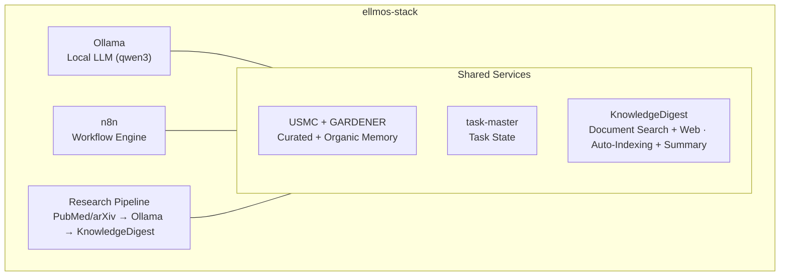
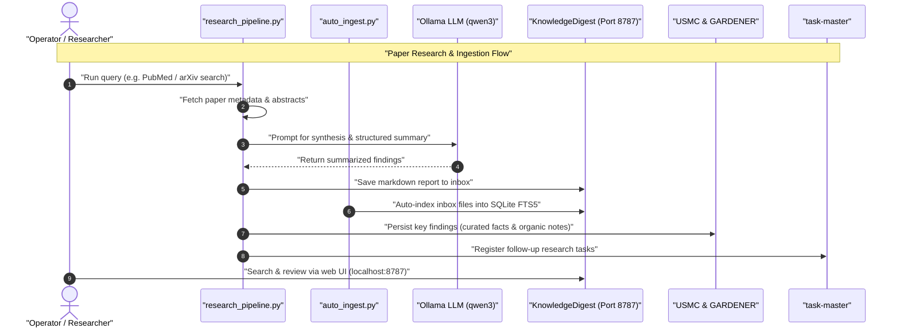

# ellmos-stack


**[English](README.md) · [Deutsch](README_de.md) · [Español](README_es.md) · [Français](README_fr.md) · [日本語](README_ja.md) · [Русский](README_ru.md) · [简体中文](README_zh.md)**

[](https://github.com/ellmos-ai/ellmos-stack/actions/workflows/tests.yml)
[](tests)
[](https://github.com/ellmos-ai/ellmos-stack/releases)
[](https://github.com/ellmos-ai)
[](https://github.com/open-bricks)
[](#arquitectura)
[](#notas-de-seguridad)
[](THIRD_PARTY_LICENSES.md#non-elevation-invariant-runasinvoker)
[](THIRD_PARTY_LICENSES.md)
[](llms.txt)
[](https://www.python.org/)
[](LICENSE)

[Inicio rápido](#inicio-rápido) • [Arquitectura](#arquitectura) • [Flujos de trabajo y secuencia](#flujos-de-trabajo-y-secuencia) • [Familia de stacks](#familia-de-stacks) • [Seguridad](#notas-de-seguridad) • [llms.txt](llms.txt)

Una pila autohospedada de investigación con IA y gestión del conocimiento. Combina un LLM local, automatización de flujos de trabajo, memoria persistente y una base de conocimiento en una sola instalación desplegable.

> [!NOTE]
> **Contexto legible por máquinas para agentes de IA:**
> Para consultar una visión indexada de los límites arquitectónicos, las interfaces principales, las políticas de seguridad y las reglas de inferencia local primero, consulte [`llms.txt`](llms.txt) o [`STACK-MAP.md`](STACK-MAP.md).

**No depende de un modelo alojado por defecto.** La inferencia, el estado de los flujos de trabajo, la memoria y los documentos permanecen en su servidor. La búsqueda de artículos (PubMed/arXiv), Telegram, las descargas de paquetes e imágenes y el backend opcional de Anthropic para resúmenes requieren acceso a la red.

Contexto legible por máquinas para LLM y herramientas de programación agéntica: [`llms.txt`](llms.txt).

## Empiece aquí

| Si necesita... | Empiece por | Motivo |
|----------------|------------|--------|
| Un servidor local de investigación con IA | [`install.sh`](install.sh) | Instala Ollama, n8n, USMC, GARDENER, task-master y KnowledgeDigest en `/opt/ellmos-stack`. |
| Automatización de flujos de trabajo con un modelo local | [`docker-compose.yml`](docker-compose.yml) | Ejecuta n8n y Ollama con volúmenes persistentes. |
| Una bandeja de entrada de documentos con búsqueda | [`services/auto_ingest.py`](services/auto_ingest.py) | Incorpora los documentos nuevos a la indexación de KnowledgeDigest. |
| Búsqueda de artículos y canalizaciones de resumen | [`services/research_pipeline.py`](services/research_pipeline.py) | Busca artículos, los resume y puede guardar los resultados en la base de conocimiento. |
| Memoria de agentes y estado de tareas | [`stack.v2.json`](stack.v2.json) | Separa la memoria curada, la memoria orgánica y las tareas en módulos especializados. |

ellmos-stack se entiende mejor como una **pila de IA local primero para automatizar la investigación y gestionar conocimiento privado**. No es un producto SaaS alojado, una puerta de enlace a LLM en la nube ni una plataforma Kubernetes.

Términos habituales para encontrarla: `ellmos-stack`, `self-hosted AI research stack`, `Ollama n8n KnowledgeDigest`, `private local RAG server` y `Docker Compose AI knowledge base`.

## Qué incluye



| Componente | Función | Origen |
|-----------|--------|--------|
| **[Ollama](https://ollama.com)** | Inferencia local de LLM (qwen3:4b de forma predeterminada) | Docker |
| **[n8n](https://n8n.io)** | Automatización de flujos de trabajo, webhooks y programación | Docker |
| **[USMC](https://github.com/ellmos-ai/usmc)** | Datos curados, memoria de trabajo y lecciones (`memory.curated`) | commit de Git fijado |
| **[GARDENER](https://github.com/ellmos-ai/gardener)** | Memoria local orgánica y sustrato de conocimiento (`memory.organic`) | commit de Git fijado |
| **[task-master](https://github.com/ellmos-ai/task-master)** | Estado dedicado de tareas (`tasks.default`) | commit de Git fijado |
| **[KnowledgeDigest](https://github.com/file-bricks/knowledgedigest)** | Ingesta, fragmentación y búsqueda de documentos; interfaz web | commit de Git fijado |
| **Research Pipeline** | Búsqueda mediante las API de PubMed/arXiv → análisis → almacenamiento | incluido |
| **Telegram Gateway** *(opcional)* | Bot de Telegram con filtro por propietario que responde mediante el LLM local | incluido |

## Composición de un vistazo

```
ellmos-stack (Docker Compose)
├── Inference       Ollama            local LLM (qwen3:4b)
├── Automation      n8n               workflows, webhooks, scheduling
├── Knowledge/RAG   KnowledgeDigest   ingest → chunk → FTS5 → summarize
├── Curated Memory  USMC              facts, working memory, lessons (pinned-git)
├── Organic Memory  GARDENER          local memory/knowledge substrate (pinned-git)
├── Tasks           task-master       dedicated task state (pinned-git)
├── services/       research_pipeline, auto_ingest, process_summaries,
│                   telegram_gateway, env_config
└── External APIs   PubMed · arXiv    paper search (https)
```

Plano completo de composición — componentes, funciones, fuentes y políticas: **[STACK-MAP.md](STACK-MAP.md)**.

## Requisitos

- **Servidor:** Linux (Ubuntu 22.04+, Debian 12+), 2 o más núcleos de CPU, 8 GB de RAM o más
- **Software:** Docker, Docker Compose v2, Python 3.10+
- **Disco:** ~5 GB para la instalación base (modelo y contenedores)

## Validación

El repositorio incluye pruebas de humo que se ejecutan sin Docker, Ollama, n8n, Telegram ni servicios de red activos:

```bash
PYTHONIOENCODING=utf-8 python -m unittest discover -s tests -v
PYTHONIOENCODING=utf-8 python -m compileall -q services tests tools
PYTHONIOENCODING=utf-8 python tools/check_release_gate.py
```

El flujo estándar de GitHub Actions ejecuta la compilación y toda la suite de pruebas unitarias en Python 3.10, 3.11 y 3.12. El flujo manual de publicación también ejecuta el verificador estático de publicación y pruebas de Compose en Linux.

Estas comprobaciones son una verificación previa sin conexión, no demuestran un despliegue en Linux. Las publicaciones públicas usan la [puerta de publicación de la pila](RELEASE_GATE.md), que exige etiquetas exactas de contenedor, un inicio y una prueba reales de Docker Compose en Linux, comprobaciones de vinculación a localhost y una revisión de la cuenta del propietario, TLS y firewall. Las etiquetas flotantes `latest` no superan esa puerta.

## Inicio rápido

```bash
# Clone
git clone https://github.com/ellmos-ai/ellmos-stack.git
cd ellmos-stack

# Install (as root)
sudo ./install.sh

# That's it. Services are running:
#   n8n:              http://127.0.0.1:5678 (localhost only -- see below)
#   KnowledgeDigest:  http://127.0.0.1:8787 (localhost only -- see below)
#   Ollama:           localhost:11434 (internal)
```

El instalador:
1. Instala las dependencias del sistema (Python, Git, curl)
2. Configura los servicios Docker (Ollama + n8n)
3. Descarga el modelo LLM configurado
4. Instala commits fijados de USMC, GARDENER, task-master y KnowledgeDigest en un entorno virtual de Python
5. Crea el usuario de sistema restringido `ellmos-stack` y un servicio systemd para KnowledgeDigest
6. Configura trabajos cron sin privilegios de root para la indexación automática y los resúmenes en segundo plano

**Primer inicio de n8n: cree la cuenta del propietario.** n8n 1.0+ no tiene Basic Auth. La autenticación se gestiona mediante la cuenta del propietario que se crea en la interfaz web durante el primer inicio. Como el puerto está vinculado a localhost, acceda mediante un túnel SSH y complete la configuración antes de exponer el servicio:

```bash
ssh -L 5678:127.0.0.1:5678 -L 8787:127.0.0.1:8787 root@your-server
# then open http://localhost:5678 for n8n and http://localhost:8787 for KnowledgeDigest
```

## Configuración

Copie y edite `.env`:

```bash
cp .env.example .env
nano .env
```

Configuración principal:

| Variable | Valor predeterminado | Descripción |
|----------|---------------------|-------------|
| `OLLAMA_MODEL` | `qwen3:4b` | Modelo LLM que se utilizará |
| `OLLAMA_MEMORY_LIMIT` | `6G` | RAM máxima para Ollama |
| `OLLAMA_BASE_URL` | `http://localhost:11434` | Endpoint de Ollama usado por los scripts del servicio |
| `OLLAMA_IMAGE_TAG` | `latest` | Etiqueta de imagen Docker de Ollama; fíjela antes de usar en producción |
| `N8N_IMAGE_TAG` | `latest` | Etiqueta de imagen Docker de n8n; fíjela antes de usar en producción |
| `KD_PORT` | `8787` | Puerto de la interfaz web de KnowledgeDigest |
| `KD_SUMMARY_PROVIDER` | `ollama` | Backend de resúmenes: `ollama`, `anthropic` |
| `ELLMOS_TELEGRAM_TOKEN` | vacío | Token preferido del bot de Telegram; `RINNSAL_TELEGRAM_TOKEN` antiguo solo se mantiene como alternativa durante la migración |

**Fije las versiones de imagen para producción:** el archivo Compose usa `latest` de forma predeterminada para ambas imágenes Docker. Esto resulta práctico para evaluar, pero no es reproducible y puede descargar cambios incompatibles no probados (n8n publica versiones principales con regularidad). Antes de usarlo en producción, establezca `OLLAMA_IMAGE_TAG` y `N8N_IMAGE_TAG` en `.env` con las versiones concretas que haya probado.

## Casos de uso

### 1. Base de conocimiento

Deposite documentos (PDF, TXT, MD, DOCX) en el directorio de entrada:

```bash
cp paper.pdf /opt/ellmos-stack/data/knowledgedigest/inbox/
# Auto-indexed within 5 minutes, summaries generated within 15 minutes
```

Explore y busque en `http://localhost:8787` mediante el túnel SSH del inicio rápido. Mantenga el servicio en localhost salvo que haya configurado un proxy inverso revisado con TLS y autenticación, junto con una regla de firewall.

### 2. Automatización de la investigación

Busque artículos académicos, analícelos con su LLM local y guarde los resultados:

```bash
cd /opt/ellmos-stack
venv/bin/python services/research_pipeline.py \
    "dark matter detection methods" \
    --papers 10 --summarize --save
```

El cliente de búsqueda integrado, sin dependencias, utiliza [NCBI E-utilities para PubMed](https://www.ncbi.nlm.nih.gov/home/develop/api/) y la [API de arXiv](https://info.arxiv.org/help/api/index.html). Seleccione una fuente con `--source pubmed` o `--source arxiv`; la búsqueda de artículos requiere acceso saliente a la red.

### 3. Memoria de IA y tareas

La memoria curada y el estado de las tareas usan bases de datos distintas deliberadamente. La memoria orgánica de GARDENER utiliza su propio directorio `/opt/ellmos-stack/data/gardener/`.

```python
from pathlib import Path

from gardener import Gardener
from usmc import api as memory
from taskplan import api as tasks

memory_db = "/opt/ellmos-stack/data/usmc/usmc_memory.db"
task_db = "/opt/ellmos-stack/data/task-master/taskplan.db"
memory.init(db_path=memory_db, agent_id="ellmos-stack")
memory.remember("server_setup", "completed", category="project")

tasks.init(db_path=task_db, agent_id="ellmos-stack")
tasks.add("Review research results", priority="high")

organic = Gardener(
    home=Path("/opt/ellmos-stack/data/gardener/home"),
    data_dir=Path("/opt/ellmos-stack/data/gardener"),
)
organic.put("research-note", content="Review the new evidence", type="memory")
```

### 4. Automatización de flujos de trabajo (n8n)

Diseñe flujos de trabajo automatizados con n8n en `http://localhost:5678` (mediante un túnel SSH; consulte el inicio rápido):

- **Investigación programada:** Cron → Research Pipeline → resumen por correo electrónico
- **Procesamiento de documentos:** Webhook → descarga → bandeja de entrada de KnowledgeDigest
- **Supervisión:** comprobaciones de estado → alertas

### 5. Acceso directo al LLM

Consulte Ollama directamente desde cualquier servicio:

```bash
curl http://localhost:11434/api/generate \
    -d '{"model":"qwen3:4b","prompt":"Explain quantum entanglement briefly"}'
```

### 6. Análisis de documentos en el escritorio (NoteSpaceLLM)

Use [NoteSpaceLLM](https://github.com/file-bricks/NoteSpaceLLM) como cliente de escritorio para analizar documentos de forma interactiva con la instancia de Ollama de la pila:

1. Instale NoteSpaceLLM en su equipo local
2. Configure un proxy de autenticación para Ollama (consulte [Exponer Ollama para acceso remoto](#exponer-ollama-para-acceso-remoto) más abajo)
3. En NoteSpaceLLM: Menú > LLM > Ajustes > configure la URL del servidor y la API key

NoteSpaceLLM permite analizar documentos mediante arrastrar y soltar, chatear con RAG y exportar informes en varios formatos; todo lo procesa el LLM de la pila.

### 7. Pasarela de Telegram (opcional)

`services/telegram_gateway.py` es un bot de Telegram que filtra por propietario: solo puede comunicarse con él el ID de chat del propietario configurado. El LLM local de la pila responde a los mensajes entrantes con contexto opcional de USMC; `/tasks` consulta la base de datos independiente de task-master. La pasarela no tiene ninguna ruta de reenvío a BACH. Solo utiliza la biblioteca estándar de Python.

Configuración:

```bash
# 1. Get a bot token from @BotFather and your chat ID from @userinfobot,
#    then set ELLMOS_TELEGRAM_TOKEN and TELEGRAM_OWNER_CHAT_ID in .env

# 2. Test the connection
/opt/ellmos-stack/venv/bin/python /opt/ellmos-stack/services/telegram_gateway.py --test

# 3. Install as systemd service (unit file is included)
cp /opt/ellmos-stack/config/telegram-gateway.service /etc/systemd/system/
systemctl daemon-reload
systemctl enable --now telegram-gateway
```

## Arquitectura

La pila usa **Docker** para Ollama y n8n (servicios con estado y volúmenes) e instala USMC, GARDENER, task-master y KnowledgeDigest desde commits de Git fijados en un entorno virtual. El estado de ejecución permanece en rutas de datos separadas. KnowledgeDigest y el procesamiento cron en segundo plano se ejecutan como el usuario restringido `ellmos-stack`.

```
Port 5678  ──→ n8n (Docker, localhost only -- SSH tunnel or reverse proxy)
Port 8787  ──→ KnowledgeDigest Web Viewer (systemd, localhost only)
Port 11434 ──→ Ollama (Docker, localhost only)
Port 443   ──→ TLS Ollama reverse proxy (optional, for remote clients)

Cron:
  */5  min ──→ auto_ingest.py (index new documents)
  */15 min ──→ process_summaries.py (LLM summarization)
```

Los datos se almacenan en `/opt/ellmos-stack/data/` (bases de datos SQLite y archivos de documentos).

## Flujos de trabajo y secuencia

El siguiente diagrama de secuencia detalla cómo se coordinan las consultas automatizadas de artículos, la ingesta de documentos, los resúmenes mediante el LLM local y las actualizaciones de memoria en toda la pila:



## Personalización

### Otro modelo LLM

```bash
# Edit .env
OLLAMA_MODEL=mistral:7b

# Pull the new model
docker exec ollama ollama pull mistral:7b

# For NoteSpaceLLM RAG embeddings, also pull an embedding model:
docker exec ollama ollama pull nomic-embed-text

# Restart summary processing (uses OLLAMA_MODEL from .env)
```

### LLM en la nube para resúmenes

```bash
# In .env
KD_SUMMARY_PROVIDER=anthropic
ANTHROPIC_API_KEY=sk-ant-...
```

### Prompt del sistema personalizado

Edite `config/system_prompt.txt` para ajustar la personalidad, el idioma y el comportamiento del LLM.

## Exponer Ollama para acceso remoto

De forma predeterminada, Ollama solo escucha en localhost. Para clientes remotos, mantenga esa vinculación y use un proxy inverso TLS con un bearer token. Obtenga primero un certificado para `ollama.example.com`; nunca envíe el token por HTTP sin cifrar.

```bash
# Install Nginx
apt install nginx

# Create proxy config
cat > /etc/nginx/sites-available/ollama-proxy << 'EOF'
server {
    listen 443 ssl;
    server_name ollama.example.com;

    ssl_certificate /etc/letsencrypt/live/ollama.example.com/fullchain.pem;
    ssl_certificate_key /etc/letsencrypt/live/ollama.example.com/privkey.pem;

    location / {
        if ($http_authorization != "Bearer YOUR_SECRET_API_KEY") {
            return 401 "Unauthorized";
        }
        proxy_pass http://127.0.0.1:11434;
        proxy_set_header Host $host;
        proxy_read_timeout 300s;
        proxy_buffering off;
    }

}
EOF

# Enable and start
chmod 600 /etc/nginx/sites-available/ollama-proxy
ln -sf /etc/nginx/sites-available/ollama-proxy /etc/nginx/sites-enabled/
nginx -t
ufw allow 443/tcp
systemctl reload nginx
```

Genere una clave segura: `python3 -c "import secrets; print(secrets.token_urlsafe(32))"`

Después, los clientes se conectan a `https://ollama.example.com` con el encabezado `Authorization: Bearer YOUR_SECRET_API_KEY`.

## Notas de seguridad

- n8n está vinculado a `127.0.0.1:5678` de forma predeterminada y **no** es accesible desde fuera. n8n 1.0+ eliminó Basic Auth; la autenticación corre a cargo de la cuenta del propietario de n8n, que debe crear en la interfaz web durante el primer inicio (a través de un túnel SSH; consulte el inicio rápido). **No exponga nunca una instancia de n8n antes de crear la cuenta del propietario**: el primer visitante se convertiría en el propietario.
- Para acceder a n8n de forma remota, mantenga la vinculación a localhost y use un proxy inverso revisado con TLS y autenticación, un túnel SSH o una VPN privada. Nunca exponga el puerto HTTP sin protección 5678 directamente a Internet, ni siquiera después de crear la cuenta del propietario.
- De forma predeterminada, Ollama solo escucha en localhost (no está expuesto a Internet).
- El proxy opcional de Ollama usa TLS y autenticación con bearer token; un bearer token enviado por HTTP sin cifrar no es seguro.
- Todas las credenciales están en `.env` (nunca se incluyen en Git); el instalador limita los permisos del archivo al propietario (`0600`).
- KnowledgeDigest se vincula a localhost de forma predeterminada; el acceso externo requiere un proxy inverso revisado con TLS y autenticación, además de una regla de firewall.
- La pasarela de Telegram no se inicia a menos que se configuren tanto el token del bot como el ID de chat del propietario.
- Las entradas del instalador de USMC, GARDENER, task-master y KnowledgeDigest están fijadas a commits exactos; las actualizaciones son cambios explícitos en el código fuente.
- Revise [`OPERATIONS.md`](OPERATIONS.md) y ensaye la restauración antes de una actualización o publicación.

## Búsqueda y desambiguación

Use **ellmos-stack** para referirse a la pila local autohospedada de investigación con IA de `ellmos-ai`: Ollama para inferencia, n8n para automatizar flujos de trabajo, memoria especializada de USMC/GARDENER, estado de tareas de task-master y búsqueda de documentos de KnowledgeDigest. Algunas frases útiles de búsqueda:

- `ellmos-stack self-hosted AI research stack`
- `ellmos stack Ollama n8n USMC GARDENER task-master KnowledgeDigest`
- `local-first AI knowledge stack Docker Compose`
- `self-hosted research automation Ollama n8n`
- `private local RAG server with Ollama and n8n`
- `Docker Compose AI knowledge base with document search`
- `self-hosted AI starter stack for research workflows`

El proyecto no está relacionado con Eclipse LMOS, Llama Stack, LLemonStack, los kits genéricos de inicio de n8n con IA, las instalaciones que solo usan Open WebUI, las pilas generales de LLMOps ni las plataformas de agentes de IA alojadas en la nube. Para desambiguar los resultados de búsqueda, use la ruta canónica del repositorio `ellmos-ai/ellmos-stack`.

## Familia de stacks

> **Catálogo canónico:** la lista completa y actualizada de todos los stacks de ellmos está en
> **[ellmos-ai/stacks](https://github.com/ellmos-ai/stacks)** — el repositorio de referencia de stacks
> (catálogo, esquema de manifiesto compartido y documentación sobre qué es un stack). La tabla
> siguiente es un extracto práctico; si hay dudas, prevalece el catálogo.

ellmos-stack es el **stack inicial todo en uno**: la implementación de referencia con todo incluido. Los stacks hermanos siguen los mismos principios de composición con enfoques específicos de cada dominio:

| Stack | Enfoque | Componentes |
|-------|---------|-------------|
| **ellmos-stack** (este repositorio) | Conocimiento e investigación todo en uno | Ollama + n8n + USMC + GARDENER + task-master + KnowledgeDigest + Research Pipeline |
| [agent-ops-stack](https://github.com/ellmos-ai/agent-ops-stack) | Operaciones multiagente (bloqueos, tickets, avatar de decisión, memoria) | ticket-master + lock-master + build-your-users-mind + skills + controlcenter-mcp + homebase-mcp |
| ellmos-research-stack (previsto) | Investigación académica y literatura | + canalizaciones de PubMed/arXiv, herramientas bibliográficas, redes de citas |
| ellmos-dev-stack (previsto) | Desarrollo de software y DevOps | + análisis de código, integración CI/CD, supervisión de repositorios |
| ellmos-media-stack (previsto) | Creación de contenido y medios | + transcripción, canalizaciones de resumen, procesamiento de medios |

Cada stack es un repositorio independiente con su propio manifiesto y `install.sh`. Comparten el principio de composición («la instalación ES el plano»), pero añaden herramientas y flujos de trabajo específicos de cada dominio.

## Parte del ecosistema ellmos

| Componente | Descripción |
|------------|-------------|
| [ellmos-ai/usmc](https://github.com/ellmos-ai/usmc) | Memoria curada de agentes |
| [ellmos-ai/gardener](https://github.com/ellmos-ai/gardener) | Memoria local orgánica y sustrato de conocimiento |
| [ellmos-ai/task-master](https://github.com/ellmos-ai/task-master) | Estado dedicado de tareas |
| [ellmos-ai/n8n-workflow-manager](https://github.com/ellmos-ai/n8n-workflow-manager) | Revisa y controla las versiones de los flujos de trabajo de n8n de esta pila: visor de grafos, registro de decisiones y reversión |
| [file-bricks/knowledgedigest](https://github.com/file-bricks/knowledgedigest) | Base de conocimiento documental con interfaz web |
| [file-bricks/NoteSpaceLLM](https://github.com/file-bricks/NoteSpaceLLM) | Análisis de documentos en escritorio y chat RAG (se conecta al Ollama de la pila) |
| [NCBI E-utilities](https://www.ncbi.nlm.nih.gov/home/develop/api/) y [API de arXiv](https://info.arxiv.org/help/api/index.html) | Búsqueda en tiempo real de metadatos de artículos académicos para Research Pipeline |

## Licencia

MIT

---

## Responsabilidad

Este proyecto es una **donación gratuita de código abierto** en el sentido de los §§ 516 y siguientes del BGB. Según el **§ 521 BGB**, la responsabilidad del autor se limita al **dolo y la negligencia grave**. También se aplican las exclusiones de responsabilidad de GPL-3.0 / MIT / Apache-2.0 §§ 15–16 (según la licencia elegida).

El uso es bajo su propia responsabilidad. No se ofrece mantenimiento ni garantía de disponibilidad, ni se garantiza la ausencia de errores o la idoneidad para un fin determinado.

Este proyecto es una donación de código abierto sin remuneración. La responsabilidad se limita al dolo y la negligencia grave (§ 521 del Código Civil alemán). Úselo bajo su propia responsabilidad. No se ofrece garantía, mantenimiento ni idoneidad para un fin específico.
