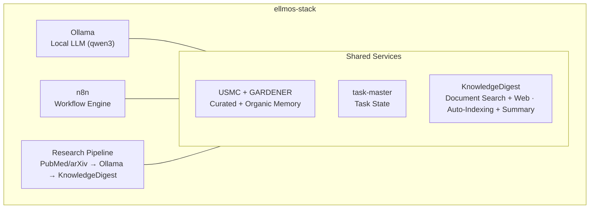
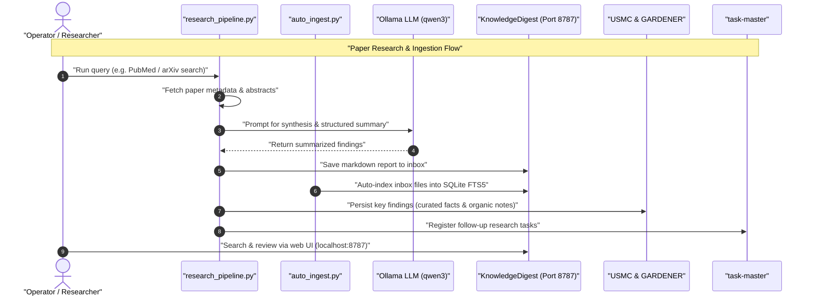

# ellmos-stack


**[English](README.md) · [Deutsch](README_de.md) · [Español](README_es.md) · [Français](README_fr.md) · [日本語](README_ja.md) · [Русский](README_ru.md) · [简体中文](README_zh.md)**

[](https://github.com/ellmos-ai/ellmos-stack/actions/workflows/tests.yml)
[](tests)
[](https://github.com/ellmos-ai/ellmos-stack/releases)
[](https://github.com/ellmos-ai)
[](https://github.com/open-bricks)
[](#architecture)
[](#notes-de-sécurité)
[](THIRD_PARTY_LICENSES.md#non-elevation-invariant-runasinvoker)
[](THIRD_PARTY_LICENSES.md)
[](llms.txt)
[](https://www.python.org/)
[](LICENSE)

[Démarrage rapide](#démarrage-rapide) • [Architecture](#architecture) • [Flux de travail et séquence](#flux-de-travail-et-séquence) • [Famille de stacks](#famille-de-stacks) • [Sécurité](#notes-de-sécurité) • [llms.txt](llms.txt)

Une pile auto-hébergée de recherche en IA et de gestion des connaissances. Elle associe un LLM local, l’automatisation des workflows, une mémoire persistante et une base de connaissances dans un déploiement unique.

> [!NOTE]
> **Contexte lisible par machine pour les agents d’IA :**
> Pour obtenir une vue d’ensemble indexée des limites architecturales, des interfaces principales, des politiques de sécurité et des règles privilégiant l’inférence locale, consultez [`llms.txt`](llms.txt) ou [`STACK-MAP.md`](STACK-MAP.md).

**Aucune dépendance à un modèle hébergé par défaut.** L’inférence, l’état des workflows, la mémoire et les documents restent sur votre serveur. La recherche d’articles (PubMed/arXiv), Telegram, les téléchargements de paquets/images et le backend Anthropic facultatif pour les résumés nécessitent un accès réseau.

Contexte lisible par machine pour les LLM et les outils de programmation agentique : [`llms.txt`](llms.txt).

## Commencez ici

| Si vous avez besoin de… | Commencez par | Pourquoi |
|-------------------------|---------------|---------|
| Un serveur local de recherche en IA | [`install.sh`](install.sh) | Installe Ollama, n8n, USMC, GARDENER, task-master et KnowledgeDigest sous `/opt/ellmos-stack`. |
| Automatiser des workflows avec un modèle local | [`docker-compose.yml`](docker-compose.yml) | Exécute n8n et Ollama avec des volumes persistants. |
| Une boîte de réception de documents consultable | [`services/auto_ingest.py`](services/auto_ingest.py) | Transfère les nouveaux documents vers l’indexation de KnowledgeDigest. |
| La recherche d’articles et des pipelines de résumé | [`services/research_pipeline.py`](services/research_pipeline.py) | Recherche des articles, les résume et peut enregistrer les résultats dans la base de connaissances. |
| La mémoire des agents et l’état des tâches | [`stack.v2.json`](stack.v2.json) | Sépare la mémoire organisée, la mémoire organique et les tâches en modules spécialisés. |

ellmos-stack se comprend avant tout comme une **pile d’IA locale d’abord pour automatiser la recherche et gérer des connaissances privées**. Ce n’est ni un produit SaaS hébergé, ni une passerelle vers des LLM dans le cloud, ni une plateforme Kubernetes.

Repères de recherche courants : `ellmos-stack`, `self-hosted AI research stack`, `Ollama n8n KnowledgeDigest`, `private local RAG server` et `Docker Compose AI knowledge base`.

## Contenu de la pile



| Composant | Rôle | Source |
|-----------|------|--------|
| **[Ollama](https://ollama.com)** | Inférence locale d’un LLM (qwen3:4b par défaut) | Docker |
| **[n8n](https://n8n.io)** | Automatisation des workflows, webhooks et planification | Docker |
| **[USMC](https://github.com/ellmos-ai/usmc)** | Faits organisés, mémoire de travail et enseignements (`memory.curated`) | commit Git épinglé |
| **[GARDENER](https://github.com/ellmos-ai/gardener)** | Mémoire locale organique et substrat de connaissances (`memory.organic`) | commit Git épinglé |
| **[task-master](https://github.com/ellmos-ai/task-master)** | État dédié des tâches (`tasks.default`) | commit Git épinglé |
| **[KnowledgeDigest](https://github.com/file-bricks/knowledgedigest)** | Ingestion, découpage et recherche de documents, interface web | commit Git épinglé |
| **Research Pipeline** | Recherche via les API PubMed/arXiv → analyse → stockage | inclus |
| **Telegram Gateway** *(facultatif)* | Bot Telegram filtré selon le propriétaire qui répond avec le LLM local | inclus |

## Composition en un coup d’œil

```
ellmos-stack (Docker Compose)
├── Inference       Ollama            local LLM (qwen3:4b)
├── Automation      n8n               workflows, webhooks, scheduling
├── Knowledge/RAG   KnowledgeDigest   ingest → chunk → FTS5 → summarize
├── Curated Memory  USMC              facts, working memory, lessons (pinned-git)
├── Organic Memory  GARDENER          local memory/knowledge substrate (pinned-git)
├── Tasks           task-master       dedicated task state (pinned-git)
├── services/       research_pipeline, auto_ingest, process_summaries,
│                   telegram_gateway, env_config
└── External APIs   PubMed · arXiv    paper search (https)
```

Plan complet de composition — composants, rôles, sources et politiques : **[STACK-MAP.md](STACK-MAP.md)**.

## Prérequis

- **Serveur :** Linux (Ubuntu 22.04+, Debian 12+), au moins 2 cœurs CPU et 8 Go de RAM
- **Logiciels :** Docker, Docker Compose v2, Python 3.10+
- **Disque :** environ 5 Go pour l’installation de base (modèle et conteneurs)

## Validation

Le dépôt comprend des tests de fumée qui s’exécutent sans Docker, Ollama, n8n, Telegram ni services réseau actifs :

```bash
PYTHONIOENCODING=utf-8 python -m unittest discover -s tests -v
PYTHONIOENCODING=utf-8 python -m compileall -q services tests tools
PYTHONIOENCODING=utf-8 python tools/check_release_gate.py
```

Le workflow GitHub Actions standard exécute la compilation et toute la suite de tests unitaires avec Python 3.10, 3.11 et 3.12. Le workflow de publication manuel exécute également le vérificateur statique de publication et des sondes Compose sous Linux.

Ces vérifications constituent un contrôle préalable hors ligne ; elles ne démontrent pas un déploiement Linux. Les publications publiques passent par le [contrôle de publication de la pile](RELEASE_GATE.md) : tags de conteneur exacts, véritable démarrage et sonde Docker Compose sous Linux, vérification des liaisons localhost et examen du compte propriétaire, de TLS et du pare-feu. Les tags flottants `latest` échouent à ce contrôle.

## Démarrage rapide

```bash
# Clone
git clone https://github.com/ellmos-ai/ellmos-stack.git
cd ellmos-stack

# Install (as root)
sudo ./install.sh

# That's it. Services are running:
#   n8n:              http://127.0.0.1:5678 (localhost only -- see below)
#   KnowledgeDigest:  http://127.0.0.1:8787 (localhost only -- see below)
#   Ollama:           localhost:11434 (internal)
```

L’installateur :
1. Installe les dépendances système (Python, Git, curl)
2. Configure les services Docker (Ollama + n8n)
3. Télécharge le modèle LLM configuré
4. Installe les commits épinglés de USMC, GARDENER, task-master et KnowledgeDigest dans un environnement virtuel Python
5. Crée un utilisateur système restreint `ellmos-stack` et un service systemd pour KnowledgeDigest
6. Configure des tâches cron sans privilèges root pour l’indexation automatique et la génération de résumés en arrière-plan

**Premier démarrage de n8n — créez le compte du propriétaire :** n8n 1.0+ ne propose pas Basic Auth. L’authentification passe par le compte du propriétaire que vous créez dans l’interface web au premier démarrage. Comme le port est lié à localhost, ouvrez-le via un tunnel SSH et terminez la configuration avant toute exposition :

```bash
ssh -L 5678:127.0.0.1:5678 -L 8787:127.0.0.1:8787 root@your-server
# then open http://localhost:5678 for n8n and http://localhost:8787 for KnowledgeDigest
```

## Configuration

Copiez et modifiez `.env` :

```bash
cp .env.example .env
nano .env
```

Paramètres principaux :

| Variable | Valeur par défaut | Description |
|----------|-------------------|-------------|
| `OLLAMA_MODEL` | `qwen3:4b` | Modèle LLM à utiliser |
| `OLLAMA_MEMORY_LIMIT` | `6G` | RAM maximale pour Ollama |
| `OLLAMA_BASE_URL` | `http://localhost:11434` | Endpoint Ollama utilisé par les scripts de service |
| `OLLAMA_IMAGE_TAG` | `latest` | Tag de l’image Docker Ollama ; épinglez-le avant toute utilisation en production |
| `N8N_IMAGE_TAG` | `latest` | Tag de l’image Docker n8n ; épinglez-le avant toute utilisation en production |
| `KD_PORT` | `8787` | Port de l’interface web KnowledgeDigest |
| `KD_SUMMARY_PROVIDER` | `ollama` | Backend de résumé : `ollama`, `anthropic` |
| `ELLMOS_TELEGRAM_TOKEN` | vide | Token de bot Telegram privilégié ; l’ancien `RINNSAL_TELEGRAM_TOKEN` reste uniquement comme solution de repli pour la migration |

**Épinglez les versions des images en production :** par défaut, le fichier Compose utilise `latest` pour les deux images Docker. C’est pratique pour l’évaluation, mais non reproductible et susceptible de récupérer des changements incompatibles non testés (n8n publie régulièrement des versions majeures). Avant toute utilisation en production, définissez `OLLAMA_IMAGE_TAG` et `N8N_IMAGE_TAG` dans `.env` avec les versions précises que vous avez testées.

## Cas d’usage

### 1. Base de connaissances

Déposez les documents (PDF, TXT, MD, DOCX) dans le dossier de réception :

```bash
cp paper.pdf /opt/ellmos-stack/data/knowledgedigest/inbox/
# Auto-indexed within 5 minutes, summaries generated within 15 minutes
```

Consultez et recherchez les documents sur `http://localhost:8787` via le tunnel SSH du démarrage rapide. Laissez le service sur localhost sauf si un proxy inverse TLS avec authentification, dûment examiné, et une règle de pare-feu sont en place.

### 2. Automatisation de la recherche

Recherchez des articles universitaires, analysez-les avec votre LLM local et enregistrez les résultats :

```bash
cd /opt/ellmos-stack
venv/bin/python services/research_pipeline.py \
    "dark matter detection methods" \
    --papers 10 --summarize --save
```

Le client de recherche intégré, sans dépendances, utilise [NCBI E-utilities pour PubMed](https://www.ncbi.nlm.nih.gov/home/develop/api/) et l’[API arXiv](https://info.arxiv.org/help/api/index.html). Sélectionnez une source avec `--source pubmed` ou `--source arxiv` ; la recherche d’articles nécessite un accès réseau sortant.

### 3. Mémoire de l’IA et tâches

La mémoire organisée et l’état des tâches utilisent volontairement des bases de données distinctes. La mémoire organique de GARDENER utilise son propre répertoire `/opt/ellmos-stack/data/gardener/`.

```python
from pathlib import Path

from gardener import Gardener
from usmc import api as memory
from taskplan import api as tasks

memory_db = "/opt/ellmos-stack/data/usmc/usmc_memory.db"
task_db = "/opt/ellmos-stack/data/task-master/taskplan.db"
memory.init(db_path=memory_db, agent_id="ellmos-stack")
memory.remember("server_setup", "completed", category="project")

tasks.init(db_path=task_db, agent_id="ellmos-stack")
tasks.add("Review research results", priority="high")

organic = Gardener(
    home=Path("/opt/ellmos-stack/data/gardener/home"),
    data_dir=Path("/opt/ellmos-stack/data/gardener"),
)
organic.put("research-note", content="Review the new evidence", type="memory")
```

### 4. Automatisation des workflows (n8n)

Créez des workflows automatisés avec n8n sur `http://localhost:5678` (via un tunnel SSH ; voir le démarrage rapide) :

- **Recherche planifiée :** Cron → Research Pipeline → résumé par e-mail
- **Traitement de documents :** Webhook → téléchargement → boîte de réception KnowledgeDigest
- **Surveillance :** contrôles de santé → alertes

### 5. Accès direct au LLM

Interrogez directement Ollama depuis n’importe quel service :

```bash
curl http://localhost:11434/api/generate \
    -d '{"model":"qwen3:4b","prompt":"Explain quantum entanglement briefly"}'
```

### 6. Analyse de documents sur ordinateur (NoteSpaceLLM)

Utilisez [NoteSpaceLLM](https://github.com/file-bricks/NoteSpaceLLM) comme client de bureau pour analyser des documents de manière interactive grâce à l’instance Ollama de la pile :

1. Installez NoteSpaceLLM sur votre ordinateur
2. Configurez un proxy d’authentification Ollama (voir [Exposer Ollama pour un accès distant](#exposer-ollama-pour-un-accès-distant) ci-dessous)
3. Dans NoteSpaceLLM : Menu > LLM > Paramètres > définissez l’URL de votre serveur et la clé d’API

NoteSpaceLLM permet d’analyser des documents par glisser-déposer, d’utiliser un chat reposant sur RAG et d’exporter des rapports dans plusieurs formats — le tout traité par le LLM de la pile.

### 7. Passerelle Telegram (facultatif)

`services/telegram_gateway.py` est un bot Telegram filtré selon le propriétaire : seul l’ID de chat du propriétaire configuré peut communiquer avec lui. Le LLM local de la pile répond aux messages entrants avec un contexte USMC facultatif ; `/tasks` consulte la base distincte de task-master. La passerelle ne dispose d’aucun mécanisme de transfert vers BACH. Elle utilise uniquement la bibliothèque standard de Python.

Configuration :

```bash
# 1. Get a bot token from @BotFather and your chat ID from @userinfobot,
#    then set ELLMOS_TELEGRAM_TOKEN and TELEGRAM_OWNER_CHAT_ID in .env

# 2. Test the connection
/opt/ellmos-stack/venv/bin/python /opt/ellmos-stack/services/telegram_gateway.py --test

# 3. Install as systemd service (unit file is included)
cp /opt/ellmos-stack/config/telegram-gateway.service /etc/systemd/system/
systemctl daemon-reload
systemctl enable --now telegram-gateway
```

## Architecture

La pile utilise **Docker** pour Ollama et n8n (services avec état et volumes), et installe USMC, GARDENER, task-master et KnowledgeDigest depuis des commits Git épinglés dans un environnement virtuel. Leur état d’exécution reste dans des chemins de données distincts. KnowledgeDigest et les traitements cron en arrière-plan s’exécutent sous l’utilisateur restreint `ellmos-stack`.

```
Port 5678  ──→ n8n (Docker, localhost only -- SSH tunnel or reverse proxy)
Port 8787  ──→ KnowledgeDigest Web Viewer (systemd, localhost only)
Port 11434 ──→ Ollama (Docker, localhost only)
Port 443   ──→ TLS Ollama reverse proxy (optional, for remote clients)

Cron:
  */5  min ──→ auto_ingest.py (index new documents)
  */15 min ──→ process_summaries.py (LLM summarization)
```

Les données sont stockées dans `/opt/ellmos-stack/data/` (bases de données SQLite et fichiers de documents).

## Flux de travail et séquence

Le diagramme de séquence ci-dessous décrit la coordination, dans toute la pile, des recherches d’articles automatisées, de l’ingestion des documents, des résumés par le LLM local et des mises à jour de mémoire :



## Personnalisation

### Autre modèle LLM

```bash
# Edit .env
OLLAMA_MODEL=mistral:7b

# Pull the new model
docker exec ollama ollama pull mistral:7b

# For NoteSpaceLLM RAG embeddings, also pull an embedding model:
docker exec ollama ollama pull nomic-embed-text

# Restart summary processing (uses OLLAMA_MODEL from .env)
```

### LLM cloud pour les résumés

```bash
# In .env
KD_SUMMARY_PROVIDER=anthropic
ANTHROPIC_API_KEY=sk-ant-...
```

### Prompt système personnalisé

Modifiez `config/system_prompt.txt` pour adapter la personnalité, la langue et le comportement du LLM.

## Exposer Ollama pour un accès distant

Par défaut, Ollama n’écoute que sur localhost. Pour les clients distants, conservez cette liaison et utilisez un proxy inverse TLS avec un jeton Bearer. Obtenez d’abord un certificat pour `ollama.example.com` ; n’envoyez jamais le jeton en HTTP non chiffré.

```bash
# Install Nginx
apt install nginx

# Create proxy config
cat > /etc/nginx/sites-available/ollama-proxy << 'EOF'
server {
    listen 443 ssl;
    server_name ollama.example.com;

    ssl_certificate /etc/letsencrypt/live/ollama.example.com/fullchain.pem;
    ssl_certificate_key /etc/letsencrypt/live/ollama.example.com/privkey.pem;

    location / {
        if ($http_authorization != "Bearer YOUR_SECRET_API_KEY") {
            return 401 "Unauthorized";
        }
        proxy_pass http://127.0.0.1:11434;
        proxy_set_header Host $host;
        proxy_read_timeout 300s;
        proxy_buffering off;
    }

}
EOF

# Enable and start
chmod 600 /etc/nginx/sites-available/ollama-proxy
ln -sf /etc/nginx/sites-available/ollama-proxy /etc/nginx/sites-enabled/
nginx -t
ufw allow 443/tcp
systemctl reload nginx
```

Générez une clé sécurisée : `python3 -c "import secrets; print(secrets.token_urlsafe(32))"`

Les clients se connectent ensuite à `https://ollama.example.com` avec l’en-tête `Authorization: Bearer YOUR_SECRET_API_KEY`.

## Notes de sécurité

- Par défaut, n8n est lié à `127.0.0.1:5678` et n’est **pas** accessible depuis l’extérieur. n8n 1.0+ a supprimé Basic Auth ; l’authentification est gérée par le compte propriétaire n8n, que vous devez créer dans l’interface web au premier démarrage (via un tunnel SSH ; voir le démarrage rapide). **N’exposez jamais une instance n8n avant la création du compte propriétaire** : le premier visiteur deviendrait le propriétaire.
- Pour accéder à n8n à distance, conservez la liaison localhost et utilisez un proxy inverse TLS avec authentification, dûment examiné, un tunnel SSH ou un VPN privé. N’exposez jamais directement le port HTTP brut 5678 à Internet, même après la création du compte propriétaire.
- Par défaut, Ollama n’écoute que sur localhost (il n’est pas exposé à Internet).
- Le proxy Ollama facultatif utilise TLS et une authentification par jeton Bearer ; un jeton Bearer transmis en HTTP non chiffré n’est pas sécurisé.
- Tous les identifiants se trouvent dans `.env` (jamais dans Git) ; l’installateur réserve les permissions de ce fichier au propriétaire (`0600`).
- KnowledgeDigest écoute sur localhost par défaut ; tout accès externe nécessite un proxy inverse TLS avec authentification, dûment examiné, ainsi qu’une règle de pare-feu.
- La passerelle Telegram refuse de démarrer si le token du bot ou l’ID de chat du propriétaire n’est pas configuré.
- Les entrées de l’installateur pour USMC, GARDENER, task-master et KnowledgeDigest sont épinglées sur des commits exacts ; les mises à niveau sont des modifications explicites du code source.
- Consultez [`OPERATIONS.md`](OPERATIONS.md) et effectuez un essai de restauration avant toute mise à niveau ou publication.

## Recherche et désambiguïsation

Utilisez **ellmos-stack** pour désigner la pile locale autohébergée de recherche en IA de `ellmos-ai` : Ollama pour l’inférence, n8n pour l’automatisation des workflows, la mémoire spécialisée de USMC/GARDENER, l’état des tâches dans task-master et la recherche documentaire de KnowledgeDigest. Exemples de termes de recherche utiles :

- `ellmos-stack self-hosted AI research stack`
- `ellmos stack Ollama n8n USMC GARDENER task-master KnowledgeDigest`
- `local-first AI knowledge stack Docker Compose`
- `self-hosted research automation Ollama n8n`
- `private local RAG server with Ollama and n8n`
- `Docker Compose AI knowledge base with document search`
- `self-hosted AI starter stack for research workflows`

Ce projet n’a aucun lien avec Eclipse LMOS, Llama Stack, LLemonStack, les kits de démarrage génériques d’IA avec n8n, les déploiements Open WebUI seuls, les piles LLMOps généralistes ou les plateformes d’agents IA hébergées dans le cloud. Pour lever toute ambiguïté dans les résultats de recherche, utilisez le chemin canonique du dépôt `ellmos-ai/ellmos-stack`.

## Famille de stacks

> **Catalogue canonique :** la liste complète et à jour de tous les stacks ellmos figure dans
> **[ellmos-ai/stacks](https://github.com/ellmos-ai/stacks)** — le dépôt de référence des stacks
> (catalogue, schéma de manifeste partagé et documentation sur la définition d’un stack). Le tableau
> ci-dessous est un extrait pratique ; en cas de doute, le catalogue fait foi.

ellmos-stack est le **stack de démarrage tout-en-un** — l’implémentation de référence qui inclut tout. Les stacks frères reprennent les mêmes principes de composition avec des domaines de spécialisation :

| Stack | Domaine | Composants |
|-------|---------|------------|
| **ellmos-stack** (ce dépôt) | Connaissances et recherche tout-en-un | Ollama + n8n + USMC + GARDENER + task-master + KnowledgeDigest + Research Pipeline |
| [agent-ops-stack](https://github.com/ellmos-ai/agent-ops-stack) | Opérations multi-agents (verrous, tickets, avatar de décision, mémoire) | ticket-master + lock-master + build-your-users-mind + skills + controlcenter-mcp + homebase-mcp |
| ellmos-research-stack (prévu) | Recherche universitaire et littérature | + pipelines PubMed/arXiv, outils bibliographiques, réseaux de citations |
| ellmos-dev-stack (prévu) | Développement logiciel et DevOps | + analyse de code, intégration CI/CD, suivi des dépôts |
| ellmos-media-stack (prévu) | Création de contenu et médias | + transcription, pipelines de résumé, traitement des médias |

Chaque stack est un dépôt autonome avec son propre manifeste et son fichier `install.sh`. Ils partagent le principe de composition (« l’installation EST le plan »), tout en ajoutant des outils et des workflows propres à chaque domaine.

## Au sein de l’écosystème ellmos

| Composant | Description |
|------------|-------------|
| [ellmos-ai/usmc](https://github.com/ellmos-ai/usmc) | Mémoire organisée des agents |
| [ellmos-ai/gardener](https://github.com/ellmos-ai/gardener) | Mémoire locale organique et substrat de connaissances |
| [ellmos-ai/task-master](https://github.com/ellmos-ai/task-master) | État dédié des tâches |
| [ellmos-ai/n8n-workflow-manager](https://github.com/ellmos-ai/n8n-workflow-manager) | Vérifie et versionne les workflows n8n de cette pile : visualiseur de graphes, journal de décisions et retour arrière |
| [file-bricks/knowledgedigest](https://github.com/file-bricks/knowledgedigest) | Base documentaire de connaissances avec interface web |
| [file-bricks/NoteSpaceLLM](https://github.com/file-bricks/NoteSpaceLLM) | Analyse de documents sur ordinateur et chat RAG (se connecte à Ollama dans la pile) |
| [NCBI E-utilities](https://www.ncbi.nlm.nih.gov/home/develop/api/) et [API arXiv](https://info.arxiv.org/help/api/index.html) | Recherche en direct de métadonnées d’articles universitaires utilisée par Research Pipeline |

## Licence

MIT

---

## Responsabilité

Ce projet est un **don gratuit de logiciel libre** au sens des §§ 516 et suivants du BGB. Conformément au **§ 521 BGB**, la responsabilité de l’auteur est limitée au **dol et à la négligence grave**. Les exclusions de responsabilité de la GPL-3.0 / MIT / Apache-2.0 §§ 15–16 s’appliquent également (selon la licence choisie).

Utilisation à vos propres risques. Aucune promesse de maintenance, aucune garantie de disponibilité, aucune garantie d’absence d’erreurs ou d’adéquation à un usage particulier.

Ce projet est un don de logiciel libre sans rémunération. La responsabilité est limitée au dol et à la négligence grave (§ 521 du Code civil allemand). Utilisez-le à vos propres risques. Aucune garantie, aucune promesse de maintenance ni d’adéquation à un usage particulier.
