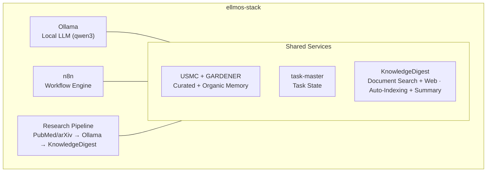
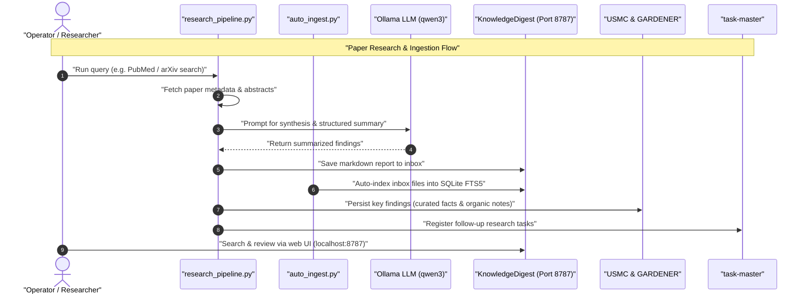

# ellmos-stack


**[English](README.md) · [Deutsch](README_de.md) · [Español](README_es.md) · [Français](README_fr.md) · [日本語](README_ja.md) · [Русский](README_ru.md) · [简体中文](README_zh.md) · [हिन्दी](README_hi.md) · [العربية](README_ar.md) · [বাংলা](README_bn.md) · [Português](README_pt.md)**

[](https://github.com/ellmos-ai/ellmos-stack/actions/workflows/tests.yml)
[](tests)
[](https://github.com/ellmos-ai/ellmos-stack/releases)
[](https://github.com/ellmos-ai)
[](https://github.com/open-bricks)
[](#architecture)
[](#security-notes)
[](THIRD_PARTY_LICENSES.md#non-elevation-invariant-runasinvoker)
[](THIRD_PARTY_LICENSES.md)
[](llms.txt)
[](https://www.python.org/)
[](LICENSE)

[त्वरित प्रारंभ](#quickstart) • [वास्तुकला](#architecture) • [कार्यप्रवाह और क्रम](#workflows--sequence) • [स्टैक परिवार](#stack-family) • [सुरक्षा](#security-notes) • [llms.txt](llms.txt)

स्व-होस्ट किया जा सकने वाला AI शोध और ज्ञान-प्रबंधन स्टैक। यह स्थानीय LLM, कार्यप्रवाह स्वचालन, स्थायी स्मृति और ज्ञान-आधार को मिलाकर एक ऐसी व्यवस्था बनाता है जिसे परिनियोजित किया जा सकता है।

> [!NOTE]
> **AI एजेंटों के लिए मशीन-पठनीय संदर्भ:**
> वास्तुसीमाओं, प्राथमिक इंटरफेस, सुरक्षा नीतियों और local-first inference नियमों के अनुक्रमित अवलोकन के लिए [`llms.txt`](llms.txt) या [`STACK-MAP.md`](STACK-MAP.md) देखें।

**डिफ़ॉल्ट रूप से किसी hosted model पर निर्भरता नहीं।** Inference, workflow state, memory और दस्तावेज़ आपके सर्वर पर ही रहते हैं। शोध-पत्र खोज (PubMed/arXiv), Telegram, package/image downloads और वैकल्पिक Anthropic summary backend के लिए नेटवर्क एक्सेस आवश्यक है।

LLM और agentic coding tools के लिए मशीन-पठनीय संदर्भ: [`llms.txt`](llms.txt)।

## यहाँ से शुरू करें

| आपको चाहिए... | शुरुआत यहाँ से करें | कारण |
|----------------|------------|-----|
| स्थानीय AI शोध सर्वर | [`install.sh`](install.sh) | `/opt/ellmos-stack` में Ollama, n8n, USMC, GARDENER, task-master और KnowledgeDigest स्थापित करता है। |
| स्थानीय मॉडल के साथ workflow automation | [`docker-compose.yml`](docker-compose.yml) | n8n और Ollama को स्थायी volumes के साथ चलाता है। |
| खोजने योग्य दस्तावेज़ inbox | [`services/auto_ingest.py`](services/auto_ingest.py) | नए दस्तावेज़ KnowledgeDigest indexing में भेजता है। |
| शोध-पत्र खोज और सारांश pipelines | [`services/research_pipeline.py`](services/research_pipeline.py) | शोध-पत्र खोजता है, उनका सारांश बनाता है और परिणामों को ज्ञान-आधार में सहेज सकता है। |
| एजेंट स्मृति और task state | [`stack.v2.json`](stack.v2.json) | चुनी हुई स्मृति, स्वाभाविक रूप से संचित स्मृति और tasks को अलग-अलग विशिष्ट modules में रखता है। |

ellmos-stack को **शोध स्वचालन और निजी ज्ञान-कार्य के लिए local-first AI stack** के रूप में समझें। यह hosted SaaS product, cloud LLM gateway या Kubernetes platform नहीं है।

खोज के सामान्य संकेत: `ellmos-stack`, `self-hosted AI research stack`, `Ollama n8n KnowledgeDigest`, `private local RAG server`, और `Docker Compose AI knowledge base`।

## इसमें क्या शामिल है



| घटक | भूमिका | स्रोत |
|-----------|------|--------|
| **[Ollama](https://ollama.com)** | स्थानीय LLM inference (डिफ़ॉल्ट qwen3:4b) | Docker |
| **[n8n](https://n8n.io)** | Workflow automation, webhooks और scheduling | Docker |
| **[USMC](https://github.com/ellmos-ai/usmc)** | चुने हुए तथ्य, कार्यशील स्मृति और सीख (`memory.curated`) | निश्चित Git commit |
| **[GARDENER](https://github.com/ellmos-ai/gardener)** | स्थानीय, स्वाभाविक स्मृति और ज्ञान-आधार (`memory.organic`) | निश्चित Git commit |
| **[task-master](https://github.com/ellmos-ai/task-master)** | समर्पित task state (`tasks.default`) | निश्चित Git commit |
| **[KnowledgeDigest](https://github.com/file-bricks/knowledgedigest)** | दस्तावेज़ ग्रहण, chunking, search और web UI | निश्चित Git commit |
| **शोध pipeline** | PubMed/arXiv API search → analysis → storage | शामिल |
| **Telegram Gateway** *(वैकल्पिक)* | स्थानीय LLM से उत्तर देने वाला, मालिक-फ़िल्टर किया गया Telegram bot | शामिल |

## एक नज़र में संरचना

```
ellmos-stack (Docker Compose)
├── Inference       Ollama            local LLM (qwen3:4b)
├── Automation      n8n               workflows, webhooks, scheduling
├── Knowledge/RAG   KnowledgeDigest   ingest → chunk → FTS5 → summarize
├── Curated Memory  USMC              facts, working memory, lessons (pinned-git)
├── Organic Memory  GARDENER          local memory/knowledge substrate (pinned-git)
├── Tasks           task-master       dedicated task state (pinned-git)
├── services/       research_pipeline, auto_ingest, process_summaries,
│                   telegram_gateway, env_config
└── External APIs   PubMed · arXiv    paper search (https)
```

पूरी संरचना का खाका — घटक, भूमिकाएँ, स्रोत और नीतियाँ: **[STACK-MAP.md](STACK-MAP.md)**।

## आवश्यकताएँ

- **सर्वर:** Linux (Ubuntu 22.04+, Debian 12+), 2+ CPU cores, 8+ GB RAM
- **सॉफ़्टवेयर:** Docker, Docker Compose v2, Python 3.10+
- **डिस्क:** मूल सेटअप के लिए लगभग 5 GB (model + containers)

## सत्यापन

इस repository में smoke tests हैं, जिन्हें Docker, Ollama, n8n, Telegram या live network services के बिना चलाया जा सकता है:

```bash
PYTHONIOENCODING=utf-8 python -m unittest discover -s tests -v
PYTHONIOENCODING=utf-8 python -m compileall -q services tests tools
PYTHONIOENCODING=utf-8 python tools/check_release_gate.py
```

मानक GitHub Actions workflow Python 3.10, 3.11 और 3.12 पर compilation और पूरी unit suite चलाता है। Manual release workflow इसके अतिरिक्त static release checker और Linux Compose probes चलाता है।

ये जाँचें offline preflight हैं, Linux deployment का दावा नहीं। सार्वजनिक releases के लिए अलग [stack release gate](RELEASE_GATE.md) लागू है: container tags का सटीक निर्धारण, वास्तविक Linux Docker Compose startup/probe, localhost binding की जाँच और owner account/TLS/firewall की समीक्षा। Floating `latest` tags इस release gate में असफल होते हैं।

<a id="quickstart"></a>
## त्वरित प्रारंभ

```bash
# Clone
git clone https://github.com/ellmos-ai/ellmos-stack.git
cd ellmos-stack

# Install (as root)
sudo ./install.sh

# That's it. Services are running:
#   n8n:              http://127.0.0.1:5678 (localhost only -- see below)
#   KnowledgeDigest:  http://127.0.0.1:8787 (localhost only -- see below)
#   Ollama:           localhost:11434 (internal)
```

इंस्टॉलर:
1. सिस्टम dependencies (Python, Git, curl) स्थापित करता है
2. Docker services (Ollama + n8n) तैयार करता है
3. कॉन्फ़िगर किया गया LLM model डाउनलोड करता है
4. pinned USMC, GARDENER, task-master और KnowledgeDigest commits को Python venv में स्थापित करता है
5. KnowledgeDigest के लिए सीमित अधिकार वाला `ellmos-stack` system user और systemd service बनाता है
6. auto-indexing और background summarization के लिए non-root cron jobs तैयार करता है

**n8n का पहला प्रारंभ — owner account बनाएँ:** n8n 1.0+ में Basic Auth नहीं है। Authentication उस owner account से होती है जिसे आप पहली बार web UI खोलने पर बनाते हैं। Port localhost से बँधा है, इसलिए किसी भी चीज़ को बाहरी पहुँच देने से पहले SSH tunnel के माध्यम से इसे खोलें और setup पूरा करें:

```bash
ssh -L 5678:127.0.0.1:5678 -L 8787:127.0.0.1:8787 root@your-server
# then open http://localhost:5678 for n8n and http://localhost:8787 for KnowledgeDigest
```

## कॉन्फ़िगरेशन

`.env` की प्रति बनाएँ और उसे संपादित करें:

```bash
cp .env.example .env
nano .env
```

मुख्य settings:

| चर | डिफ़ॉल्ट | विवरण |
|----------|---------|-------------|
| `OLLAMA_MODEL` | `qwen3:4b` | उपयोग किया जाने वाला LLM model |
| `OLLAMA_MEMORY_LIMIT` | `6G` | Ollama के लिए अधिकतम RAM |
| `OLLAMA_BASE_URL` | `http://localhost:11434` | service scripts द्वारा उपयोग किया जाने वाला Ollama endpoint |
| `OLLAMA_IMAGE_TAG` | `latest` | Ollama Docker image tag — production में उपयोग से पहले pin करें |
| `N8N_IMAGE_TAG` | `latest` | n8n Docker image tag — production में उपयोग से पहले pin करें |
| `KD_PORT` | `8787` | KnowledgeDigest web UI port |
| `KD_SUMMARY_PROVIDER` | `ollama` | सारांश backend: `ollama`, `anthropic` |
| `ELLMOS_TELEGRAM_TOKEN` | empty | पसंदीदा Telegram bot token; पुराना `RINNSAL_TELEGRAM_TOKEN` केवल migration fallback है |

**Production के लिए image versions pin करें:** compose file में दोनों Docker images के लिए डिफ़ॉल्ट `latest` है। यह मूल्यांकन के लिए सुविधाजनक है, पर पुनरुत्पाद्य नहीं और बिना जाँचे breaking changes ला सकता है (n8n नियमित रूप से major releases जारी करता है)। Production उपयोग से पहले `.env` में `OLLAMA_IMAGE_TAG` और `N8N_IMAGE_TAG` को उन ठोस versions पर सेट करें जिन्हें आपने जाँचा है।

## उपयोग के मामले

### 1. ज्ञान-आधार

दस्तावेज़ (PDF, TXT, MD, DOCX) inbox directory में डालें:

```bash
cp paper.pdf /opt/ellmos-stack/data/knowledgedigest/inbox/
# Auto-indexed within 5 minutes, summaries generated within 15 minutes
```

त्वरित प्रारंभ में दिए SSH tunnel के ज़रिए `http://localhost:8787` पर देखें और खोजें। जब तक समीक्षा किया हुआ TLS/authentication reverse proxy और firewall rule तैयार न हो, service को localhost पर ही रखें।

### 2. शोध स्वचालन

शैक्षणिक शोध-पत्र खोजें, स्थानीय LLM से उनका विश्लेषण करें और परिणाम सहेजें:

```bash
cd /opt/ellmos-stack
venv/bin/python services/research_pipeline.py \
    "dark matter detection methods" \
    --papers 10 --summarize --save
```

अंतर्निर्मित search client किसी अतिरिक्त dependency के बिना [PubMed के लिए NCBI E-utilities](https://www.ncbi.nlm.nih.gov/home/develop/api/) और [arXiv API](https://info.arxiv.org/help/api/index.html) का उपयोग करता है। `--source pubmed` या `--source arxiv` से एक स्रोत चुनें; शोध-पत्र खोजने के लिए outbound network access आवश्यक है।

### 3. AI स्मृति और कार्य

चुनी हुई स्मृति और task state जानबूझकर अलग databases में रखे जाते हैं। GARDENER की
organic memory अपनी `/opt/ellmos-stack/data/gardener/` directory का उपयोग करती है।

```python
from pathlib import Path

from gardener import Gardener
from usmc import api as memory
from taskplan import api as tasks

memory_db = "/opt/ellmos-stack/data/usmc/usmc_memory.db"
task_db = "/opt/ellmos-stack/data/task-master/taskplan.db"
memory.init(db_path=memory_db, agent_id="ellmos-stack")
memory.remember("server_setup", "completed", category="project")

tasks.init(db_path=task_db, agent_id="ellmos-stack")
tasks.add("Review research results", priority="high")

organic = Gardener(
    home=Path("/opt/ellmos-stack/data/gardener/home"),
    data_dir=Path("/opt/ellmos-stack/data/gardener"),
)
organic.put("research-note", content="Review the new evidence", type="memory")
```

### 4. कार्यप्रवाह स्वचालन (n8n)

त्वरित प्रारंभ में दिए SSH tunnel के माध्यम से `http://localhost:5678` पर n8n के साथ स्वचालित workflows बनाएँ:

- **निर्धारित शोध:** Cron → Research Pipeline → Email digest
- **दस्तावेज़ प्रसंस्करण:** Webhook → Download → KnowledgeDigest inbox
- **निगरानी:** Health checks → Alerts

### 5. सीधे LLM तक पहुँच

किसी भी service से सीधे Ollama को query करें:

```bash
curl http://localhost:11434/api/generate \
    -d '{"model":"qwen3:4b","prompt":"Explain quantum entanglement briefly"}'
```

### 6. डेस्कटॉप दस्तावेज़ विश्लेषण (NoteSpaceLLM)

स्टैक के Ollama instance से संचालित, इंटरैक्टिव दस्तावेज़ विश्लेषण के लिए [NoteSpaceLLM](https://github.com/file-bricks/NoteSpaceLLM) को desktop client के रूप में उपयोग करें:

1. अपने स्थानीय कंप्यूटर पर NoteSpaceLLM स्थापित करें
2. Ollama auth proxy तैयार करें (नीचे [Ollama को बाहरी पहुँच देना](#exposing-ollama-for-remote-access) देखें)
3. NoteSpaceLLM में: Menu > LLM > Settings > अपना server URL और API key सेट करें

NoteSpaceLLM drag-and-drop दस्तावेज़ विश्लेषण, RAG-आधारित chat और कई formats में report export देता है — इन सबको स्टैक का LLM संसाधित करता है।

### 7. Telegram Gateway (वैकल्पिक)

`services/telegram_gateway.py` मालिक-फ़िल्टर किया गया Telegram bot है: केवल कॉन्फ़िगर किया गया owner chat ID इससे बात कर सकता है। आने वाले संदेशों के उत्तर स्टैक का स्थानीय LLM देता है, जिसमें वैकल्पिक USMC संदर्भ शामिल हो सकता है; `/tasks` अलग task-master database पढ़ता है। Gateway में BACH forwarding path नहीं है। यह केवल Python standard library का उपयोग करता है।

सेटअप:

```bash
# 1. Get a bot token from @BotFather and your chat ID from @userinfobot,
#    then set ELLMOS_TELEGRAM_TOKEN and TELEGRAM_OWNER_CHAT_ID in .env

# 2. Test the connection
/opt/ellmos-stack/venv/bin/python /opt/ellmos-stack/services/telegram_gateway.py --test

# 3. Install as systemd service (unit file is included)
cp /opt/ellmos-stack/config/telegram-gateway.service /etc/systemd/system/
systemctl daemon-reload
systemctl enable --now telegram-gateway
```

<a id="architecture"></a>
## वास्तुकला

स्टैक में Ollama और n8n (volumes वाले stateful services) के लिए **Docker** है। USMC, GARDENER, task-master और KnowledgeDigest के pinned Git commits को venv में स्थापित किया जाता है। उनका runtime state अलग-अलग data paths में रहता है। KnowledgeDigest और background cron processing सीमित अधिकार वाले `ellmos-stack` user के रूप में चलते हैं।

```
Port 5678  ──→ n8n (Docker, localhost only -- SSH tunnel or reverse proxy)
Port 8787  ──→ KnowledgeDigest Web Viewer (systemd, localhost only)
Port 11434 ──→ Ollama (Docker, localhost only)
Port 443   ──→ TLS Ollama reverse proxy (optional, for remote clients)

Cron:
  */5  min ──→ auto_ingest.py (index new documents)
  */15 min ──→ process_summaries.py (LLM summarization)
```

डेटा `/opt/ellmos-stack/data/` में रखा जाता है (SQLite databases और दस्तावेज़ फ़ाइलें)।

<a id="workflows--sequence"></a>
## कार्यप्रवाह और क्रम

नीचे का sequence diagram दिखाता है कि स्वचालित शोध-पत्र queries, दस्तावेज़ ग्रहण, स्थानीय LLM summarization और स्मृति अद्यतन स्टैक के विभिन्न भागों में कैसे समन्वित होते हैं:



## अनुकूलन

### अलग LLM मॉडल

```bash
# Edit .env
OLLAMA_MODEL=mistral:7b

# Pull the new model
docker exec ollama ollama pull mistral:7b

# For NoteSpaceLLM RAG embeddings, also pull an embedding model:
docker exec ollama ollama pull nomic-embed-text

# Restart summary processing (uses OLLAMA_MODEL from .env)
```

### सारांश के लिए क्लाउड LLM

```bash
# In .env
KD_SUMMARY_PROVIDER=anthropic
ANTHROPIC_API_KEY=sk-ant-...
```

### कस्टम सिस्टम प्रॉम्प्ट

LLM के व्यक्तित्व, भाषा और व्यवहार को बदलने के लिए `config/system_prompt.txt` संपादित करें।

<a id="exposing-ollama-for-remote-access"></a>
## दूरस्थ पहुँच के लिए Ollama उपलब्ध कराना

डिफ़ॉल्ट रूप से Ollama केवल localhost पर सुनता है। दूरस्थ clients के लिए उस binding को बनाए रखें और bearer token वाला TLS reverse proxy उपयोग करें। पहले `ollama.example.com` के लिए certificate प्राप्त करें; token को कभी plain HTTP पर न भेजें।

```bash
# Install Nginx
apt install nginx

# Create proxy config
cat > /etc/nginx/sites-available/ollama-proxy << 'EOF'
server {
    listen 443 ssl;
    server_name ollama.example.com;

    ssl_certificate /etc/letsencrypt/live/ollama.example.com/fullchain.pem;
    ssl_certificate_key /etc/letsencrypt/live/ollama.example.com/privkey.pem;

    location / {
        if ($http_authorization != "Bearer YOUR_SECRET_API_KEY") {
            return 401 "Unauthorized";
        }
        proxy_pass http://127.0.0.1:11434;
        proxy_set_header Host $host;
        proxy_read_timeout 300s;
        proxy_buffering off;
    }

}
EOF

# Enable and start
chmod 600 /etc/nginx/sites-available/ollama-proxy
ln -sf /etc/nginx/sites-available/ollama-proxy /etc/nginx/sites-enabled/
nginx -t
ufw allow 443/tcp
systemctl reload nginx
```

सुरक्षित key बनाएँ: `python3 -c "import secrets; print(secrets.token_urlsafe(32))"`

इसके बाद clients `https://ollama.example.com` से `Authorization: Bearer YOUR_SECRET_API_KEY` header के साथ जुड़ सकते हैं।

<a id="security-notes"></a>
## सुरक्षा नोट्स

- n8n डिफ़ॉल्ट रूप से `127.0.0.1:5678` से बँधा है और **बाहरी नेटवर्क से पहुँच योग्य नहीं** है। n8n 1.0+ में Basic Auth हटा दिया गया; authentication n8n owner account से होती है, जिसे पहले प्रारंभ पर web UI में बनाना आवश्यक है (त्वरित प्रारंभ में SSH tunnel देखें)। **Owner account बनने से पहले n8n instance को कभी बाहरी पहुँच न दें** — पहला आगंतुक ही owner बन जाएगा।
- दूर से n8n उपयोग करने के लिए localhost binding बनाए रखें और समीक्षा किया हुआ TLS/authentication reverse proxy, SSH tunnel या निजी VPN लगाएँ। Owner account बन जाने के बाद भी raw HTTP port 5678 को सार्वजनिक इंटरनेट पर कभी न खोलें।
- Ollama डिफ़ॉल्ट रूप से केवल localhost पर सुनता है (इंटरनेट पर खुला नहीं है)।
- वैकल्पिक Ollama proxy में TLS और bearer-token authentication है; plain HTTP पर भेजा bearer token सुरक्षित नहीं होता।
- सभी credentials `.env` में हैं (कभी git में commit नहीं होते); installer उस फ़ाइल की पहुँच केवल owner तक सीमित करता है (`0600`)।
- KnowledgeDigest डिफ़ॉल्ट रूप से localhost से बँधा है; बाहरी पहुँच के लिए समीक्षा किया हुआ TLS/authentication reverse proxy और firewall rule आवश्यक है।
- जब तक bot token और owner chat ID दोनों कॉन्फ़िगर न हों, Telegram gateway शुरू होने से मना कर देता है।
- USMC, GARDENER, task-master और KnowledgeDigest के installer inputs सटीक commits पर pinned हैं; upgrades स्पष्ट source changes के रूप में किए जाते हैं।
- Upgrade या release से पहले [`OPERATIONS.md`](OPERATIONS.md) देखें और restore प्रक्रिया का अभ्यास करें।

## खोज और नामों में भेद

जब आपका आशय `ellmos-ai` के self-hosted local AI research stack से हो, तब **ellmos-stack** नाम का उपयोग करें: inference के लिए Ollama, workflow automation के लिए n8n, विशिष्ट USMC/GARDENER memory, task state के लिए task-master और दस्तावेज़ खोज के लिए KnowledgeDigest। उपयोगी खोज-वाक्यांश:

- `ellmos-stack self-hosted AI research stack`
- `ellmos stack Ollama n8n USMC GARDENER task-master KnowledgeDigest`
- `local-first AI knowledge stack Docker Compose`
- `self-hosted research automation Ollama n8n`
- `private local RAG server with Ollama and n8n`
- `Docker Compose AI knowledge base with document search`
- `self-hosted AI starter stack for research workflows`

यह परियोजना Eclipse LMOS, Llama Stack, LLemonStack, सामान्य n8n AI starter kits, केवल Open WebUI वाले deployments, सामान्य LLMOps stacks या cloud-hosted AI agent platforms से संबंधित नहीं है। खोज-परिणामों में सही पहचान के लिए canonical repo path `ellmos-ai/ellmos-stack` उपयोग करें।

<a id="stack-family"></a>
## स्टैक परिवार

> **Canonical catalog:** सभी ellmos stacks की पूरी और नवीनतम सूची
> **[ellmos-ai/stacks](https://github.com/ellmos-ai/stacks)** — stacks overview repo में रहती है
> (catalog, साझा manifest schema और “stack क्या है” दस्तावेज़)। नीचे दी गई तालिका
> सुविधा के लिए संक्षिप्त अंश है; संदेह होने पर catalog को मानें।

ellmos-stack **सब-कुछ-एक-साथ वाला starter stack** है — हर चीज़ शामिल करने वाला संदर्भ कार्यान्वयन। इससे जुड़े stacks साझा सिद्धांतों पर बने हैं और किसी खास क्षेत्र पर ध्यान देते हैं:

| Stack | केंद्र | घटक |
|-------|-------|------------|
| **ellmos-stack** (यह repo) | ज्ञान और शोध के लिए सब-कुछ-एक-साथ | Ollama + n8n + USMC + GARDENER + task-master + KnowledgeDigest + Research Pipeline |
| [agent-ops-stack](https://github.com/ellmos-ai/agent-ops-stack) | Multi-agent operations (locks, tickets, decision avatar, memory) | ticket-master + lock-master + build-your-users-mind + skills + controlcenter-mcp + homebase-mcp |
| ellmos-research-stack (planned) | शैक्षणिक शोध और साहित्य | + PubMed/arXiv pipelines, bibliography tools, citation networks |
| ellmos-dev-stack (planned) | सॉफ़्टवेयर विकास और DevOps | + Code analysis, CI/CD integration, repo monitoring |
| ellmos-media-stack (planned) | सामग्री निर्माण और मीडिया | + Transcription, summarization pipelines, media processing |

हर stack अपना manifest और `install.sh` रखने वाला स्वायत्त repo है। सभी “installation IS the blueprint” सिद्धांत साझा करते हैं, पर क्षेत्र के अनुसार विशिष्ट tools और workflows जोड़ते हैं।

## ellmos पारिस्थितिकी तंत्र का हिस्सा

| घटक | विवरण |
|-----------|-------------|
| [ellmos-ai/usmc](https://github.com/ellmos-ai/usmc) | चुनी हुई agent memory |
| [ellmos-ai/gardener](https://github.com/ellmos-ai/gardener) | स्वाभाविक स्थानीय स्मृति और ज्ञान-आधार |
| [ellmos-ai/task-master](https://github.com/ellmos-ai/task-master) | समर्पित task state |
| [ellmos-ai/n8n-workflow-manager](https://github.com/ellmos-ai/n8n-workflow-manager) | इस स्टैक के n8n में चल रहे workflows की समीक्षा और version control करता है: graph viewer, decision log, rollback |
| [file-bricks/knowledgedigest](https://github.com/file-bricks/knowledgedigest) | web UI वाला दस्तावेज़ ज्ञान-आधार |
| [file-bricks/NoteSpaceLLM](https://github.com/file-bricks/NoteSpaceLLM) | Desktop दस्तावेज़ विश्लेषण और RAG chat (स्टैक के Ollama से जुड़ता है) |
| [PubMed E-utilities](https://www.ncbi.nlm.nih.gov/home/develop/api/) और [arXiv API](https://info.arxiv.org/help/api/index.html) | शामिल research pipeline में उपयोग होने वाली शोध-पत्र metadata की live खोज |

## लाइसेंस

MIT

---

## दायित्व और उत्तरदायित्व

यह परियोजना BGB की §§ 516 ff. के अर्थ में **बिना भुगतान दिया गया open-source उपहार** है। रचयिता का दायित्व **§ 521 BGB** के अनुसार **जानबूझकर किए गए कृत्य और घोर लापरवाही** तक सीमित है। इसके अतिरिक्त GPL-3.0 / MIT / Apache-2.0 §§ 15–16 के दायित्व-अपवर्जन लागू होते हैं (चुने गए license के अनुसार)।

उपयोग अपने जोखिम पर करें। रखरखाव का कोई वचन नहीं, उपलब्धता की कोई गारंटी नहीं, त्रुटि-मुक्त होने या किसी विशेष उद्देश्य के लिए उपयुक्त होने की कोई गारंटी नहीं।

यह परियोजना बिना भुगतान दिया गया open-source उपहार है। दायित्व जानबूझकर किए गए कृत्यों और घोर लापरवाही तक सीमित है (§ 521 जर्मन नागरिक संहिता)। उपयोग अपने जोखिम पर करें। कोई वारंटी नहीं, रखरखाव की कोई गारंटी नहीं, और किसी विशेष उद्देश्य के लिए उपयुक्तता की कोई गारंटी नहीं दी जाती।
