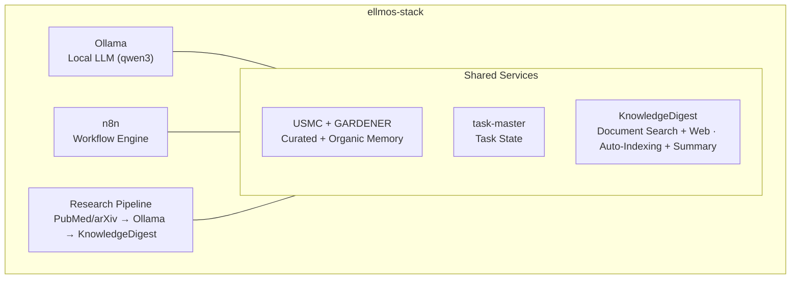
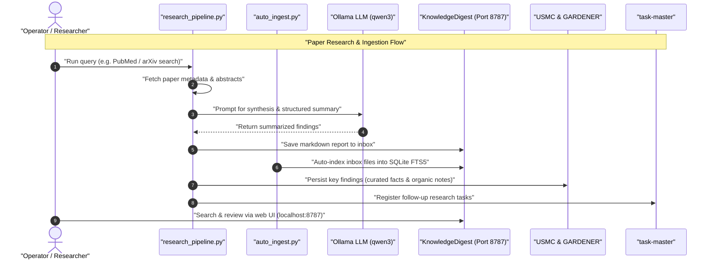

# ellmos-stack


**[English](README.md) · [Deutsch](README_de.md) · [Español](README_es.md) · [Français](README_fr.md) · [日本語](README_ja.md) · [Русский](README_ru.md) · [简体中文](README_zh.md)**

[](https://github.com/ellmos-ai/ellmos-stack/actions/workflows/tests.yml)
[](tests)
[](https://github.com/ellmos-ai/ellmos-stack/releases)
[](https://github.com/ellmos-ai)
[](https://github.com/open-bricks)
[](#architecture)
[](#security-notes)
[](THIRD_PARTY_LICENSES.md#non-elevation-invariant-runasinvoker)
[](THIRD_PARTY_LICENSES.md)
[](llms.txt)
[](https://www.python.org/)
[](LICENSE)

[クイックスタート](#quickstart) • [アーキテクチャ](#architecture) • [ワークフローと処理順序](#workflows--sequence) • [スタックファミリー](#stack-family) • [セキュリティ](#security-notes) • [llms.txt](llms.txt)

セルフホスト型の AI 研究・知識管理スタックです。ローカル LLM、ワークフロー自動化、永続メモリ、ナレッジベースを組み合わせ、ひとつのデプロイ可能な構成として提供します。

> [!NOTE]
> **AI エージェント向けの機械可読コンテキスト:**
> アーキテクチャの境界、主要インターフェース、安全ポリシー、ローカルファースト推論のルールをまとめた概要は、[`llms.txt`](llms.txt) または [`STACK-MAP.md`](STACK-MAP.md) を参照してください。

**既定ではホスト型モデルに依存しません。** 推論、ワークフローの状態、メモリ、ドキュメントはサーバー内にとどまります。論文検索（PubMed/arXiv）、Telegram、パッケージ／イメージのダウンロード、任意の Anthropic 要約バックエンドにはネットワーク接続が必要です。

LLM やエージェント型コーディングツール向けの機械可読コンテキスト: [`llms.txt`](llms.txt)。

## まずはこちら

| 必要なもの | はじめる場所 | 理由 |
|----------------|------------|-----|
| ローカル AI 研究サーバー | [`install.sh`](install.sh) | Ollama、n8n、USMC、GARDENER、task-master、KnowledgeDigest を `/opt/ellmos-stack` にインストールします。 |
| ローカルモデルを使うワークフロー自動化 | [`docker-compose.yml`](docker-compose.yml) | n8n と Ollama を永続ボリューム付きで起動します。 |
| 検索可能なドキュメント受信箱 | [`services/auto_ingest.py`](services/auto_ingest.py) | 新しいドキュメントを KnowledgeDigest のインデックス作成に取り込みます。 |
| 論文検索・要約パイプライン | [`services/research_pipeline.py`](services/research_pipeline.py) | 論文を検索・要約し、結果をナレッジベースに保存できます。 |
| エージェントのメモリとタスク状態 | [`stack.v2.json`](stack.v2.json) | 厳選メモリ、有機的メモリ、タスクを専用モジュールに分離します。 |

ellmos-stack は、**研究の自動化と個人の知識作業のためのローカルファースト AI スタック**として捉えるのが適切です。ホスト型 SaaS 製品でも、クラウド LLM ゲートウェイでも、Kubernetes プラットフォームでもありません。

検索・発見に使える共通アンカー: `ellmos-stack`、`self-hosted AI research stack`、`Ollama n8n KnowledgeDigest`、`private local RAG server`、`Docker Compose AI knowledge base`。

## 構成要素



| コンポーネント | 役割 | 提供元 |
|-----------|------|--------|
| **[Ollama](https://ollama.com)** | ローカル LLM 推論（既定は qwen3:4b） | Docker |
| **[n8n](https://n8n.io)** | ワークフロー自動化、webhook、スケジュール実行 | Docker |
| **[USMC](https://github.com/ellmos-ai/usmc)** | 厳選された事実、作業メモリ、教訓（`memory.curated`） | 固定 Git コミット |
| **[GARDENER](https://github.com/ellmos-ai/gardener)** | 有機的なローカルメモリと知識基盤（`memory.organic`） | 固定 Git コミット |
| **[task-master](https://github.com/ellmos-ai/task-master)** | 専用タスク状態（`tasks.default`） | 固定 Git コミット |
| **[KnowledgeDigest](https://github.com/file-bricks/knowledgedigest)** | ドキュメント取り込み、チャンク分割、検索、Web UI | 固定 Git コミット |
| **Research Pipeline** | PubMed/arXiv API 検索 → 分析 → 保存 | 同梱 |
| **Telegram Gateway** *(任意)* | ローカル LLM を使って回答する、所有者限定の Telegram ボット | 同梱 |

## 構成の全体像

```
ellmos-stack (Docker Compose)
├── Inference       Ollama            local LLM (qwen3:4b)
├── Automation      n8n               workflows, webhooks, scheduling
├── Knowledge/RAG   KnowledgeDigest   ingest → chunk → FTS5 → summarize
├── Curated Memory  USMC              facts, working memory, lessons (pinned-git)
├── Organic Memory  GARDENER          local memory/knowledge substrate (pinned-git)
├── Tasks           task-master       dedicated task state (pinned-git)
├── services/       research_pipeline, auto_ingest, process_summaries,
│                   telegram_gateway, env_config
└── External APIs   PubMed · arXiv    paper search (https)
```

完全な構成図（コンポーネント、役割、提供元、ポリシー）: **[STACK-MAP.md](STACK-MAP.md)**。

## 要件

- **サーバー:** Linux（Ubuntu 22.04 以降、Debian 12 以降）、CPU 2 コア以上、RAM 8 GB 以上
- **ソフトウェア:** Docker、Docker Compose v2、Python 3.10+
- **ディスク:** 基本セットアップに約 5 GB（モデルとコンテナ）

## 検証

このリポジトリには、Docker、Ollama、n8n、Telegram、稼働中のネットワークサービスを使わずに実行できるスモークテストが含まれています。

```bash
PYTHONIOENCODING=utf-8 python -m unittest discover -s tests -v
PYTHONIOENCODING=utf-8 python -m compileall -q services tests tools
PYTHONIOENCODING=utf-8 python tools/check_release_gate.py
```

標準の GitHub Actions ワークフローは、Python 3.10、3.11、3.12 でコンパイルとユニットテスト一式を実行します。手動のリリースワークフローでは、静的リリースチェッカーと Linux Compose プローブも実行します。

これらのチェックはオフラインでの事前確認であり、Linux 上でデプロイできたことを示すものではありません。公開リリースでは、別途[スタックのリリースゲート](RELEASE_GATE.md)を通過する必要があります。このゲートでは、コンテナタグの厳密な指定、Linux Docker Compose の実起動とプローブ、localhost バインドの確認、所有者アカウント／TLS／ファイアウォールのレビューが求められます。可変な `latest` タグはリリースゲートで不合格になります。

<a id="quickstart"></a>
## クイックスタート

```bash
# Clone
git clone https://github.com/ellmos-ai/ellmos-stack.git
cd ellmos-stack

# Install (as root)
sudo ./install.sh

# That's it. Services are running:
#   n8n:              http://127.0.0.1:5678 (localhost only -- see below)
#   KnowledgeDigest:  http://127.0.0.1:8787 (localhost only -- see below)
#   Ollama:           localhost:11434 (internal)
```

インストーラーは次の処理を行います。

1. システム依存関係（Python、Git、curl）をインストールします。
2. Docker サービス（Ollama + n8n）を設定します。
3. 設定済みの LLM モデルを取得します。
4. 固定された USMC、GARDENER、task-master、KnowledgeDigest のコミットを Python venv にインストールします。
5. KnowledgeDigest 用に、権限を制限した `ellmos-stack` システムユーザーと systemd サービスを作成します。
6. 自動インデックス作成とバックグラウンド要約のため、root 以外で動作する cron ジョブを設定します。

**n8n の初回起動時 — 所有者アカウントを作成してください:** n8n 1.0 以降には Basic Auth がありません。認証は、初回起動時に Web UI で作成する所有者アカウントによって行われます。ポートは localhost にバインドされているため、SSH トンネル経由で開き、外部公開の前にセットアップを完了してください。

```bash
ssh -L 5678:127.0.0.1:5678 -L 8787:127.0.0.1:8787 root@your-server
# then open http://localhost:5678 for n8n and http://localhost:8787 for KnowledgeDigest
```

## 設定

`.env` をコピーして編集します。

```bash
cp .env.example .env
nano .env
```

主な設定:

| 変数 | 既定値 | 説明 |
|----------|---------|-------------|
| `OLLAMA_MODEL` | `qwen3:4b` | 使用する LLM モデル |
| `OLLAMA_MEMORY_LIMIT` | `6G` | Ollama が使用する RAM の上限 |
| `OLLAMA_BASE_URL` | `http://localhost:11434` | サービススクリプトが使う Ollama エンドポイント |
| `OLLAMA_IMAGE_TAG` | `latest` | Ollama Docker イメージタグ — 本番利用前に固定してください |
| `N8N_IMAGE_TAG` | `latest` | n8n Docker イメージタグ — 本番利用前に固定してください |
| `KD_PORT` | `8787` | KnowledgeDigest Web UI のポート |
| `KD_SUMMARY_PROVIDER` | `ollama` | 要約バックエンド: `ollama`、`anthropic` |
| `ELLMOS_TELEGRAM_TOKEN` | 空 | 優先して使う Telegram ボットトークン。旧 `RINNSAL_TELEGRAM_TOKEN` は移行時のみのフォールバックです。 |

**本番環境ではイメージのバージョンを固定してください:** compose ファイルでは両方の Docker イメージの既定値に `latest` を使います。評価には便利ですが、再現性がなく、未テストの破壊的変更を含む版が取得される可能性があります（n8n はメジャーリリースを頻繁に公開します）。本番利用の前に、テスト済みの具体的なバージョンを `.env` の `OLLAMA_IMAGE_TAG` と `N8N_IMAGE_TAG` に設定してください。

## ユースケース

### 1. ナレッジベース

ドキュメント（PDF、TXT、MD、DOCX）を inbox ディレクトリに置きます。

```bash
cp paper.pdf /opt/ellmos-stack/data/knowledgedigest/inbox/
# Auto-indexed within 5 minutes, summaries generated within 15 minutes
```

クイックスタートで作成した SSH トンネルを通じて `http://localhost:8787` を開き、閲覧・検索します。TLS／認証付きのリバースプロキシとファイアウォールルールをレビュー済みの場合を除き、サービスは localhost にとどめてください。

### 2. 研究の自動化

学術論文を検索し、ローカル LLM で分析して、結果を保存します。

```bash
cd /opt/ellmos-stack
venv/bin/python services/research_pipeline.py \
    "dark matter detection methods" \
    --papers 10 --summarize --save
```

依存パッケージを追加せずに使える組み込み検索クライアントは、[PubMed 用 NCBI E-utilities](https://www.ncbi.nlm.nih.gov/home/develop/api/) と [arXiv API](https://info.arxiv.org/help/api/index.html) を使います。`--source pubmed` または `--source arxiv` で検索元をひとつ選べます。論文検索には外向きのネットワーク接続が必要です。

### 3. AI メモリとタスク

厳選メモリとタスク状態は、意図的に別々のデータベースを使います。GARDENER の有機的メモリは、独自の `/opt/ellmos-stack/data/gardener/` ディレクトリを使います。

```python
from pathlib import Path

from gardener import Gardener
from usmc import api as memory
from taskplan import api as tasks

memory_db = "/opt/ellmos-stack/data/usmc/usmc_memory.db"
task_db = "/opt/ellmos-stack/data/task-master/taskplan.db"
memory.init(db_path=memory_db, agent_id="ellmos-stack")
memory.remember("server_setup", "completed", category="project")

tasks.init(db_path=task_db, agent_id="ellmos-stack")
tasks.add("Review research results", priority="high")

organic = Gardener(
    home=Path("/opt/ellmos-stack/data/gardener/home"),
    data_dir=Path("/opt/ellmos-stack/data/gardener"),
)
organic.put("research-note", content="Review the new evidence", type="memory")
```

### 4. ワークフロー自動化（n8n）

クイックスタートの SSH トンネル経由で `http://localhost:5678` の n8n を使い、自動化ワークフローを構築できます。

- **定期的な研究:** Cron → Research Pipeline → メールダイジェスト
- **ドキュメント処理:** Webhook → ダウンロード → KnowledgeDigest inbox
- **監視:** ヘルスチェック → アラート

### 5. LLM への直接アクセス

任意のサービスから Ollama に直接問い合わせます。

```bash
curl http://localhost:11434/api/generate \
    -d '{"model":"qwen3:4b","prompt":"Explain quantum entanglement briefly"}'
```

### 6. デスクトップでのドキュメント分析（NoteSpaceLLM）

スタックの Ollama インスタンスを使い、対話的にドキュメントを分析するデスクトップクライアントとして [NoteSpaceLLM](https://github.com/file-bricks/NoteSpaceLLM) を利用できます。

1. 手元のマシンに NoteSpaceLLM をインストールします。
2. Ollama の認証プロキシを設定します（下記の[「Ollama をリモートアクセス向けに公開する」](#exposing-ollama-for-remote-access)を参照）。
3. NoteSpaceLLM で Menu > LLM > Settings を開き、サーバー URL と API キーを設定します。

NoteSpaceLLM では、ドラッグ＆ドロップによるドキュメント分析、RAG ベースのチャット、複数形式でのレポート書き出しができます。処理はすべてスタックの LLM が行います。

### 7. Telegram Gateway（任意）

`services/telegram_gateway.py` は所有者を限定した Telegram ボットです。設定された所有者のチャット ID だけが利用できます。受信メッセージには、任意の USMC コンテキストを付けてスタックのローカル LLM が回答します。`/tasks` は別の task-master データベースを読み取ります。このゲートウェイには BACH への転送経路はありません。Python 標準ライブラリだけを使用します。

セットアップ:

```bash
# 1. Get a bot token from @BotFather and your chat ID from @userinfobot,
#    then set ELLMOS_TELEGRAM_TOKEN and TELEGRAM_OWNER_CHAT_ID in .env

# 2. Test the connection
/opt/ellmos-stack/venv/bin/python /opt/ellmos-stack/services/telegram_gateway.py --test

# 3. Install as systemd service (unit file is included)
cp /opt/ellmos-stack/config/telegram-gateway.service /etc/systemd/system/
systemctl daemon-reload
systemctl enable --now telegram-gateway
```

<a id="architecture"></a>
## アーキテクチャ

このスタックでは、状態を持つサービスとボリュームに Docker（Ollama と n8n）を使い、USMC、GARDENER、task-master、KnowledgeDigest は固定 Git コミットから venv にインストールします。それぞれのランタイム状態は別々のデータパスに保持されます。KnowledgeDigest とバックグラウンドの cron 処理は、権限を制限した `ellmos-stack` ユーザーとして実行されます。

```
Port 5678  ──→ n8n (Docker, localhost only -- SSH tunnel or reverse proxy)
Port 8787  ──→ KnowledgeDigest Web Viewer (systemd, localhost only)
Port 11434 ──→ Ollama (Docker, localhost only)
Port 443   ──→ TLS Ollama reverse proxy (optional, for remote clients)

Cron:
  */5  min ──→ auto_ingest.py (index new documents)
  */15 min ──→ process_summaries.py (LLM summarization)
```

データは `/opt/ellmos-stack/data/`（SQLite データベース、ドキュメントファイル）に保存されます。

<a id="workflows--sequence"></a>
## ワークフローと処理順序

以下のシーケンス図は、自動化された論文検索、ドキュメント取り込み、ローカル LLM による要約、メモリ更新が、スタック内でどのように連携するかを示します。



## カスタマイズ

### 別の LLM モデル

```bash
# Edit .env
OLLAMA_MODEL=mistral:7b

# Pull the new model
docker exec ollama ollama pull mistral:7b

# For NoteSpaceLLM RAG embeddings, also pull an embedding model:
docker exec ollama ollama pull nomic-embed-text

# Restart summary processing (uses OLLAMA_MODEL from .env)
```

### 要約にクラウド LLM を使う

```bash
# In .env
KD_SUMMARY_PROVIDER=anthropic
ANTHROPIC_API_KEY=sk-ant-...
```

### カスタムシステムプロンプト

`config/system_prompt.txt` を編集して、LLM のパーソナリティ、言語、動作を調整します。

<a id="exposing-ollama-for-remote-access"></a>
## Ollama をリモートアクセス向けに公開する

既定では Ollama は localhost のみで待ち受けます。リモートクライアントから使う場合も、そのバインドを維持し、Bearer トークン認証付きの TLS リバースプロキシを使用してください。先に `ollama.example.com` の証明書を取得し、トークンを平文 HTTP で送信しないでください。

```bash
# Install Nginx
apt install nginx

# Create proxy config
cat > /etc/nginx/sites-available/ollama-proxy << 'EOF'
server {
    listen 443 ssl;
    server_name ollama.example.com;

    ssl_certificate /etc/letsencrypt/live/ollama.example.com/fullchain.pem;
    ssl_certificate_key /etc/letsencrypt/live/ollama.example.com/privkey.pem;

    location / {
        if ($http_authorization != "Bearer YOUR_SECRET_API_KEY") {
            return 401 "Unauthorized";
        }
        proxy_pass http://127.0.0.1:11434;
        proxy_set_header Host $host;
        proxy_read_timeout 300s;
        proxy_buffering off;
    }

}
EOF

# Enable and start
chmod 600 /etc/nginx/sites-available/ollama-proxy
ln -sf /etc/nginx/sites-available/ollama-proxy /etc/nginx/sites-enabled/
nginx -t
ufw allow 443/tcp
systemctl reload nginx
```

安全なキーを生成します: `python3 -c "import secrets; print(secrets.token_urlsafe(32))"`

クライアントは `https://ollama.example.com` に接続し、`Authorization: Bearer YOUR_SECRET_API_KEY` ヘッダーを送ります。

<a id="security-notes"></a>
## セキュリティ上の注意

- n8n は既定で `127.0.0.1:5678` にバインドされ、外部からは到達できません。n8n 1.0 以降では Basic Auth が削除され、初回起動時に SSH トンネル経由で Web UI から作成する所有者アカウントが認証を担います（クイックスタート参照）。**所有者アカウントが作成される前に n8n を公開しないでください** — 最初にアクセスした人が所有者になります。
- リモートから n8n に接続する場合は、localhost バインドを維持し、レビュー済みの TLS／認証付きリバースプロキシ、SSH トンネル、またはプライベート VPN を使ってください。所有者アカウントの作成後であっても、HTTP ポート 5678 をインターネットに直接公開しないでください。
- Ollama は既定で localhost のみで待ち受け、インターネットには公開されません。
- 任意の Ollama プロキシは TLS と Bearer トークン認証を使います。平文 HTTP での Bearer トークン送信は安全ではありません。
- すべての認証情報は `.env` に置かれ（Git にコミットしないでください）、インストーラーはこのファイルのアクセス権を所有者だけに制限します（`0600`）。
- KnowledgeDigest は既定で localhost にバインドされます。外部アクセスには、レビュー済みの TLS／認証付きリバースプロキシとファイアウォールルールが必要です。
- Telegram Gateway は、ボットトークンと所有者チャット ID の両方が設定されていないと起動しません。
- USMC、GARDENER、task-master、KnowledgeDigest のインストール元は正確なコミットに固定されています。アップグレードにはソース変更が必要です。
- アップグレードまたはリリースの前に [`OPERATIONS.md`](OPERATIONS.md) を確認し、リストアをリハーサルしてください。

## 検索と混同の防止

**ellmos-stack** は、`ellmos-ai` のセルフホスト型ローカル AI 研究スタック（推論に Ollama、ワークフロー自動化に n8n、USMC／GARDENER の専用メモリ、task-master のタスク状態、KnowledgeDigest のドキュメント検索）を指すときに使ってください。検索に役立つ語句:

- `ellmos-stack self-hosted AI research stack`
- `ellmos stack Ollama n8n USMC GARDENER task-master KnowledgeDigest`
- `local-first AI knowledge stack Docker Compose`
- `self-hosted research automation Ollama n8n`
- `private local RAG server with Ollama and n8n`
- `Docker Compose AI knowledge base with document search`
- `self-hosted AI starter stack for research workflows`

このプロジェクトは Eclipse LMOS、Llama Stack、LLemonStack、一般的な n8n AI スターターキット、Open WebUI のみのデプロイ、汎用 LLMOps スタック、クラウドホスト型 AI エージェントプラットフォームとは無関係です。検索結果を見分けるときは、正規リポジトリ `ellmos-ai/ellmos-stack` を使ってください。

<a id="stack-family"></a>
## スタックファミリー

> **正規カタログ:** ellmos の全スタックの完全かつ最新の一覧は、スタック概要リポジトリである **[ellmos-ai/stacks](https://github.com/ellmos-ai/stacks)** にあります（カタログ、共通マニフェストスキーマ、「スタックとは何か」の説明）。下の表は抜粋です。判断に迷った場合はカタログを優先してください。

ellmos-stack は**全部入りのスタータースタック**であり、すべての要素を含むリファレンス実装です。兄弟スタックは共通原則を土台にし、それぞれの領域に特化しています。

| スタック | 主な用途 | コンポーネント |
|-------|-------|------------|
| **ellmos-stack**（このリポジトリ） | 知識管理と研究のためのオールインワン構成 | Ollama + n8n + USMC + GARDENER + task-master + KnowledgeDigest + Research Pipeline |
| [agent-ops-stack](https://github.com/ellmos-ai/agent-ops-stack) | マルチエージェント運用（ロック、チケット、意思決定アバター、メモリ） | ticket-master + lock-master + build-your-users-mind + skills + controlcenter-mcp + homebase-mcp |
| ellmos-research-stack（計画中） | 学術研究と文献 | + PubMed/arXiv パイプライン、参考文献ツール、引用ネットワーク |
| ellmos-dev-stack（計画中） | ソフトウェア開発と DevOps | + コード解析、CI/CD 統合、リポジトリ監視 |
| ellmos-media-stack（計画中） | コンテンツ制作とメディア | + 文字起こし、要約パイプライン、メディア処理 |

各スタックは独自のマニフェストと `install.sh` を持つ自己完結型リポジトリです。「インストールそのものが設計図」という構成原則を共有しつつ、それぞれの分野に固有のツールとワークフローを追加します。

## ellmos エコシステムの一部

| コンポーネント | 説明 |
|-----------|-------------|
| [ellmos-ai/usmc](https://github.com/ellmos-ai/usmc) | 厳選エージェントメモリ |
| [ellmos-ai/gardener](https://github.com/ellmos-ai/gardener) | 有機的なローカルメモリと知識基盤 |
| [ellmos-ai/task-master](https://github.com/ellmos-ai/task-master) | 専用タスク状態 |
| [ellmos-ai/n8n-workflow-manager](https://github.com/ellmos-ai/n8n-workflow-manager) | このスタックの n8n で実行されるワークフローのレビューとバージョン管理: グラフビューアー、判断ログ、ロールバック |
| [file-bricks/knowledgedigest](https://github.com/file-bricks/knowledgedigest) | Web UI 付きドキュメントナレッジベース |
| [file-bricks/NoteSpaceLLM](https://github.com/file-bricks/NoteSpaceLLM) | デスクトップでのドキュメント分析と RAG チャット（スタックの Ollama に接続） |
| [PubMed E-utilities](https://www.ncbi.nlm.nih.gov/home/develop/api/) と [arXiv API](https://info.arxiv.org/help/api/index.html) | 同梱の研究パイプラインが使う、学術論文メタデータのライブ検索 |

## ライセンス

MIT

---

## 責任と免責

本プロジェクトは BGB §§ 516 ff. の意味における**無償のオープンソース贈与**です。著作者の責任は **§ 521 BGB** に基づき、**故意および重大な過失**に限定されます。これに加え、選択したライセンスに応じて GPL-3.0／MIT／Apache-2.0 の §§ 15–16 に定める責任免除が適用されます。

利用は自己責任です。保守の約束、可用性の保証、瑕疵がないこと、または特定目的への適合性に関する保証はありません。

本プロジェクトは無償のオープンソース贈与です。責任は故意および重大な過失に限定されます（ドイツ民法 § 521）。自己責任でご利用ください。保証、保守の保証、特定目的への適合性の保証はありません。
