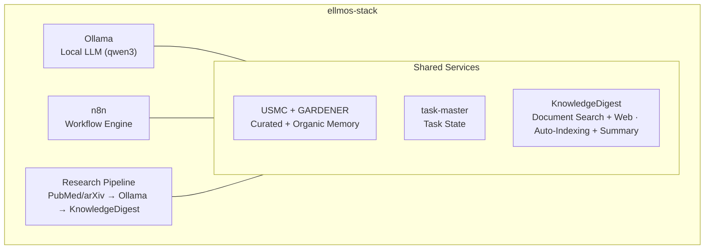
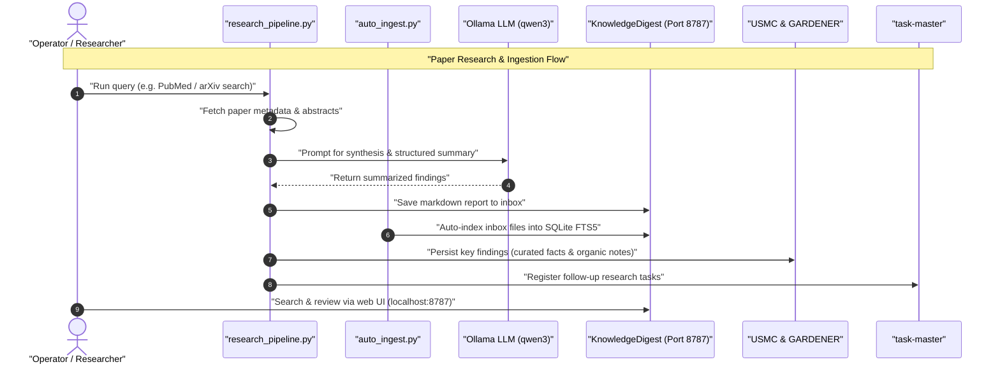

# ellmos-stack


**[English](README.md) · [Deutsch](README_de.md) · [Español](README_es.md) · [Français](README_fr.md) · [日本語](README_ja.md) · [Русский](README_ru.md) · [简体中文](README_zh.md) · [हिन्दी](README_hi.md) · [العربية](README_ar.md) · [বাংলা](README_bn.md) · [Português](README_pt.md)**

[](https://github.com/ellmos-ai/ellmos-stack/actions/workflows/tests.yml)
[](tests)
[](https://github.com/ellmos-ai/ellmos-stack/releases)
[](https://github.com/ellmos-ai)
[](https://github.com/open-bricks)
[](#architecture)
[](#security-notes)
[](THIRD_PARTY_LICENSES.md#non-elevation-invariant-runasinvoker)
[](THIRD_PARTY_LICENSES.md)
[](llms.txt)
[](https://www.python.org/)
[](LICENSE)

[Início rápido](#quickstart) • [Arquitetura](#architecture) • [Fluxos de trabalho e sequência](#workflows--sequence) • [Família de stacks](#stack-family) • [Segurança](#security-notes) • [llms.txt](llms.txt)

Uma stack de pesquisa com IA e gestão do conhecimento auto-hospedada. Ela combina um LLM local, automação de fluxos de trabalho, memória persistente e uma base de conhecimento em uma configuração que pode ser implantada.

> [!NOTE]
> **Contexto legível por máquina para agentes de IA:**
> Para uma visão geral indexada dos limites arquiteturais, das interfaces principais, das políticas de segurança e das regras de inferência local-first, consulte [`llms.txt`](llms.txt) ou [`STACK-MAP.md`](STACK-MAP.md).

**Sem dependência de modelo hospedado por padrão.** A inferência, o estado dos fluxos de trabalho, a memória e os documentos permanecem no seu servidor. A pesquisa de artigos (PubMed/arXiv), o Telegram, os downloads de pacotes e imagens e o backend opcional de resumos da Anthropic exigem acesso à rede.

Contexto legível por máquina para LLMs e ferramentas de programação agentiva: [`llms.txt`](llms.txt).

## Comece por aqui

| Se você precisa de... | Comece por | Motivo |
|----------------------|------------|--------|
| Um servidor local de pesquisa com IA | [`install.sh`](install.sh) | Instala Ollama, n8n, USMC, GARDENER, task-master e KnowledgeDigest em `/opt/ellmos-stack`. |
| Automação de fluxos de trabalho com um modelo local | [`docker-compose.yml`](docker-compose.yml) | Executa n8n e Ollama com volumes persistentes. |
| Uma caixa de entrada de documentos pesquisável | [`services/auto_ingest.py`](services/auto_ingest.py) | Encaminha novos documentos para indexação pelo KnowledgeDigest. |
| Pipelines de pesquisa e resumo de artigos | [`services/research_pipeline.py`](services/research_pipeline.py) | Pesquisa artigos, resume-os e pode salvar os resultados na base de conhecimento. |
| Memória de agentes e estado de tarefas | [`stack.v2.json`](stack.v2.json) | Separa memória selecionada, memória orgânica e tarefas em módulos especializados. |

A ellmos-stack é melhor entendida como uma **stack de IA local-first para automação de pesquisa e trabalho privado com conhecimento**. Não é um produto SaaS hospedado, um gateway de LLM na nuvem nem uma plataforma Kubernetes.

Âncoras de descoberta comuns: `ellmos-stack`, `self-hosted AI research stack`, `Ollama n8n KnowledgeDigest`, `private local RAG server` e `Docker Compose AI knowledge base`.

## O que inclui



| Componente | Função | Origem |
|-----------|--------|--------|
| **[Ollama](https://ollama.com)** | Inferência de LLM local (qwen3:4b por padrão) | Docker |
| **[n8n](https://n8n.io)** | Automação de fluxos de trabalho, webhooks e agendamento | Docker |
| **[USMC](https://github.com/ellmos-ai/usmc)** | Fatos selecionados, memória de trabalho e aprendizados (`memory.curated`) | Commit Git fixado |
| **[GARDENER](https://github.com/ellmos-ai/gardener)** | Memória local orgânica e base de conhecimento (`memory.organic`) | Commit Git fixado |
| **[task-master](https://github.com/ellmos-ai/task-master)** | Estado de tarefas dedicado (`tasks.default`) | Commit Git fixado |
| **[KnowledgeDigest](https://github.com/file-bricks/knowledgedigest)** | Ingestão e divisão de documentos em blocos, pesquisa e interface web | Commit Git fixado |
| **Pipeline de pesquisa** | Pesquisa por API em PubMed/arXiv → análise → armazenamento | Incluído |
| **Gateway do Telegram** *(opcional)* | Bot do Telegram com filtro por proprietário que responde usando o LLM local | Incluído |

## Composição em resumo

```
ellmos-stack (Docker Compose)
├── Inference       Ollama            local LLM (qwen3:4b)
├── Automation      n8n               workflows, webhooks, scheduling
├── Knowledge/RAG   KnowledgeDigest   ingest → chunk → FTS5 → summarize
├── Curated Memory  USMC              facts, working memory, lessons (pinned-git)
├── Organic Memory  GARDENER          local memory/knowledge substrate (pinned-git)
├── Tasks           task-master       dedicated task state (pinned-git)
├── services/       research_pipeline, auto_ingest, process_summaries,
│                   telegram_gateway, env_config
└── External APIs   PubMed · arXiv    paper search (https)
```

Projeto completo da composição — componentes, funções, origens e políticas: **[STACK-MAP.md](STACK-MAP.md)**.

## Requisitos

- **Servidor:** Linux (Ubuntu 22.04+, Debian 12+), 2 ou mais núcleos de CPU, 8 GB ou mais de RAM
- **Software:** Docker, Docker Compose v2, Python 3.10+
- **Disco:** cerca de 5 GB para a configuração básica (modelo + contêineres)

## Validação

O repositório inclui testes rápidos que são executados sem Docker, Ollama, n8n, Telegram ou serviços de rede ativos:

```bash
PYTHONIOENCODING=utf-8 python -m unittest discover -s tests -v
PYTHONIOENCODING=utf-8 python -m compileall -q services tests tools
PYTHONIOENCODING=utf-8 python tools/check_release_gate.py
```

O fluxo padrão do GitHub Actions executa a compilação e toda a suíte de testes com Python 3.10, 3.11 e 3.12. O fluxo manual de release também executa o verificador estático de release e sondagens do Compose no Linux.

Essas verificações são uma validação preliminar offline; elas não comprovam uma implantação no Linux. Releases públicos passam pelo [gate de release da stack](RELEASE_GATE.md), que exige tags exatas de contêiner, uma inicialização e sondagem reais do Docker Compose no Linux, verificações de vinculação ao localhost e uma revisão da conta do proprietário, do TLS e do firewall. Tags flutuantes `latest` não passam nesse gate de release.

<a id="quickstart"></a>
## Início rápido

```bash
# Clone
git clone https://github.com/ellmos-ai/ellmos-stack.git
cd ellmos-stack

# Install (as root)
sudo ./install.sh

# That's it. Services are running:
#   n8n:              http://127.0.0.1:5678 (localhost only -- see below)
#   KnowledgeDigest:  http://127.0.0.1:8787 (localhost only -- see below)
#   Ollama:           localhost:11434 (internal)
```

O instalador:
1. Instala dependências do sistema (Python, Git, curl)
2. Configura os serviços Docker (Ollama + n8n)
3. Baixa o modelo LLM configurado
4. Instala commits fixados de USMC, GARDENER, task-master e KnowledgeDigest em um ambiente virtual do Python
5. Cria o usuário de sistema restrito `ellmos-stack` e um serviço systemd para KnowledgeDigest
6. Configura tarefas cron sem privilégios de root para indexação automática e geração de resumos em segundo plano

**Primeira inicialização do n8n — crie a conta do proprietário:** n8n 1.0+ não tem Basic Auth. A autenticação é feita pela conta do proprietário, que você cria na interface web na primeira inicialização. Como a porta está vinculada ao localhost, abra a interface por um túnel SSH e conclua a configuração antes de expor qualquer serviço:

```bash
ssh -L 5678:127.0.0.1:5678 -L 8787:127.0.0.1:8787 root@your-server
# then open http://localhost:5678 for n8n and http://localhost:8787 for KnowledgeDigest
```

## Configuração

Copie e edite `.env`:

```bash
cp .env.example .env
nano .env
```

Configurações principais:

| Variável | Padrão | Descrição |
|----------|--------|-----------|
| `OLLAMA_MODEL` | `qwen3:4b` | Modelo LLM a usar |
| `OLLAMA_MEMORY_LIMIT` | `6G` | RAM máxima para Ollama |
| `OLLAMA_BASE_URL` | `http://localhost:11434` | Endpoint do Ollama usado pelos scripts de serviço |
| `OLLAMA_IMAGE_TAG` | `latest` | Tag da imagem Docker do Ollama — fixe-a antes de usar em produção |
| `N8N_IMAGE_TAG` | `latest` | Tag da imagem Docker do n8n — fixe-a antes de usar em produção |
| `KD_PORT` | `8787` | Porta da interface web do KnowledgeDigest |
| `KD_SUMMARY_PROVIDER` | `ollama` | Backend de resumo: `ollama`, `anthropic` |
| `ELLMOS_TELEGRAM_TOKEN` | vazio | Token preferencial do bot do Telegram; `RINNSAL_TELEGRAM_TOKEN`, o nome antigo, serve apenas como fallback de migração |

**Fixe as versões das imagens para produção:** o arquivo Compose usa `latest` como padrão para as duas imagens Docker. Isso é prático para avaliação, mas não é reproduzível e pode baixar alterações incompatíveis que não foram testadas (o n8n lança versões principais com frequência). Antes de usar em produção, defina `OLLAMA_IMAGE_TAG` e `N8N_IMAGE_TAG` em `.env` com as versões específicas que você testou.

## Casos de uso

### 1. Base de conhecimento

Coloque documentos (PDF, TXT, MD, DOCX) no diretório da caixa de entrada:

```bash
cp paper.pdf /opt/ellmos-stack/data/knowledgedigest/inbox/
# Auto-indexed within 5 minutes, summaries generated within 15 minutes
```

Consulte e pesquise em `http://localhost:8787` pelo túnel SSH descrito no início rápido. Mantenha o serviço no localhost, a menos que haja um proxy reverso com TLS/autenticação e uma regra de firewall revisados.

### 2. Automação de pesquisa

Pesquise artigos acadêmicos, analise-os com seu LLM local e armazene os resultados:

```bash
cd /opt/ellmos-stack
venv/bin/python services/research_pipeline.py \
    "dark matter detection methods" \
    --papers 10 --summarize --save
```

O cliente de pesquisa integrado e sem dependências, usa [NCBI E-utilities para PubMed](https://www.ncbi.nlm.nih.gov/home/develop/api/) e a [API do arXiv](https://info.arxiv.org/help/api/index.html). Selecione uma fonte com `--source pubmed` ou `--source arxiv`; a pesquisa de artigos exige acesso de saída à rede.

### 3. Memória e tarefas de IA

A memória selecionada e o estado das tarefas usam bancos de dados diferentes intencionalmente. A memória orgânica do GARDENER usa seu próprio diretório `/opt/ellmos-stack/data/gardener/`.

```python
from pathlib import Path

from gardener import Gardener
from usmc import api as memory
from taskplan import api as tasks

memory_db = "/opt/ellmos-stack/data/usmc/usmc_memory.db"
task_db = "/opt/ellmos-stack/data/task-master/taskplan.db"
memory.init(db_path=memory_db, agent_id="ellmos-stack")
memory.remember("server_setup", "completed", category="project")

tasks.init(db_path=task_db, agent_id="ellmos-stack")
tasks.add("Review research results", priority="high")

organic = Gardener(
    home=Path("/opt/ellmos-stack/data/gardener/home"),
    data_dir=Path("/opt/ellmos-stack/data/gardener"),
)
organic.put("research-note", content="Review the new evidence", type="memory")
```

### 4. Automação de fluxos de trabalho (n8n)

Crie fluxos de trabalho automatizados com n8n em `http://localhost:5678` (pelo túnel SSH; consulte o início rápido):

- **Pesquisa agendada:** Cron → Pipeline de pesquisa → Resumo por e-mail
- **Processamento de documentos:** Webhook → Download → Caixa de entrada do KnowledgeDigest
- **Monitoramento:** Verificações de integridade → Alertas

### 5. Acesso direto ao LLM

Consulte o Ollama diretamente de qualquer serviço:

```bash
curl http://localhost:11434/api/generate \
    -d '{"model":"qwen3:4b","prompt":"Explain quantum entanglement briefly"}'
```

### 6. Análise de documentos no desktop (NoteSpaceLLM)

Use o [NoteSpaceLLM](https://github.com/file-bricks/NoteSpaceLLM) como cliente de desktop para análise interativa de documentos, com tecnologia da instância de Ollama da stack:

1. Instale o NoteSpaceLLM na sua máquina local
2. Configure um proxy de autenticação do Ollama (consulte [Expondo o Ollama](#exposing-ollama-for-remote-access) abaixo)
3. No NoteSpaceLLM: Menu > LLM > Settings > defina a URL do servidor e a chave de API

O NoteSpaceLLM oferece análise de documentos por arrastar e soltar, chat com base em RAG e exportação de relatórios em vários formatos — tudo processado pelo LLM da stack.

### 7. Gateway do Telegram (opcional)

`services/telegram_gateway.py` é um bot do Telegram que filtra por proprietário: somente o ID de chat do proprietário configurado pode interagir com ele. As mensagens recebidas são respondidas pelo LLM local da stack, com contexto opcional do USMC; `/tasks` lê o banco de dados separado do task-master. O gateway não tem um caminho de encaminhamento para o BACH. Ele usa apenas a biblioteca padrão do Python.

Configuração:

```bash
# 1. Get a bot token from @BotFather and your chat ID from @userinfobot,
#    then set ELLMOS_TELEGRAM_TOKEN and TELEGRAM_OWNER_CHAT_ID in .env

# 2. Test the connection
/opt/ellmos-stack/venv/bin/python /opt/ellmos-stack/services/telegram_gateway.py --test

# 3. Install as systemd service (unit file is included)
cp /opt/ellmos-stack/config/telegram-gateway.service /etc/systemd/system/
systemctl daemon-reload
systemctl enable --now telegram-gateway
```

<a id="architecture"></a>
## Arquitetura

A stack usa **Docker** para Ollama e n8n (serviços com estado e volumes) e instala USMC, GARDENER, task-master e KnowledgeDigest a partir de commits Git fixados em um ambiente virtual. O estado de execução de cada um permanece em caminhos de dados separados. KnowledgeDigest e o processamento cron em segundo plano são executados como o usuário restrito `ellmos-stack`.

```
Port 5678  ──→ n8n (Docker, localhost only -- SSH tunnel or reverse proxy)
Port 8787  ──→ KnowledgeDigest Web Viewer (systemd, localhost only)
Port 11434 ──→ Ollama (Docker, localhost only)
Port 443   ──→ TLS Ollama reverse proxy (optional, for remote clients)

Cron:
  */5  min ──→ auto_ingest.py (index new documents)
  */15 min ──→ process_summaries.py (LLM summarization)
```

Os dados são armazenados em `/opt/ellmos-stack/data/` (bancos de dados SQLite e arquivos de documentos).

<a id="workflows--sequence"></a>
## Fluxos de trabalho e sequência

O diagrama de sequência abaixo detalha como as consultas automatizadas de artigos, a ingestão de documentos, a geração de resumos com LLM local e as atualizações de memória se coordenam na stack:



## Personalização

### Um modelo LLM diferente

```bash
# Edit .env
OLLAMA_MODEL=mistral:7b

# Pull the new model
docker exec ollama ollama pull mistral:7b

# For NoteSpaceLLM RAG embeddings, also pull an embedding model:
docker exec ollama ollama pull nomic-embed-text

# Restart summary processing (uses OLLAMA_MODEL from .env)
```

### LLM na nuvem para resumos

```bash
# In .env
KD_SUMMARY_PROVIDER=anthropic
ANTHROPIC_API_KEY=sk-ant-...
```

### Prompt de sistema personalizado

Edite `config/system_prompt.txt` para ajustar a personalidade, o idioma e o comportamento do LLM.

<a id="exposing-ollama-for-remote-access"></a>
## Expondo o Ollama para acesso remoto

Por padrão, o Ollama escuta apenas no localhost. Para clientes remotos, mantenha essa vinculação e use um proxy reverso TLS com um token bearer. Primeiro obtenha um certificado para `ollama.example.com`; nunca envie o token por HTTP sem criptografia.

```bash
# Install Nginx
apt install nginx

# Create proxy config
cat > /etc/nginx/sites-available/ollama-proxy << 'EOF'
server {
    listen 443 ssl;
    server_name ollama.example.com;

    ssl_certificate /etc/letsencrypt/live/ollama.example.com/fullchain.pem;
    ssl_certificate_key /etc/letsencrypt/live/ollama.example.com/privkey.pem;

    location / {
        if ($http_authorization != "Bearer YOUR_SECRET_API_KEY") {
            return 401 "Unauthorized";
        }
        proxy_pass http://127.0.0.1:11434;
        proxy_set_header Host $host;
        proxy_read_timeout 300s;
        proxy_buffering off;
    }

}
EOF

# Enable and start
chmod 600 /etc/nginx/sites-available/ollama-proxy
ln -sf /etc/nginx/sites-available/ollama-proxy /etc/nginx/sites-enabled/
nginx -t
ufw allow 443/tcp
systemctl reload nginx
```

Gere uma chave segura: `python3 -c "import secrets; print(secrets.token_urlsafe(32))"`

Os clientes se conectam então a `https://ollama.example.com` com o cabeçalho `Authorization: Bearer YOUR_SECRET_API_KEY`.

<a id="security-notes"></a>
## Notas de segurança

- Por padrão, o n8n está vinculado a `127.0.0.1:5678` e **não** pode ser acessado de fora. O n8n 1.0+ removeu o Basic Auth; a autenticação é feita pela conta do proprietário do n8n, que você precisa criar na interface web na primeira inicialização (pelo túnel SSH; consulte o início rápido). **Nunca exponha uma instância do n8n antes de existir uma conta do proprietário** — o primeiro visitante se tornaria o proprietário.
- Para acesso remoto ao n8n, mantenha a vinculação ao localhost e use um proxy reverso com TLS/autenticação revisados, um túnel SSH ou uma VPN privada. Nunca exponha a porta HTTP bruta 5678 à internet pública, mesmo depois que a conta do proprietário existir.
- Por padrão, o Ollama escuta somente no localhost (não fica exposto à internet).
- O proxy opcional do Ollama usa TLS e autenticação por token bearer; um token bearer enviado por HTTP sem criptografia não é seguro.
- Todas as credenciais ficam em `.env` (nunca são enviadas ao Git); o instalador restringe o acesso a esse arquivo ao proprietário (`0600`).
- Por padrão, o KnowledgeDigest fica vinculado ao localhost; o acesso externo exige um proxy reverso com TLS/autenticação e uma regra de firewall revisados.
- O gateway do Telegram se recusa a iniciar se o token do bot e o ID de chat do proprietário não estiverem configurados.
- As entradas de instalação do USMC, GARDENER, task-master e KnowledgeDigest estão fixadas em commits exatos; as atualizações exigem alterações explícitas no código-fonte.
- Consulte [`OPERATIONS.md`](OPERATIONS.md) e ensaie a restauração antes de uma atualização ou release.

## Pesquisa e desambiguação

Use **ellmos-stack** quando você estiver se referindo à stack local e auto-hospedada de pesquisa com IA da `ellmos-ai`: Ollama para inferência, n8n para automação de fluxos de trabalho, memória especializada do USMC/GARDENER, estado de tarefas do task-master e pesquisa de documentos no KnowledgeDigest. Frases úteis para pesquisa incluem:

- `ellmos-stack self-hosted AI research stack`
- `ellmos stack Ollama n8n USMC GARDENER task-master KnowledgeDigest`
- `local-first AI knowledge stack Docker Compose`
- `self-hosted research automation Ollama n8n`
- `private local RAG server with Ollama and n8n`
- `Docker Compose AI knowledge base with document search`
- `self-hosted AI starter stack for research workflows`

O projeto não tem relação com Eclipse LMOS, Llama Stack, LLemonStack, kits genéricos de início rápido de IA para n8n, implantações que usam apenas Open WebUI, stacks gerais de LLMOps ou plataformas de agentes de IA hospedadas na nuvem. Use o caminho canônico do repositório `ellmos-ai/ellmos-stack` para desambiguar resultados de pesquisa.

<a id="stack-family"></a>
## Família de stacks

> **Catálogo canônico:** a lista completa e atualizada de todas as stacks ellmos está em
> **[ellmos-ai/stacks](https://github.com/ellmos-ai/stacks)** — o repositório de visão geral das stacks
> (catálogo, esquema de manifesto compartilhado e documentação sobre o que é uma stack). A tabela abaixo é um
> trecho de conveniência; em caso de dúvida, o catálogo prevalece.

A ellmos-stack é a **stack inicial completa** — a implementação de referência que inclui tudo. As stacks relacionadas seguem princípios compartilhados, com foco em domínios específicos:

| Stack | Foco | Componentes |
|-------|------|-------------|
| **ellmos-stack** (este repositório) | Conhecimento e pesquisa, tudo em um | Ollama + n8n + USMC + GARDENER + task-master + KnowledgeDigest + Pipeline de pesquisa |
| [agent-ops-stack](https://github.com/ellmos-ai/agent-ops-stack) | Operações multiagente (bloqueios, chamados, avatar de decisão, memória) | ticket-master + lock-master + build-your-users-mind + skills + controlcenter-mcp + homebase-mcp |
| ellmos-research-stack (planejada) | Pesquisa acadêmica e literatura | + pipelines PubMed/arXiv, ferramentas bibliográficas, redes de citações |
| ellmos-dev-stack (planejada) | Desenvolvimento de software e DevOps | + análise de código, integração CI/CD, monitoramento de repositórios |
| ellmos-media-stack (planejada) | Criação de conteúdo e mídia | + transcrição, pipelines de resumo, processamento de mídia |

Cada stack é um repositório autossuficiente com seu próprio manifesto e `install.sh`. Elas compartilham o princípio de composição («a instalação É o projeto»), mas acrescentam ferramentas e fluxos de trabalho específicos de cada domínio.

## Parte do ecossistema ellmos

| Componente | Descrição |
|-----------|-----------|
| [ellmos-ai/usmc](https://github.com/ellmos-ai/usmc) | Memória selecionada de agentes |
| [ellmos-ai/gardener](https://github.com/ellmos-ai/gardener) | Memória local orgânica e base de conhecimento |
| [ellmos-ai/task-master](https://github.com/ellmos-ai/task-master) | Estado de tarefas dedicado |
| [ellmos-ai/n8n-workflow-manager](https://github.com/ellmos-ai/n8n-workflow-manager) | Revisa e controla versões dos fluxos de trabalho executados no n8n desta stack: visualizador de grafos, registro de decisões e reversão |
| [file-bricks/knowledgedigest](https://github.com/file-bricks/knowledgedigest) | Base de conhecimento de documentos com interface web |
| [file-bricks/NoteSpaceLLM](https://github.com/file-bricks/NoteSpaceLLM) | Análise de documentos no desktop e chat com RAG (conecta-se ao Ollama da stack) |
| [PubMed E-utilities](https://www.ncbi.nlm.nih.gov/home/develop/api/) e [API do arXiv](https://info.arxiv.org/help/api/index.html) | Pesquisa ao vivo de metadados de artigos acadêmicos usada pelo pipeline de pesquisa incluído |

## Licença

MIT

---

## Responsabilidade / Limitação de responsabilidade

Este projeto é uma **doação gratuita de código aberto** nos termos dos §§ 516 e seguintes do BGB. A responsabilidade do autor, conforme o **§ 521 BGB**, limita-se a **dolo e negligência grave**. Além disso, aplicam-se as exclusões de responsabilidade das licenças GPL-3.0 / MIT / Apache-2.0, §§ 15–16 (conforme a licença escolhida).

Uso por sua conta e risco. Não há compromisso de manutenção, garantia de disponibilidade nem garantia de ausência de erros ou de adequação a uma finalidade específica.

Este projeto é uma doação gratuita de código aberto. A responsabilidade limita-se a dolo e negligência grave (§ 521 do Código Civil alemão). Use por sua conta e risco. Não há garantia, compromisso de manutenção nem presunção de adequação a uma finalidade específica.
