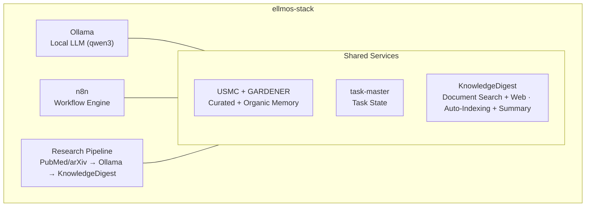
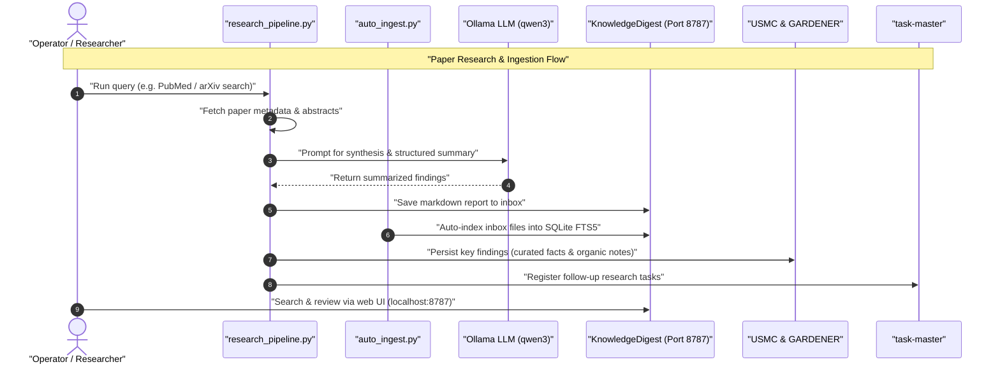

# ellmos-stack


**[English](README.md) · [Deutsch](README_de.md) · [Español](README_es.md) · [Français](README_fr.md) · [日本語](README_ja.md) · [Русский](README_ru.md)**

[](https://github.com/ellmos-ai/ellmos-stack/actions/workflows/tests.yml)
[](tests)
[](https://github.com/ellmos-ai/ellmos-stack/releases)
[](https://github.com/ellmos-ai)
[](https://github.com/open-bricks)
[](#architecture)
[](#security-notes)
[](THIRD_PARTY_LICENSES.md#non-elevation-invariant-runasinvoker)
[](THIRD_PARTY_LICENSES.md)
[](llms.txt)
[](https://www.python.org/)
[](LICENSE)

[Быстрый старт](#quickstart) • [Архитектура](#architecture) • [Рабочие процессы и последовательность](#workflows--sequence) • [Семейство стеков](#stack-family) • [Безопасность](#security-notes) • [llms.txt](llms.txt)

Самостоятельно размещаемый стек для исследований с ИИ и управления знаниями. Он объединяет локальную большую языковую модель, автоматизацию рабочих процессов, постоянную память и базу знаний в единое развертываемое решение.

> [!NOTE]
> **Контекст для ИИ-агентов в машиночитаемом виде:**
> Для обзора архитектурных границ, основных интерфейсов, правил безопасности и принципов локальной обработки см. [`llms.txt`](llms.txt) или [`STACK-MAP.md`](STACK-MAP.md).

**По умолчанию облачная модель не требуется.** Инференс, состояние рабочих процессов, память и документы остаются на вашем сервере. Для поиска статей (PubMed/arXiv), Telegram, загрузки пакетов и образов, а также необязательного бэкенда сводок Anthropic нужен сетевой доступ.

Машиночитаемый контекст для LLM и агентных инструментов разработки: [`llms.txt`](llms.txt).

## Начните здесь

| Если вам нужно... | Начните с | Зачем |
|------------------|-----------|-------|
| Локальный сервер для ИИ-исследований | [`install.sh`](install.sh) | Устанавливает Ollama, n8n, USMC, GARDENER, task-master и KnowledgeDigest в каталог `/opt/ellmos-stack`. |
| Автоматизация рабочих процессов с локальной моделью | [`docker-compose.yml`](docker-compose.yml) | Запускает n8n и Ollama с постоянными томами. |
| Поисковый архив входящих документов | [`services/auto_ingest.py`](services/auto_ingest.py) | Передаёт новые файлы в систему индексирования KnowledgeDigest. |
| Конвейеры поиска и краткого изложения статей | [`services/research_pipeline.py`](services/research_pipeline.py) | Ищет статьи, готовит сводки и может сохранять их в базе знаний. |
| Память агента и состояние задач | [`stack.v2.json`](stack.v2.json) | Разделяет курируемую память, органическую память и задачи по специализированным модулям. |

ellmos-stack лучше всего понимать как **локальный ИИ-стек для автоматизации исследований и приватной работы со знаниями**. Это не размещённый SaaS-сервис, не облачный шлюз для LLM и не платформа Kubernetes.

Основные ориентиры для поиска: `ellmos-stack`, `self-hosted AI research stack`, `Ollama n8n KnowledgeDigest`, `private local RAG server` и `Docker Compose AI knowledge base`.

## Что входит в состав



| Компонент | Назначение | Источник |
|-----------|------------|----------|
| **[Ollama](https://ollama.com)** | Локальный инференс LLM (по умолчанию qwen3:4b) | Docker |
| **[n8n](https://n8n.io)** | Автоматизация рабочих процессов, вебхуки и расписания | Docker |
| **[USMC](https://github.com/ellmos-ai/usmc)** | Курируемые факты, рабочая память и извлечённые уроки (`memory.curated`) | Закреплённый коммит Git |
| **[GARDENER](https://github.com/ellmos-ai/gardener)** | Органическая локальная память и база знаний (`memory.organic`) | Закреплённый коммит Git |
| **[task-master](https://github.com/ellmos-ai/task-master)** | Выделенное состояние задач (`tasks.default`) | Закреплённый коммит Git |
| **[KnowledgeDigest](https://github.com/file-bricks/knowledgedigest)** | Приём документов, разбиение на фрагменты, поиск и веб-интерфейс | Закреплённый коммит Git |
| Research Pipeline | Поиск через API PubMed/arXiv → анализ → сохранение | Включено в состав |
| Telegram Gateway *(необязательно)* | Telegram-бот с фильтром по владельцу, отвечающий через локальную LLM | Включено в состав |

## Состав кратко

```
ellmos-stack (Docker Compose)
├── Inference       Ollama            local LLM (qwen3:4b)
├── Automation      n8n               workflows, webhooks, scheduling
├── Knowledge/RAG   KnowledgeDigest   ingest → chunk → FTS5 → summarize
├── Curated Memory  USMC              facts, working memory, lessons (pinned-git)
├── Organic Memory  GARDENER          local memory/knowledge substrate (pinned-git)
├── Tasks           task-master       dedicated task state (pinned-git)
├── services/       research_pipeline, auto_ingest, process_summaries,
│                   telegram_gateway, env_config
└── External APIs   PubMed · arXiv    paper search (https)
```

Полная схема композиции — компоненты, роли, источники и правила: **[STACK-MAP.md](STACK-MAP.md)**.

## Требования

- **Сервер:** Linux (Ubuntu 22.04+, Debian 12+), не менее 2 ядер CPU и 8 ГБ ОЗУ
- **Программное обеспечение:** Docker, Docker Compose v2, Python 3.10+
- **Диск:** около 5 ГБ для базовой установки (модель и контейнеры)

## Проверка

В репозитории есть smoke-тесты, которые выполняются без Docker, Ollama, n8n, Telegram и сетевых сервисов:

```bash
PYTHONIOENCODING=utf-8 python -m unittest discover -s tests -v
PYTHONIOENCODING=utf-8 python -m compileall -q services tests tools
PYTHONIOENCODING=utf-8 python tools/check_release_gate.py
```

Стандартный рабочий процесс GitHub Actions запускает компиляцию и полный набор модульных тестов на Python 3.10, 3.11 и 3.12. Ручной рабочий процесс выпуска дополнительно запускает статический проверщик выпуска и проверки Docker Compose в Linux.

Эти проверки — предварительный офлайн-контроль, а не подтверждение развёртывания в Linux. Для публичных выпусков действует отдельный [контроль выпуска стека](RELEASE_GATE.md): точные теги контейнеров, реальный запуск и проверка Docker Compose в Linux, проверки привязки к localhost и проверка учётной записи владельца, TLS и межсетевого экрана. Плавающие теги `latest` не проходят этот контроль.

<a id="quickstart"></a>
## Быстрый старт

```bash
# Clone
git clone https://github.com/ellmos-ai/ellmos-stack.git
cd ellmos-stack

# Install (as root)
sudo ./install.sh

# That's it. Services are running:
#   n8n:              http://127.0.0.1:5678 (localhost only -- see below)
#   KnowledgeDigest:  http://127.0.0.1:8787 (localhost only -- see below)
#   Ollama:           localhost:11434 (internal)
```

Установщик:
1. Устанавливает системные зависимости (Python, Git, curl)
2. Настраивает службы Docker (Ollama и n8n)
3. Загружает выбранную модель LLM
4. Устанавливает закреплённые коммиты USMC, GARDENER, task-master и KnowledgeDigest в виртуальное окружение Python
5. Создаёт ограниченную системную учётную запись `ellmos-stack` и службу systemd для KnowledgeDigest
6. Настраивает задания cron без прав root для автоматической индексации и фонового создания сводок

**Первый запуск n8n — создайте учётную запись владельца:** в n8n 1.0+ больше нет Basic Auth. Аутентификацией управляет учётная запись владельца, которую вы создадите в веб-интерфейсе при первом запуске. Поскольку порт привязан к localhost, откройте интерфейс через SSH-туннель и завершите настройку до того, как разрешить внешний доступ:

```bash
ssh -L 5678:127.0.0.1:5678 -L 8787:127.0.0.1:8787 root@your-server
# then open http://localhost:5678 for n8n and http://localhost:8787 for KnowledgeDigest
```

## Настройка

Скопируйте и отредактируйте `.env`:

```bash
cp .env.example .env
nano .env
```

Основные параметры:

| Переменная | Значение по умолчанию | Описание |
|------------|-----------------------|----------|
| `OLLAMA_MODEL` | `qwen3:4b` | Модель LLM для использования |
| `OLLAMA_MEMORY_LIMIT` | `6G` | Максимальный объём памяти ОЗУ для Ollama |
| `OLLAMA_BASE_URL` | `http://localhost:11434` | Адрес Ollama, который используют сервисные скрипты |
| `OLLAMA_IMAGE_TAG` | `latest` | Тег Docker-образа Ollama — закрепите версию перед использованием в рабочей среде |
| `N8N_IMAGE_TAG` | `latest` | Тег Docker-образа n8n — закрепите версию перед использованием в рабочей среде |
| `KD_PORT` | `8787` | Порт веб-интерфейса KnowledgeDigest |
| `KD_SUMMARY_PROVIDER` | `ollama` | Бэкенд сводок: `ollama`, `anthropic` |
| `ELLMOS_TELEGRAM_TOKEN` | пусто | Предпочтительный токен Telegram-бота; старый `RINNSAL_TELEGRAM_TOKEN` остаётся только запасным вариантом для миграции |

**Закрепляйте версии образов для промышленной эксплуатации:** по умолчанию файл Compose использует для обоих Docker-образов тег `latest`. Это удобно для оценки, но не обеспечивает воспроизводимость и может загрузить непроверенные критические изменения (n8n регулярно выпускает новые основные версии). Перед запуском в рабочей среде задайте проверенные значения `OLLAMA_IMAGE_TAG` и `N8N_IMAGE_TAG` в файле `.env`.

## Сценарии использования

### 1. База знаний

Поместите документы (PDF, TXT, MD, DOCX) во входной каталог:

```bash
cp paper.pdf /opt/ellmos-stack/data/knowledgedigest/inbox/
# Auto-indexed within 5 minutes, summaries generated within 15 minutes
```

Просматривайте и ищите документы по адресу `http://localhost:8787` через SSH-туннель из раздела «Быстрый старт». Оставляйте службу доступной только через localhost, если не настроены проверенные обратный прокси с TLS и аутентификацией и правило межсетевого экрана.

### 2. Автоматизация исследований

Ищите научные статьи, анализируйте их с помощью локальной LLM и сохраняйте результаты:

```bash
cd /opt/ellmos-stack
venv/bin/python services/research_pipeline.py \
    "dark matter detection methods" \
    --papers 10 --summarize --save
```

Встроенный поисковый клиент без внешних зависимостей использует [NCBI E-utilities для PubMed](https://www.ncbi.nlm.nih.gov/home/develop/api/) и [API arXiv](https://info.arxiv.org/help/api/index.html). Выберите источник с помощью `--source pubmed` или `--source arxiv`; для поиска статей нужен исходящий сетевой доступ.

### 3. Память ИИ и задачи

Курируемая память и состояние задач намеренно хранятся в разных базах данных. Органическая
память GARDENER использует собственный каталог `/opt/ellmos-stack/data/gardener/`.

```python
from pathlib import Path

from gardener import Gardener
from usmc import api as memory
from taskplan import api as tasks

memory_db = "/opt/ellmos-stack/data/usmc/usmc_memory.db"
task_db = "/opt/ellmos-stack/data/task-master/taskplan.db"
memory.init(db_path=memory_db, agent_id="ellmos-stack")
memory.remember("server_setup", "completed", category="project")

tasks.init(db_path=task_db, agent_id="ellmos-stack")
tasks.add("Review research results", priority="high")

organic = Gardener(
    home=Path("/opt/ellmos-stack/data/gardener/home"),
    data_dir=Path("/opt/ellmos-stack/data/gardener"),
)
organic.put("research-note", content="Review the new evidence", type="memory")
```

### 4. Автоматизация рабочих процессов (n8n)

Создавайте автоматизированные процессы в n8n по адресу `http://localhost:5678` (через SSH-туннель, см. раздел «Быстрый старт»):

- **Запланированные исследования:** Cron → Research Pipeline → дайджест электронной почты
- **Обработка документов:** Webhook → Download → входящий каталог KnowledgeDigest
- **Мониторинг:** проверки работоспособности → оповещения

### 5. Прямой доступ к LLM

Отправляйте запросы непосредственно в Ollama из любого сервиса:

```bash
curl http://localhost:11434/api/generate \
    -d '{"model":"qwen3:4b","prompt":"Explain quantum entanglement briefly"}'
```

### 6. Анализ документов на настольном компьютере (NoteSpaceLLM)

Используйте [NoteSpaceLLM](https://github.com/file-bricks/NoteSpaceLLM) как настольный клиент для интерактивного анализа документов на базе экземпляра Ollama из этого стека:

1. Установите NoteSpaceLLM на свой компьютер
2. Настройте прокси Ollama с аутентификацией (см. раздел [«Открытый удалённый доступ к Ollama»](#exposing-ollama-for-remote-access) ниже)
3. В NoteSpaceLLM откройте: Menu > LLM > Settings > укажите URL сервера и API-ключ

NoteSpaceLLM поддерживает анализ документов перетаскиванием, чат на основе RAG и экспорт отчётов в нескольких форматах — всё это обрабатывает LLM стека.

### 7. Шлюз Telegram (необязательно)

`services/telegram_gateway.py` — это Telegram-бот с проверкой владельца: общаться с ним может только чат с настроенным идентификатором владельца. На входящие сообщения отвечает локальная LLM стека, при необходимости используя контекст USMC; команда `/tasks` читает отдельную базу данных task-master. У шлюза нет канала пересылки в BACH. Он использует только стандартную библиотеку Python.

Настройка:

```bash
# 1. Get a bot token from @BotFather and your chat ID from @userinfobot,
#    then set ELLMOS_TELEGRAM_TOKEN and TELEGRAM_OWNER_CHAT_ID in .env

# 2. Test the connection
/opt/ellmos-stack/venv/bin/python /opt/ellmos-stack/services/telegram_gateway.py --test

# 3. Install as systemd service (unit file is included)
cp /opt/ellmos-stack/config/telegram-gateway.service /etc/systemd/system/
systemctl daemon-reload
systemctl enable --now telegram-gateway
```

<a id="architecture"></a>
## Архитектура

Для Ollama и n8n стек использует **Docker** (службы с состоянием и томами), а USMC, GARDENER, task-master и KnowledgeDigest устанавливает из закреплённых Git-коммитов в виртуальное окружение. Их данные времени выполнения находятся в раздельных каталогах. KnowledgeDigest и фоновые задания cron запускаются от ограниченной учётной записи `ellmos-stack`.

```
Port 5678  ──→ n8n (Docker, localhost only -- SSH tunnel or reverse proxy)
Port 8787  ──→ KnowledgeDigest Web Viewer (systemd, localhost only)
Port 11434 ──→ Ollama (Docker, localhost only)
Port 443   ──→ TLS Ollama reverse proxy (optional, for remote clients)

Cron:
  */5  min ──→ auto_ingest.py (index new documents)
  */15 min ──→ process_summaries.py (LLM summarization)
```

Данные хранятся в каталоге `/opt/ellmos-stack/data/` (базы SQLite и файлы документов).

<a id="workflows--sequence"></a>
## Рабочие процессы и последовательность

Диаграмма последовательности ниже показывает, как в стеке взаимодействуют автоматический поиск статей, приём документов, создание сводок локальной LLM и обновление памяти:



## Дополнительная настройка

### Другая модель LLM

```bash
# Edit .env
OLLAMA_MODEL=mistral:7b

# Pull the new model
docker exec ollama ollama pull mistral:7b

# For NoteSpaceLLM RAG embeddings, also pull an embedding model:
docker exec ollama ollama pull nomic-embed-text

# Restart summary processing (uses OLLAMA_MODEL from .env)
```

### Облачная LLM для создания сводок

```bash
# In .env
KD_SUMMARY_PROVIDER=anthropic
ANTHROPIC_API_KEY=sk-ant-...
```

### Пользовательский системный промпт

Отредактируйте `config/system_prompt.txt`, чтобы настроить характер, язык и поведение LLM.

<a id="exposing-ollama-for-remote-access"></a>
## Открытие удалённого доступа к Ollama

По умолчанию Ollama принимает соединения только через localhost. Для удалённых клиентов сохраните эту привязку и используйте обратный прокси с TLS и bearer-токеном. Сначала получите сертификат для `ollama.example.com`; никогда не передавайте токен по обычному HTTP.

```bash
# Install Nginx
apt install nginx

# Create proxy config
cat > /etc/nginx/sites-available/ollama-proxy << 'EOF'
server {
    listen 443 ssl;
    server_name ollama.example.com;

    ssl_certificate /etc/letsencrypt/live/ollama.example.com/fullchain.pem;
    ssl_certificate_key /etc/letsencrypt/live/ollama.example.com/privkey.pem;

    location / {
        if ($http_authorization != "Bearer YOUR_SECRET_API_KEY") {
            return 401 "Unauthorized";
        }
        proxy_pass http://127.0.0.1:11434;
        proxy_set_header Host $host;
        proxy_read_timeout 300s;
        proxy_buffering off;
    }

}
EOF

# Enable and start
chmod 600 /etc/nginx/sites-available/ollama-proxy
ln -sf /etc/nginx/sites-available/ollama-proxy /etc/nginx/sites-enabled/
nginx -t
ufw allow 443/tcp
systemctl reload nginx
```

Создайте надёжный ключ: `python3 -c "import secrets; print(secrets.token_urlsafe(32))"`

Клиенты подключаются к `https://ollama.example.com` и передают заголовок `Authorization: Bearer YOUR_SECRET_API_KEY`.

<a id="security-notes"></a>
## Замечания по безопасности

- n8n привязан к адресу `127.0.0.1:5678` по умолчанию и **недоступен извне**. В n8n 1.0+ удалена Basic Auth; аутентификацией управляет учётная запись владельца n8n, которую нужно создать в веб-интерфейсе при первом запуске (через SSH-туннель, см. «Быстрый старт»). **Никогда не открывайте экземпляр n8n до создания учётной записи владельца** — иначе владельцем станет первый посетитель.
- Для удалённого доступа к n8n оставьте привязку к localhost и используйте проверенный обратный прокси с TLS и аутентификацией, SSH-туннель или частную VPN. Не открывайте порт HTTP 5678 напрямую в публичный интернет, даже после создания учётной записи владельца.
- По умолчанию Ollama принимает подключения только через localhost и недоступна из интернета.
- Необязательный прокси Ollama использует TLS и аутентификацию bearer-токеном; передавать bearer-токен по обычному HTTP небезопасно.
- Все учётные данные хранятся в `.env` (файл никогда не добавляется в Git); установщик ограничивает доступ к нему владельцем (`0600`).
- По умолчанию KnowledgeDigest привязан к localhost; для внешнего доступа нужны проверенный обратный прокси с TLS и аутентификацией и правило межсетевого экрана.
- Шлюз Telegram отказывается запускаться, если не заданы токен бота и идентификатор чата владельца.
- Установщик использует точные закреплённые коммиты USMC, GARDENER, task-master и KnowledgeDigest; обновление означает явное изменение исходного кода.
- Перед обновлением или выпуском изучите [`OPERATIONS.md`](OPERATIONS.md) и выполните пробное восстановление.

## Поиск и различение проектов

Под **ellmos-stack** подразумевается локальный ИИ-стек для исследований от `ellmos-ai`: Ollama для инференса, n8n для автоматизации рабочих процессов, специализированная память USMC/GARDENER, состояние задач task-master и поиск по документам KnowledgeDigest. Для поиска проекта пригодятся следующие фразы:

- `ellmos-stack self-hosted AI research stack`
- `ellmos stack Ollama n8n USMC GARDENER task-master KnowledgeDigest`
- `local-first AI knowledge stack Docker Compose`
- `self-hosted research automation Ollama n8n`
- `private local RAG server with Ollama and n8n`
- `Docker Compose AI knowledge base with document search`
- `self-hosted AI starter stack for research workflows`

Проект не связан с Eclipse LMOS, Llama Stack, LLemonStack, типовыми стартовыми наборами для ИИ в n8n, развёртываниями только с Open WebUI, общими стеками LLMOps или облачными платформами ИИ-агентов. Для однозначного определения используйте канонический путь репозитория `ellmos-ai/ellmos-stack`.

<a id="stack-family"></a>
## Семейство стеков

> **Канонический каталог:** полный и актуальный перечень всех стеков ellmos находится в
> **[ellmos-ai/stacks](https://github.com/ellmos-ai/stacks)** — обзорном репозитории стеков
> (каталог, общая схема манифеста и документация о том, что такое стек). Таблица ниже —
> лишь краткая выборка; при сомнениях главным источником является каталог.

ellmos-stack — это **универсальный стартовый стек** и эталонная реализация, в которую входит всё необходимое. Соседние стеки используют те же принципы композиции, но ориентированы на отдельные области:

| Стек | Область применения | Компоненты |
|------|-------------------|------------|
| **ellmos-stack** (этот репозиторий) | Универсальные знания и исследования | Ollama + n8n + USMC + GARDENER + task-master + KnowledgeDigest + Research Pipeline |
| [agent-ops-stack](https://github.com/ellmos-ai/agent-ops-stack) | Операции с несколькими агентами (блокировки, заявки, аватар решений, память) | ticket-master + lock-master + build-your-users-mind + skills + controlcenter-mcp + homebase-mcp |
| ellmos-research-stack (запланирован) | Академические исследования и литература | + конвейеры PubMed/arXiv, библиографические инструменты, сети цитирования |
| ellmos-dev-stack (запланирован) | Разработка ПО и DevOps | + анализ кода, интеграция CI/CD, мониторинг репозитория |
| ellmos-media-stack (запланирован) | Создание контента и работа с медиа | + транскрибация, конвейеры кратких сводок, обработка медиа |

Каждый стек — самостоятельный репозиторий со своим манифестом и `install.sh`. Все они основаны на общем принципе «установка и есть схема развертывания», но включают инструменты и процессы для своих предметных областей.

## Часть экосистемы ellmos

| Компонент | Описание |
|------------|----------|
| [ellmos-ai/usmc](https://github.com/ellmos-ai/usmc) | Курируемая память агента |
| [ellmos-ai/gardener](https://github.com/ellmos-ai/gardener) | Органическая локальная память и база знаний |
| [ellmos-ai/task-master](https://github.com/ellmos-ai/task-master) | Отдельное хранилище состояния задач |
| [ellmos-ai/n8n-workflow-manager](https://github.com/ellmos-ai/n8n-workflow-manager) | Проверяет рабочие процессы n8n в этом стеке и ведёт их версии: просмотр графа, журнал решений и откат |
| [file-bricks/knowledgedigest](https://github.com/file-bricks/knowledgedigest) | База знаний документов с веб-интерфейсом |
| [file-bricks/NoteSpaceLLM](https://github.com/file-bricks/NoteSpaceLLM) | Настольный анализ документов и чат с RAG (подключается к Ollama этого стека) |
| [PubMed E-utilities](https://www.ncbi.nlm.nih.gov/home/develop/api/) и [API arXiv](https://info.arxiv.org/help/api/index.html) | Поиск актуальных метаданных научных статей для включённого конвейера исследований |

## Лицензия

MIT

---

## Ответственность

Этот проект — **безвозмездное пожертвование ПО с открытым исходным кодом** в смысле §§ 516 и следующих Гражданского кодекса Германии (BGB). Согласно **§ 521 BGB**, ответственность автора ограничена умыслом и грубой неосторожностью. Дополнительно применяются положения об ограничении ответственности из §§ 15–16 лицензий GPL-3.0 / MIT / Apache-2.0 (в зависимости от выбранной лицензии).

Используйте ПО на свой риск. Обязательства по сопровождению нет; доступность, отсутствие ошибок и пригодность для определённой цели не гарантируются.

Этот проект является безвозмездным пожертвованием ПО с открытым исходным кодом. Ответственность ограничена умыслом и грубой неосторожностью (§ 521 Гражданского кодекса Германии). Используйте ПО на свой риск. Гарантии, обязательства по сопровождению и пригодность для определённой цели не гарантируются.
