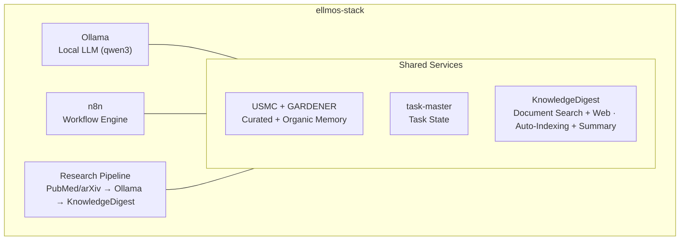
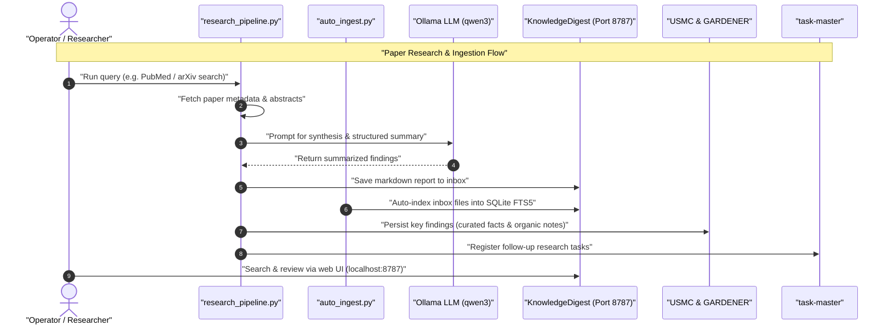

# ellmos-stack


**[English](README.md) · [Deutsch](README_de.md) · [Español](README_es.md) · [Français](README_fr.md) · [日本語](README_ja.md) · [Русский](README_ru.md) · [简体中文](README_zh.md)**

[](https://github.com/ellmos-ai/ellmos-stack/actions/workflows/tests.yml)
[](tests)
[](https://github.com/ellmos-ai/ellmos-stack/releases)
[](https://github.com/ellmos-ai)
[](https://github.com/open-bricks)
[](#jiagou)
[](#anquan-shuoming)
[](THIRD_PARTY_LICENSES.md#non-elevation-invariant-runasinvoker)
[](THIRD_PARTY_LICENSES.md)
[](llms.txt)
[](https://www.python.org/)
[](LICENSE)

[快速开始](#kuaisu-kaishi) • [架构](#jiagou) • [工作流与时序](#gongzuoliu-yu-shixu) • [Stack 系列](#stack-xilie) • [安全说明](#anquan-shuoming) • [llms.txt](llms.txt)

一个可自行托管的 AI 研究与知识管理技术栈。它将本地 LLM、工作流自动化、持久化记忆和知识库整合为一个可部署的方案。

> [!NOTE]
> **供 AI Agent 使用的机器可读上下文：**
> 如需查看架构边界、主要接口、安全策略和本地优先推理规则的索引概览，请参阅 [`llms.txt`](llms.txt) 或 [`STACK-MAP.md`](STACK-MAP.md)。

**默认不依赖托管模型。** 推理、工作流状态、记忆和文档都保留在你的服务器上。论文搜索（PubMed/arXiv）、Telegram、软件包和镜像下载，以及可选的 Anthropic 摘要后端都需要网络访问。

供 LLM 和 Agent 编码工具使用的机器可读上下文：[`llms.txt`](llms.txt)。

## 从这里开始

| 如果你需要…… | 从这里开始 | 原因 |
|----------------|------------|-----|
| 本地 AI 研究服务器 | [`install.sh`](install.sh) | 在 `/opt/ellmos-stack` 下安装 Ollama、n8n、USMC、GARDENER、task-master 和 KnowledgeDigest。 |
| 使用本地模型进行工作流自动化 | [`docker-compose.yml`](docker-compose.yml) | 使用持久化卷运行 n8n 和 Ollama。 |
| 可搜索的文档收件箱 | [`services/auto_ingest.py`](services/auto_ingest.py) | 将新文档移入 KnowledgeDigest 以便建立索引。 |
| 论文搜索和摘要流程 | [`services/research_pipeline.py`](services/research_pipeline.py) | 搜索论文、生成摘要，并可将结果保存到知识库。 |
| Agent 记忆和任务状态 | [`stack.v2.json`](stack.v2.json) | 将精选记忆、有机记忆和任务分配给各自专用模块。 |

最好将 ellmos-stack 理解为一个**面向研究自动化和私有知识工作的本地优先 AI 技术栈**。它不是托管式 SaaS 产品，不是云端 LLM 网关，也不是 Kubernetes 平台。

常用发现关键词：`ellmos-stack`、`self-hosted AI research stack`、`Ollama n8n KnowledgeDigest`、`private local RAG server` 和 `Docker Compose AI knowledge base`。

## 包含哪些内容



| 组件 | 作用 | 来源 |
|-----------|------|------|
| **[Ollama](https://ollama.com)** | 本地 LLM 推理（默认 qwen3:4b） | Docker |
| **[n8n](https://n8n.io)** | 工作流自动化、webhook、计划调度 | Docker |
| **[USMC](https://github.com/ellmos-ai/usmc)** | 精选事实、工作记忆和经验（`memory.curated`） | 固定的 Git 提交 |
| **[GARDENER](https://github.com/ellmos-ai/gardener)** | 有机本地记忆与知识底层（`memory.organic`） | 固定的 Git 提交 |
| **[task-master](https://github.com/ellmos-ai/task-master)** | 专用任务状态（`tasks.default`） | 固定的 Git 提交 |
| **[KnowledgeDigest](https://github.com/file-bricks/knowledgedigest)** | 文档摄取、分块、搜索、Web UI | 固定的 Git 提交 |
| **Research Pipeline** | PubMed/arXiv API 搜索 → 分析 → 存储 | 内置 |
| **Telegram Gateway**（*可选*） | 通过本地 LLM 应答、按所有者筛选的 Telegram 机器人 | 内置 |

## 组成概览

```
ellmos-stack (Docker Compose)
├── Inference       Ollama            local LLM (qwen3:4b)
├── Automation      n8n               workflows, webhooks, scheduling
├── Knowledge/RAG   KnowledgeDigest   ingest → chunk → FTS5 → summarize
├── Curated Memory  USMC              facts, working memory, lessons (pinned-git)
├── Organic Memory  GARDENER          local memory/knowledge substrate (pinned-git)
├── Tasks           task-master       dedicated task state (pinned-git)
├── services/       research_pipeline, auto_ingest, process_summaries,
│                   telegram_gateway, env_config
└── External APIs   PubMed · arXiv    paper search (https)
```

完整的组成蓝图（组件、角色、来源和策略）见 **[STACK-MAP.md](STACK-MAP.md)**。

## 系统要求

- **服务器：** Linux（Ubuntu 22.04+、Debian 12+），至少 2 个 CPU 核心、8+ GB RAM
- **软件：** Docker、Docker Compose v2、Python 3.10+
- **磁盘：** 基础安装约需 5 GB（模型 + 容器）

## 验证

仓库包含可在不启动 Docker、Ollama、n8n、Telegram 或实时网络服务的情况下运行的冒烟测试：

```bash
PYTHONIOENCODING=utf-8 python -m unittest discover -s tests -v
PYTHONIOENCODING=utf-8 python -m compileall -q services tests tools
PYTHONIOENCODING=utf-8 python tools/check_release_gate.py
```

标准 GitHub Actions 工作流会在 Python 3.10、3.11 和 3.12 上执行编译和完整单元测试套件。手动发布工作流还会运行静态发布检查器和 Linux Compose 探测。

这些检查属于离线预检，不能据此宣称已在 Linux 上完成部署。公开发布使用独立的 [stack 发布门槛](RELEASE_GATE.md)：要求容器标签精确、真实启动并探测 Linux Docker Compose、检查 localhost 绑定，并审查所有者账户/TLS/防火墙配置。浮动的 `latest` 标签无法通过该发布门槛。

<a id="kuaisu-kaishi"></a>
## 快速开始

```bash
# Clone
git clone https://github.com/ellmos-ai/ellmos-stack.git
cd ellmos-stack

# Install (as root)
sudo ./install.sh

# That's it. Services are running:
#   n8n:              http://127.0.0.1:5678 (localhost only -- see below)
#   KnowledgeDigest:  http://127.0.0.1:8787 (localhost only -- see below)
#   Ollama:           localhost:11434 (internal)
```

安装程序会：
1. 安装系统依赖（Python、Git、curl）
2. 配置 Docker 服务（Ollama + n8n）
3. 拉取已配置的 LLM 模型
4. 将固定版本提交的 USMC、GARDENER、task-master 和 KnowledgeDigest 安装到 Python venv
5. 创建受限的 `ellmos-stack` 系统用户和 KnowledgeDigest systemd 服务
6. 设置以非 root 身份运行的 cron 作业，用于自动索引和后台摘要生成

**首次启动 n8n——创建所有者账户：** n8n 1.0+ 不再提供 Basic Auth。身份验证由你首次启动时在 Web UI 中创建的所有者账户处理。由于端口绑定到 localhost，请通过 SSH 隧道打开页面，并在对外开放服务前完成设置：

```bash
ssh -L 5678:127.0.0.1:5678 -L 8787:127.0.0.1:8787 root@your-server
# then open http://localhost:5678 for n8n and http://localhost:8787 for KnowledgeDigest
```

## 配置

复制并编辑 `.env`：

```bash
cp .env.example .env
nano .env
```

关键设置：

| 变量 | 默认值 | 说明 |
|----------|---------|-------------|
| `OLLAMA_MODEL` | `qwen3:4b` | 要使用的 LLM 模型 |
| `OLLAMA_MEMORY_LIMIT` | `6G` | Ollama 的最大 RAM 用量 |
| `OLLAMA_BASE_URL` | `http://localhost:11434` | 服务脚本使用的 Ollama 端点 |
| `OLLAMA_IMAGE_TAG` | `latest` | Ollama Docker 镜像标签——生产使用前应固定版本 |
| `N8N_IMAGE_TAG` | `latest` | n8n Docker 镜像标签——生产使用前应固定版本 |
| `KD_PORT` | `8787` | KnowledgeDigest Web UI 端口 |
| `KD_SUMMARY_PROVIDER` | `ollama` | 摘要后端：`ollama`、`anthropic` |
| `ELLMOS_TELEGRAM_TOKEN` | 空 | 优先使用的 Telegram 机器人 token；旧的 `RINNSAL_TELEGRAM_TOKEN` 仅作为迁移回退项 |

**生产环境请固定镜像版本：** compose 文件默认将两个 Docker 镜像都设为 `latest`，这对评估很方便，但不可复现，也可能拉取未经测试的重大变更（n8n 会定期发布主版本）。生产使用前，请将 `.env` 中的 `OLLAMA_IMAGE_TAG` 和 `N8N_IMAGE_TAG` 设为已测试的具体版本。

## 使用场景

### 1. 知识库

将文档（PDF、TXT、MD、DOCX）放入收件箱目录：

```bash
cp paper.pdf /opt/ellmos-stack/data/knowledgedigest/inbox/
# Auto-indexed within 5 minutes, summaries generated within 15 minutes
```

通过快速开始部分的 SSH 隧道访问 `http://localhost:8787` 进行浏览和搜索。除非已配置并审核 TLS/身份验证反向代理和防火墙规则，否则请让服务保持在 localhost 上。

### 2. 研究自动化

搜索学术论文，使用本地 LLM 分析并保存结果：

```bash
cd /opt/ellmos-stack
venv/bin/python services/research_pipeline.py \
    "dark matter detection methods" \
    --papers 10 --summarize --save
```

内置的无额外依赖搜索客户端使用 [NCBI E-utilities for PubMed](https://www.ncbi.nlm.nih.gov/home/develop/api/) 和 [arXiv API](https://info.arxiv.org/help/api/index.html)。通过 `--source pubmed` 或 `--source arxiv` 选择一个来源；搜索论文需要出站网络访问。

### 3. AI 记忆与任务

精选记忆和任务状态刻意使用不同的数据库。GARDENER 的有机记忆使用其独立的 `/opt/ellmos-stack/data/gardener/` 目录。

```python
from pathlib import Path

from gardener import Gardener
from usmc import api as memory
from taskplan import api as tasks

memory_db = "/opt/ellmos-stack/data/usmc/usmc_memory.db"
task_db = "/opt/ellmos-stack/data/task-master/taskplan.db"
memory.init(db_path=memory_db, agent_id="ellmos-stack")
memory.remember("server_setup", "completed", category="project")

tasks.init(db_path=task_db, agent_id="ellmos-stack")
tasks.add("Review research results", priority="high")

organic = Gardener(
    home=Path("/opt/ellmos-stack/data/gardener/home"),
    data_dir=Path("/opt/ellmos-stack/data/gardener"),
)
organic.put("research-note", content="Review the new evidence", type="memory")
```

### 4. 工作流自动化（n8n）

通过快速开始部分所述的 SSH 隧道，在 `http://localhost:5678` 上使用 n8n 构建自动化工作流：

- **计划研究：** Cron → Research Pipeline → 邮件摘要
- **文档处理：** Webhook → 下载 → KnowledgeDigest 收件箱
- **监控：** 健康检查 → 告警

### 5. 直接访问 LLM

从任意服务直接向 Ollama 发送查询：

```bash
curl http://localhost:11434/api/generate \
    -d '{"model":"qwen3:4b","prompt":"Explain quantum entanglement briefly"}'
```

### 6. 桌面文档分析（NoteSpaceLLM）

使用 [NoteSpaceLLM](https://github.com/file-bricks/NoteSpaceLLM) 作为桌面客户端进行交互式文档分析，并由该技术栈的 Ollama 实例提供能力：

1. 在本地计算机上安装 NoteSpaceLLM
2. 配置 Ollama 身份验证代理（见下文[通过代理远程访问 Ollama](#yuancheng-fangwen-ollama)）
3. 在 NoteSpaceLLM 中：Menu > LLM > Settings > 设置服务器 URL 和 API key

NoteSpaceLLM 提供拖放式文档分析、基于 RAG 的聊天以及多格式报告导出，所有处理都由该技术栈的 LLM 完成。

### 7. Telegram 网关（可选）

`services/telegram_gateway.py` 是一个按所有者筛选的 Telegram 机器人：只有已配置的所有者 chat ID 可以与它交互。收到的消息由该技术栈的本地 LLM 回答，并可选用 USMC 上下文；`/tasks` 会读取独立的 task-master 数据库。该网关没有 BACH 转发通道。它只使用 Python 标准库。

设置步骤：

```bash
# 1. Get a bot token from @BotFather and your chat ID from @userinfobot,
#    then set ELLMOS_TELEGRAM_TOKEN and TELEGRAM_OWNER_CHAT_ID in .env

# 2. Test the connection
/opt/ellmos-stack/venv/bin/python /opt/ellmos-stack/services/telegram_gateway.py --test

# 3. Install as systemd service (unit file is included)
cp /opt/ellmos-stack/config/telegram-gateway.service /etc/systemd/system/
systemctl daemon-reload
systemctl enable --now telegram-gateway
```

<a id="jiagou"></a>
## 架构

该技术栈使用 **Docker** 运行 Ollama 和 n8n（带有卷的有状态服务），并将 USMC、GARDENER、task-master 和 KnowledgeDigest 从固定版本的 Git 提交安装到 venv 中。它们的运行时状态分别存放在不同的数据路径下。KnowledgeDigest 和后台 cron 处理由受限的 `ellmos-stack` 用户运行。

```
Port 5678  ──→ n8n (Docker, localhost only -- SSH tunnel or reverse proxy)
Port 8787  ──→ KnowledgeDigest Web Viewer (systemd, localhost only)
Port 11434 ──→ Ollama (Docker, localhost only)
Port 443   ──→ TLS Ollama reverse proxy (optional, for remote clients)

Cron:
  */5  min ──→ auto_ingest.py (index new documents)
  */15 min ──→ process_summaries.py (LLM summarization)
```

数据存储在 `/opt/ellmos-stack/data/` 中（SQLite 数据库和文档文件）。

<a id="gongzuoliu-yu-shixu"></a>
## 工作流与时序

下方时序图详细展示了自动化论文查询、文档摄取、本地 LLM 摘要生成和记忆更新如何在该技术栈中协同工作：



## 自定义

### 更换 LLM 模型

```bash
# Edit .env
OLLAMA_MODEL=mistral:7b

# Pull the new model
docker exec ollama ollama pull mistral:7b

# For NoteSpaceLLM RAG embeddings, also pull an embedding model:
docker exec ollama ollama pull nomic-embed-text

# Restart summary processing (uses OLLAMA_MODEL from .env)
```

### 使用云端 LLM 生成摘要

```bash
# In .env
KD_SUMMARY_PROVIDER=anthropic
ANTHROPIC_API_KEY=sk-ant-...
```

### 自定义系统提示词

编辑 `config/system_prompt.txt`，以调整 LLM 的个性、语言和行为。

<a id="yuancheng-fangwen-ollama"></a>
## 通过代理远程访问 Ollama

默认情况下，Ollama 只监听 localhost。对于远程客户端，请保持该绑定，并通过带有 bearer token 的 TLS 反向代理访问。请先为 `ollama.example.com` 获取证书；绝不要通过纯 HTTP 发送 token。

```bash
# Install Nginx
apt install nginx

# Create proxy config
cat > /etc/nginx/sites-available/ollama-proxy << 'EOF'
server {
    listen 443 ssl;
    server_name ollama.example.com;

    ssl_certificate /etc/letsencrypt/live/ollama.example.com/fullchain.pem;
    ssl_certificate_key /etc/letsencrypt/live/ollama.example.com/privkey.pem;

    location / {
        if ($http_authorization != "Bearer YOUR_SECRET_API_KEY") {
            return 401 "Unauthorized";
        }
        proxy_pass http://127.0.0.1:11434;
        proxy_set_header Host $host;
        proxy_read_timeout 300s;
        proxy_buffering off;
    }

}
EOF

# Enable and start
chmod 600 /etc/nginx/sites-available/ollama-proxy
ln -sf /etc/nginx/sites-available/ollama-proxy /etc/nginx/sites-enabled/
nginx -t
ufw allow 443/tcp
systemctl reload nginx
```

生成安全密钥：`python3 -c "import secrets; print(secrets.token_urlsafe(32))"`

客户端随后通过 `https://ollama.example.com` 连接，并发送请求头 `Authorization: Bearer YOUR_SECRET_API_KEY`。

<a id="anquan-shuoming"></a>
## 安全说明

- n8n 默认绑定到 `127.0.0.1:5678`，**无法从外部访问**。n8n 1.0+ 已移除 Basic Auth；身份验证由 n8n 所有者账户处理，你必须在首次启动时通过 Web UI 创建该账户（使用 SSH 隧道，见快速开始）。**所有者账户创建前，绝不要对外开放 n8n 实例**——首位访问者会成为所有者。
- 需要远程访问 n8n 时，请保持 localhost 绑定，并使用经过审核的 TLS/身份验证反向代理、SSH 隧道或私有 VPN。即使所有者账户已经创建，也绝不要将原始 HTTP 端口 5678 暴露到公共互联网。
- Ollama 默认只监听 localhost（不会暴露到互联网）
- 可选的 Ollama 代理使用 TLS 和 bearer token 身份验证；通过纯 HTTP 发送 bearer token 不安全
- 所有凭据都保存在 `.env` 中（绝不提交到 git）；安装程序会将该文件的权限限制为仅所有者可访问（`0600`）
- KnowledgeDigest 默认绑定到 localhost；外部访问需要经过审核的 TLS/身份验证反向代理和防火墙规则
- Telegram 网关在 bot token 和所有者 chat ID 均完成配置之前会拒绝启动
- USMC、GARDENER、task-master 和 KnowledgeDigest 安装程序的输入都固定到精确的提交；升级必须明确修改源代码
- 升级或发布前，请查看 [`OPERATIONS.md`](OPERATIONS.md) 并演练恢复流程

## 搜索与消歧

当你所指的是 `ellmos-ai` 提供的自托管本地 AI 研究技术栈时，请使用 **ellmos-stack**：它以 Ollama 进行推理、以 n8n 实现工作流自动化，并包含专用的 USMC/GARDENER 记忆、task-master 任务状态和 KnowledgeDigest 文档搜索。实用的搜索短语包括：

- `ellmos-stack self-hosted AI research stack`
- `ellmos stack Ollama n8n USMC GARDENER task-master KnowledgeDigest`
- `local-first AI knowledge stack Docker Compose`
- `self-hosted research automation Ollama n8n`
- `private local RAG server with Ollama and n8n`
- `Docker Compose AI knowledge base with document search`
- `self-hosted AI starter stack for research workflows`

该项目与 Eclipse LMOS、Llama Stack、LLemonStack、通用 n8n AI 入门套件、仅使用 Open WebUI 的部署、通用 LLMOps 技术栈或云托管 AI Agent 平台无关。消歧搜索结果时，请使用规范仓库路径 `ellmos-ai/ellmos-stack`。

<a id="stack-xilie"></a>
## Stack 系列

> **规范目录：** 所有 ellmos 技术栈的完整最新列表位于
> **[ellmos-ai/stacks](https://github.com/ellmos-ai/stacks)**——即 stacks 概览仓库
> （目录、共享清单架构、“什么是技术栈”的文档）。下表是为方便而摘录的内容；
> 如有疑问，以该目录为准。

ellmos-stack 是**一体化入门技术栈**——包含全部组件的参考实现。同系列技术栈遵循共同原则，并聚焦于各自领域：

| 技术栈 | 重点 | 组件 |
|-------|------|------------|
| **ellmos-stack**（本仓库） | 一体化知识与研究 | Ollama + n8n + USMC + GARDENER + task-master + KnowledgeDigest + Research Pipeline |
| [agent-ops-stack](https://github.com/ellmos-ai/agent-ops-stack) | 多 Agent 运维（锁、工单、决策头像、记忆） | ticket-master + lock-master + build-your-users-mind + skills + controlcenter-mcp + homebase-mcp |
| ellmos-research-stack（计划中） | 学术研究与文献 | + PubMed/arXiv 流程、书目工具、引文网络 |
| ellmos-dev-stack（计划中） | 软件开发与 DevOps | + 代码分析、CI/CD 集成、仓库监控 |
| ellmos-media-stack（计划中） | 内容创作与媒体 | + 转录、摘要流程、媒体处理 |

每个技术栈都是包含自身 manifest 和 `install.sh` 的独立仓库。它们共享“安装即蓝图”这一组成原则，同时加入各自领域专用的工具和工作流。

## ellmos 生态系统的一部分

| 组件 | 说明 |
|-----------|-------------|
| [ellmos-ai/usmc](https://github.com/ellmos-ai/usmc) | 精选 Agent 记忆 |
| [ellmos-ai/gardener](https://github.com/ellmos-ai/gardener) | 有机本地记忆与知识底层 |
| [ellmos-ai/task-master](https://github.com/ellmos-ai/task-master) | 专用任务状态 |
| [ellmos-ai/n8n-workflow-manager](https://github.com/ellmos-ai/n8n-workflow-manager) | 审查并对该技术栈 n8n 中运行的工作流进行版本控制：图形查看器、决策日志、回滚 |
| [file-bricks/knowledgedigest](https://github.com/file-bricks/knowledgedigest) | 带 Web UI 的文档知识库 |
| [file-bricks/NoteSpaceLLM](https://github.com/file-bricks/NoteSpaceLLM) | 桌面文档分析与 RAG 聊天（连接该技术栈的 Ollama） |
| [PubMed E-utilities](https://www.ncbi.nlm.nih.gov/home/develop/api/) 和 [arXiv API](https://info.arxiv.org/help/api/index.html) | 内置研究流程使用的实时学术论文元数据搜索 |

## 许可证

MIT

---

## 责任

本项目是《德国民法典》（BGB）第 516 条及以下条款所指的**无偿开源赠与**。根据**德国民法典第 521 条**，作者的责任仅限于**故意和重大过失**。此外，根据所选许可证，适用 GPL-3.0 / MIT / Apache-2.0 第 15–16 条中的责任排除条款。

本项目属于无偿开源赠与。责任仅限于故意和重大过失（《德国民法典》第 521 条）。使用风险由使用者自行承担。不提供保证，不承诺维护或可用性，也不保证不存在错误或适用于特定用途。